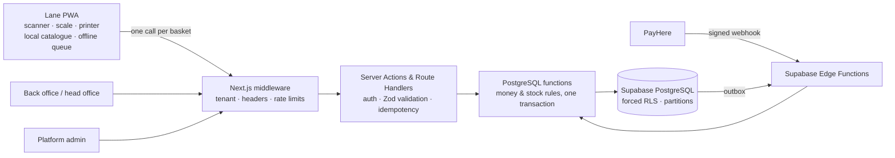
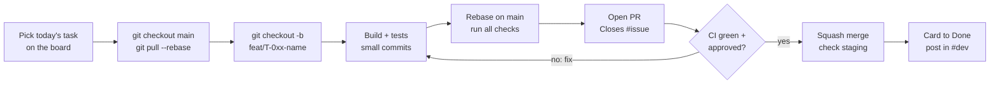

# LaneOS

**White-label, multi-tenant POS SaaS for Sri Lankan grocery shops, supermarkets and franchise chains.**

One codebase serves a single shop with one checkout lane and a 30-shop chain. The plan decides how many shops, lanes and features a business can use. Distributors can rebrand it with their own logo, colours and domain.

> 🔒 Private repository. Proprietary and confidential. Do not share code, keys or data outside the team.

---

## Contents

- [Project status](#project-status)
- [Delivery plan and milestones](#delivery-plan-and-milestones)
- [Features](#features)
- [Architecture](#architecture)
- [Tech stack](#tech-stack)
- [Repository structure](#repository-structure)
- [Getting started](#getting-started)
- [Environment variables](#environment-variables)
- [Common commands](#common-commands)
- [Database and migrations](#database-and-migrations)
- [Testing](#testing)
- [How we work](#how-we-work)
- [Team and code ownership](#team-and-code-ownership)
- [Accounts and access](#accounts-and-access)
- [Test logins (local and staging only)](#test-logins-local-and-staging-only)
- [Security rules](#security-rules)
- [Deployment](#deployment)
- [Scope deferred until after go-live](#scope-deferred-until-after-go-live)
- [Documentation](#documentation)

---

## Project status

**Current milestone:** `M0 · Foundations ready` (due D5, Fri 23 Oct 2026)
**Current task:** `T-001` Create the project folder structure and monorepo (Chathuka, D1)

| Done | Next (rest of T-001) |
| --- | --- |
| Full folder skeleton for `apps/web`, `packages/*`, `supabase/*`, `e2e`, `load`, `docs`, `.github` (created by [`scaffold-folders.sh`](scaffold-folders.sh)) | `pnpm init`, `pnpm-workspace.yaml`, `turbo.json`, `.npmrc`, `.nvmrc` (Node 22) |
| Blueprint moved to [`docs/01-blueprint.md`](docs/01-blueprint.md) | `create-next-app` in `apps/web`; placeholder pages in each route group |
| | `package.json` + `tsconfig.json` + `src/index.ts` in every package |
| | `supabase init`, `tsconfig.base.json`, ESLint import rules, Prettier, `.env.example` |
| | `.github/workflows/ci.yml` (lint, typecheck, unit test, build) |

`scaffold-folders.sh` is safe to run more than once: it only creates missing folders and `.gitkeep` files.

## Delivery plan and milestones

40 working days of development, one week of manual system testing, then go-live. **D1 = Monday 19 October 2026.** Day numbers are the real plan; if a public holiday (Poya day, Christmas) falls on a working day, every later task moves by one day and Friday buffer time absorbs it.

| Milestone (GitHub name) | Due | Goal |
| --- | --- | --- |
| `M0 · Foundations ready` | D5 Fri 23 Oct | Protected repo, working database, login plumbing and staging |
| `M1 · Tenancy, login & catalogue` | D10 Fri 30 Oct | Owner logs in with 2FA, staff and lanes created, cashier PIN login, 3,000 items imported |
| `M2 · First real sale` | D15 Fri 6 Nov | 20-item basket with a scale-label item sold on real hardware; receipt printed |
| `M3 · Offline, returns & credit notes` | D20 Fri 13 Nov | Lane sells offline; returns with every settlement type; credit notes spent later |
| `M4 · MVP features complete` | D25 Fri 20 Nov | Credit customers, shifts and Z-report, stock control, damaged goods, simple promotions |
| `M5 · MVP release candidate` | D30 Fri 27 Nov | Secured, measured and tagged `v1.0.0-rc.1` |
| `M6 · Purchasing, batches & loyalty` | D35 Fri 4 Dec | GRN with batches and expiry, supplier returns, promotions v2, loyalty, PayHere sandbox |
| `M7 · Chain, billing & code freeze` | D40 Fri 11 Dec | Head office, central pricing, transfers, labels, billing read-only mode; **code freeze 16:00** |
| `M8 · Manual system test passed` | D45 Fri 18 Dec | Every test case run by a non-author; 0 open S1/S2 bugs |
| `M9 · Production go-live` | D47 Tue 22 Dec | `v1.1.0` in production; pilot shop trades a full day |

**Critical path** (these block other people; merge them first in the day): T-001 scaffold → T-002 base schema → T-006 RLS + auth hook → T-015 catalogue schema → T-021 catalogue API → T-029 sales schema → T-030 `create_sale` → T-028 lane cart → T-037 offline lane + T-039 returns and credit notes → M3.

**Definition of finished** for the whole plan:

| ID | Outcome | Target |
| --- | --- | --- |
| OUT-D01 | All in-scope features built | M0–M7 closed; code freeze on D40 |
| OUT-D02 | Every task merged through review | 100% via PR with CI green and CODEOWNERS approval |
| OUT-D03 | Security proven | RLS isolation and coverage tests green on every PR; no high ZAP findings at M5 and M7 |
| OUT-D04 | Correct prices | Lane and server totals equal in 5,000 random baskets |
| OUT-D05 | Manual system test passed | All TC-M cases run by a non-author; 0 open S1/S2 bugs |
| OUT-D06 | Live pilot | Pilot shop trades a full day on production `v1.1.0` |

Every task (T-001 … T-091) has a task card with branch name, files, steps, daily sub-tasks and "done when" checks in the delivery task plan (see [Documentation](#documentation)).

## Features

| Area | What it does |
| --- | --- |
| **Checkout lane** | Fast scan-first checkout, quick keys, weighed items and scale labels (embedded-price barcodes), cash / card / LankaQR / split payments, 80 mm receipts, cash drawer, customer display |
| **Offline mode** | Lanes keep selling without internet; sales sync exactly once when the connection returns |
| **Returns & credit notes** | Refund, exchange or a printed credit note (credit bill) that can be spent later, in part or in full |
| **Credit customers** | Sell on credit within a limit, settle later, print statements |
| **Inventory** | Stock per shop, batches and expiry (FEFO), wastage, stock counts, transfers between shops |
| **Damaged goods** | Separate damaged stock with manager decisions: return to supplier, sell reduced, write off, use in store; two-person approval above a threshold |
| **Purchasing** | Suppliers, purchase orders, GRN with free issues and expiry, sale-or-return suppliers, supplier payments |
| **Promotions & loyalty** | % / amount off, multi-buy, buy X get Y, mix and match, spend thresholds, loyalty points |
| **Chains** | Head office dashboard, central price lists with shop overrides and scheduled changes, shelf-label lists, transfers |
| **Security** | Tenant isolation with Row Level Security, 2FA, cashier PIN on registered lanes, access reset per user / lane / shop / tenant, step-up re-authentication, audit logs and fraud alerts |
| **SaaS platform** | Tenants, plans and limits, PayHere subscription billing with read-only mode, white-label branding |

## Architecture



Key rules:

- Every row has a `tenant_id`; **Row Level Security is forced on every table**.
- Money and stock change **only** inside `api.*` database functions (financial tables are read-only to clients).
- Money is stored as **integer cents**; quantities as **integer milli-units** (grams for weighed items).
- The lane prices baskets with `packages/pricing`; the server recalculates with the same rules and has the final say.

## Tech stack

| Layer | Technology |
| --- | --- |
| App | Next.js (App Router) + TypeScript |
| UI | Tailwind CSS, shadcn/ui, next-intl (English, Sinhala, Tamil) |
| Database | Supabase PostgreSQL (RLS, pg_cron, Vault) |
| Auth | Supabase Auth (email + TOTP 2FA; cashier PIN on registered lanes) |
| Backend jobs | Supabase Edge Functions (PayHere webhook, licence, SMS/email outbox) |
| Devices | QZ Tray / browser print (ESC/POS), Web Serial (scales) |
| Monorepo | pnpm workspaces + Turborepo |
| Testing | Vitest, fast-check, pgTAP, Playwright, k6 |
| Hosting | Vercel + Supabase (Singapore region) |
| Monitoring | Sentry (PII scrubbing on), uptime checks |

## Repository structure

```text
laneos/
├─ apps/
│  └─ web/                                  # Next.js app (single deployment)
│     ├─ app/(auth)/                        # login, MFA, forgot/reset password          → Dinuka, Sashika
│     ├─ app/(platform)/admin/              # tenants, billing, security                 → Dinuka, Sashika
│     ├─ app/(tenant)/backoffice/           # items, pricing, promotions, stock, suppliers,
│     │                                     # purchasing, transfers, customers, staff,
│     │                                     # lanes, reports, billing, settings          → Dinuka, Thimira
│     ├─ app/(lane)/lane/                   # register, locked, [laneId]/pin|display|return|shift → Dinuka, Chathuka
│     ├─ app/api/lane/                      # catalog, sales, returns, payments, credit-notes,
│     │                                     # loyalty, damage, shifts                    → Thimira
│     ├─ app/api/import/items/              # CSV item import                            → Thimira
│     ├─ app/api/qz/sign/                   # QZ Tray request signing                    → Dinuka (Sashika reviews)
│     ├─ app/r/[id]/                        # public digital receipt (token required)    → Thimira
│     ├─ app/manifest.webmanifest/          # per-tenant PWA manifest route              → Dinuka
│     ├─ app/dev/                           # dev-only pages: /dev/ui, /dev/whoami
│     ├─ components/                        # auth, lane, items, import, charts, security
│     ├─ lib/supabase/                      # server + browser clients                   → Sashika
│     ├─ lib/server/                        # route wrapper, idempotency, rate limits, admin client → Thimira
│     ├─ lib/lane/                          # catalogue cache, scanner, cart, offline queue, sync → Chathuka
│     ├─ lib/security/                      # headers, permissions, override, step-up    → Sashika
│     ├─ messages/                          # en.json, si.json, ta.json
│     ├─ test/                              # server, api, admin, catalogue, lane, parity, utils
│     └─ middleware.ts                      # session refresh, headers, tenant, reset markers → Sashika
├─ packages/
│  ├─ core/        # Zod schemas, money/qty helpers, error codes and envelope     → Thimira
│  ├─ pricing/     # basket pricing, promotions, tax, rounding + golden fixtures  → Chathuka
│  ├─ barcode/     # EAN/UPC/ITF check digits, PLU, scale labels                 → Chathuka
│  ├─ devices/     # receipt/slip/label templates, ESC/POS, QZ Tray               → Dinuka
│  ├─ ui/          # design system and theme tokens                              → Dinuka
│  └─ db-types/    # generated Supabase types (never edit by hand)               → CI
├─ supabase/
│  ├─ migrations/  # SQL migrations (created with the CLI only)                  → Chathuka, Sashika
│  ├─ functions/   # Edge Functions: payhere-notify, outbox-worker, licence, _shared → Thimira, Sashika
│  ├─ tests/       # pgTAP tests                                                 → Sashika, Chathuka
│  └─ seed.sql     # synthetic local/staging data                                → Chathuka
├─ e2e/            # Playwright end-to-end tests                                 → Dinuka
├─ load/           # k6 load tests                                               → Chathuka
├─ scripts/        # explain-check, onboarding scripts
├─ docs/           # blueprint, SDD documents, ADRs, slices, templates, training,
│                  # security reports, incidents, delivery plan
└─ .github/        # CI workflows, issue/PR templates, CODEOWNERS
```

**Module boundaries** (enforced with ESLint `no-restricted-imports`):

- `packages/*` never import from `apps/*`.
- `packages/pricing` and `packages/barcode` are pure (no network, no React), so they run on the lane, the server and in tests.
- UI code never writes to financial tables directly; it calls a Route Handler or Server Action.
- Only `apps/web/lib/server/admin.ts` may use the service role key.

## Getting started

### Local setup checklist (every member, D1)

- [ ] **Node.js 22 LTS** and **pnpm 9** (`corepack enable`); Git with an SSH key added to GitHub
- [ ] **Docker Desktop** (running) and the **Supabase CLI**
- [ ] **VS Code** with ESLint, Prettier, Tailwind CSS IntelliSense and SQLTools/Supabase extensions
- [ ] An **authenticator app** on your phone (TOTP) and the team **password manager** with 2FA
- [ ] 2FA turned on for GitHub, Supabase, Vercel and Sentry

### First run

> Works once the rest of T-001 (workspace files, Next.js app, `supabase init`) is merged.

```bash
git clone https://github.com/incasoftsolutionsorg/laneos.git
cd laneos
pnpm install
supabase start                 # starts local Postgres, Auth, Storage, Studio
cp .env.example .env.local     # fill values printed by `supabase status` (never production keys)
supabase db reset              # applies all migrations + seed data
pnpm db:types                  # generates packages/db-types
pnpm dev                       # http://localhost:3000
```

| URL (local) | What |
| --- | --- |
| http://localhost:3000/login | Owner / staff login |
| http://localhost:3000/backoffice | Back office |
| http://localhost:3000/admin | Platform admin |
| http://localhost:3000/lane/register | Register this browser as a lane |
| http://localhost:3000/dev/ui | Component style guide (dev only) |
| http://localhost:3000/dev/whoami | Token claims of the current session (dev only) |
| http://localhost:54323 | Supabase Studio (local only) |

## Environment variables

Copy `.env.example` to `.env.local`. **Never commit `.env.local`.** Staging and production values live only in the team password manager and in Vercel / Supabase settings.

| Variable | Where used | Notes |
| --- | --- | --- |
| `NEXT_PUBLIC_SUPABASE_URL` | browser + server | From `supabase status` locally |
| `NEXT_PUBLIC_SUPABASE_ANON_KEY` | browser + server | Public anon key |
| `SUPABASE_SERVICE_ROLE_KEY` | server only | **Secret.** Only `apps/web/lib/server/admin.ts` may read it |
| `NEXT_PUBLIC_ROOT_DOMAIN` | middleware | e.g. `localhost:3000` / `laneos.lk` |
| `QZ_PRIVATE_KEY` | server only | Signs QZ Tray print requests |
| `UPSTASH_REDIS_REST_URL`, `UPSTASH_REDIS_REST_TOKEN` | server only | Rate limits (optional; Postgres table fallback) |
| `SENTRY_DSN` | browser + server | Error tracking |

PayHere, SMS and email keys are stored as **Supabase Edge Function secrets**, not in `.env.local`. Credit-note HMAC and NIC encryption keys live in **Supabase Vault** (new values per environment, never copied from staging).

## Common commands

| Command | What it does |
| --- | --- |
| `pnpm dev` | Run the app locally |
| `pnpm build` | Production build |
| `pnpm lint` / `pnpm typecheck` | Lint and type-check all packages |
| `pnpm test` | Unit tests (Vitest) |
| `pnpm -F @laneos/<pkg> test` | Unit tests for one package |
| `pnpm test:e2e` | Playwright tests (needs the app running) |
| `pnpm db:types` | Regenerate Supabase types |
| `supabase migration new <name>` | Create a new migration file |
| `supabase db reset` | Rebuild local DB from migrations + seed |
| `supabase test db` | Run pgTAP tests |

## Database and migrations

- Create migrations **only** with `supabase migration new <snake_name>` (the CLI adds the timestamp, e.g. `20261102093012_create_sale.sql`). Never rename or edit a migration after it is merged; write a new one.
- **One migration per pull request** where possible; rebase on `main` daily.
- Every new table must **enable and force RLS** in the same migration. CI fails if any table has no RLS.
- Financial tables get **SELECT policies only**; writes go through `api.*` functions declared `SECURITY DEFINER` with `set search_path = ''`.
- Before opening a PR that touches SQL:

```bash
git pull --rebase origin main
supabase db reset && supabase test db && pnpm db:types
```

- Migrations run automatically on **staging** after merge to `main`, and on **production** only from a release tag with approval.

## Testing

| Suite | Tool | Runs |
| --- | --- | --- |
| Unit | Vitest (100% coverage for `packages/core`, `packages/pricing`, `packages/barcode`) | Every PR |
| Database & security | pgTAP (RLS isolation, coverage, business rules, attack tests) | Every PR |
| Price parity | Golden baskets + fast-check random baskets: lane engine vs server function | Every PR |
| Query plans | `scripts/explain-check.ts` (fails on Seq Scan over 10k rows) | Every PR |
| End-to-end | Playwright (checkout, offline, returns, credit notes, billing …) | After staging deploy |
| Load | k6 (8 lanes × 30 sales/min, p95 checkout < 400 ms) | Before releases |
| Security scans | gitleaks, `pnpm audit`, CodeQL, OWASP ZAP (staging) | Every PR / M5 / M7 |
| Manual system test | TC-M-* cases, each run by someone who did not build it | Week 9 (D41–D45) |

## How we work

### Daily rhythm

| Time | What |
| --- | --- |
| 09:00–09:15 | Stand-up in the `#dev` thread: yesterday, today (task ID + sub-task), blockers (label `blocked`, tag the owner) |
| 09:15–12:30 | Build (focus time, notifications off) |
| 13:30–16:00 | Build; pairing for hand-offs listed in the task card |
| 16:00–16:30 | Review window: every open PR gets a review the same day |
| 16:30–17:00 | Merge, check staging, update the board. **Fridays 16:00: milestone review** |

### Git workflow for every task



1. Open the task card and the matching GitHub issue (title = task ID + title). Assign yourself; set Status to **In progress**.
2. `git checkout main && git pull --rebase origin main`
3. `git checkout -b feat/T-0xx-short-name` (branch name is in the task card).
4. Small Conventional Commits, e.g. `feat(lane): parse scale labels (T-016)`. Push at least once a day: `git push -u origin HEAD`.
5. Before the PR: `git pull --rebase origin main`, then `pnpm lint && pnpm typecheck && pnpm test` (plus the SQL checks above if you touched SQL).
6. Open the PR with the template: title = the task's PR title, body includes `Closes #<issue>`, milestone set, screenshots for UI. Draft PRs are welcome early.
7. Fix review comments with new commits (no force-push after review starts).
8. When CI is green and approved: **Squash and merge**. The branch is deleted automatically.
9. Check the staging deploy, move the card to **Done** and post the PR link in `#dev`.

### Naming rules

| Thing | Rule | Example |
| --- | --- | --- |
| Task ID | `T-001` … `T-091` (fixed in the delivery plan) | `T-030` |
| Issue title | `<Task ID> <title>` | `T-030 Checkout function create_sale and lane sales endpoint` |
| Branch | `<type>/<Task ID>-<short-kebab-name>`; types `feat`, `fix`, `chore`, `test`, `docs` | `feat/T-030-create-sale` |
| Bug branch | `fix/BUG-<issue no>-<short-name>` | `fix/BUG-214-rounding-cash` |
| Commit / PR title | `type(scope): summary (Task ID)` | `feat(db): create_sale with idempotency (T-030)` |
| Migration file | `supabase migration new <snake_name>` | `20261102093012_create_sale.sql` |
| Milestone | `<ID> · <name>`, due date = Friday of the week | `M2 · First real sale` |
| Release tag | SemVer; release candidates `-rc.N` | `v1.0.0-rc.1`, `v1.1.0` |
| Labels | `type:*`, `area:*`, `sev:*`, `prio:*`, `milestone-week:W1…W10`, `system-test`, `release-fix` | `type:task area:db` |

`main` is protected: pull request, passing CI and a CODEOWNERS approval are required. No direct pushes. After code freeze (D40 16:00) only PRs labelled `release-fix` that close an S1/S2 bug are merged.

### Milestones

Each Friday at 16:00 Chathuka runs the milestone review: demo script, check every exit criterion with evidence (PR links, test runs, screenshots). If all pass, the milestone is closed in GitHub with an evidence comment. If not, unfinished issues move to the next milestone with a reason, and scope is cut with the Product Owner to protect the next Friday. **Security tests are never dropped.**

### Bugs

Use the bug issue form. Severity decides speed:

| Severity | Meaning | Response |
| --- | --- | --- |
| **S1** | Data leak, wrong money, checkout down | Stop and fix now; everyone helps |
| **S2** | Core flow broken | Fixed within the day by the area owner |
| **S3 / S4** | Minor / cosmetic | Next free slot |

Every fix includes a regression test that fails before the fix. New error codes go into `packages/core` and the blueprint error catalogue (MD §29.2) in the same PR. S1 bugs get a blameless post-incident review in `docs/incidents/YYYY-MM-DD-title.md`.

### Changing requirements

Open a change-request issue. The Product Owner and Chathuka decide at the next stand-up. An accepted change must replace something of equal size in the same or a later week; **the schedule does not grow**.

## Team and code ownership

| Member | Role | Owns (reviews and decides) | Backup |
| --- | --- | --- | --- |
| **Chathuka** | Tech lead & integration lead | Project structure, database schema and migrations, pricing and barcode engines, lane cart and offline logic, integration, releases, CI pipelines | Thimira (backend), Dinuka (front end) |
| **Sashika** | Security lead | Auth, sessions and cookies, RLS policies, permissions, secrets, CI security, billing security, environments and production | Chathuka |
| **Thimira** | Backend developer | Server layer, API routes, Server Actions, database business functions, Edge Functions, imports, reports, outbox | Chathuka |
| **Dinuka** | Front-end developer | Design system, all screens (lane, back office, admin), printing templates, E2E tests, translations | Chathuka |

Approval authority: **scope** — Product Owner; **architecture and merges to `main`** — Chathuka; **security, auth, RLS, secrets** — Sashika; **release** — Chathuka + Product Owner.

Required reviewers (from [`.github/CODEOWNERS`](.github/CODEOWNERS)):

| Path | Required reviewer | Second reviewer |
| --- | --- | --- |
| `supabase/migrations/**` | Sashika or Chathuka (the other one when the author is one of them) | Sashika for policies and `SECURITY DEFINER` functions |
| `apps/web/middleware.ts`, `lib/security/**`, `lib/server/admin.ts`, `supabase/functions/payhere-notify` | Sashika | Chathuka |
| `apps/web/app/api/**`, `lib/server/**`, `supabase/functions/**`, `packages/core` | Thimira or Chathuka | — |
| `packages/pricing`, `packages/barcode`, `apps/web/lib/lane/**` | Chathuka (Thimira reviews Chathuka's PRs) | — |
| `apps/web/app/(lane\|tenant\|platform)/**`, `packages/ui`, `packages/devices` | Dinuka or Chathuka | — |
| `.github/**`, `docs/**` | Chathuka | Sashika for security docs |

## Accounts and access

| Account / tool | Access | Notes |
| --- | --- | --- |
| GitHub organisation | All four: Maintain; Sashika + Chathuka: Admin | 2FA required |
| Supabase (staging + production, Singapore) | All: staging Developer; production: Sashika + Chathuka only | 2FA required |
| Vercel team | All: Member; Sashika + Chathuka: Owner | Production deploy needs approval |
| Password manager vaults | `LaneOS – Staging`: all; `LaneOS – Production`: Sashika + Chathuka | **The only place secrets live** |
| Sentry | All: Member | PII scrubbing on |
| PayHere sandbox merchant | Sashika, Thimira | Needed by D33 |
| SMS gateway sandbox + email provider | Thimira, Sashika | Needed by D28 |
| QZ Tray signing certificate | Sashika, Dinuka | Needed by D15 |
| Team chat `#dev`, `#alerts` | All + Product Owner | Daily stand-up thread |
| Test hardware: lane PC, USB scanner, 80 mm printer, cash drawer, label scale, Android tablet | Kept at the team desk | Needed by D14 |

## Test logins (local and staging only)

`supabase/seed.sql` (T-003) creates synthetic tenants: **Demo Single Shop** (KDY1), **Demo Chain** (KDY1, GMP1, CMB2) and **Other Tenant** (OTH1, used for isolation tests).

| Login | Role | Tenant / shop | Used for |
| --- | --- | --- | --- |
| `platform.admin@laneos.test` | Platform super admin | — | Admin app, tenant creation, billing admin, global sign-out |
| `platform.admin2@laneos.test` | Platform super admin (second approver) | — | Two-admin approval tests |
| `owner.single@laneos.test` | Tenant owner (TOTP) | Demo Single Shop / KDY1 | Back office, settings, reset access, reports |
| `owner.chain@laneos.test` | Tenant owner (TOTP) | Demo Chain / KDY1, GMP1, CMB2 | Chain features, head office |
| `ho.manager@laneos.test` | Head office manager | Demo Chain / all shops | Central pricing, transfers |
| `manager.kdy1@laneos.test` | Store manager | Demo Single Shop / KDY1 | Approvals, damage decisions, shifts |
| `supervisor.kdy1` (code `S201`) | Supervisor | KDY1 | Lane overrides, pickups |
| Cashier codes `C101`, `C102` | Cashier | KDY1 lanes L1, L2 | Checkout, returns |
| `stock.kdy1@laneos.test` | Stock keeper | KDY1 | GRN, damage reports, counts |
| `accountant.chain@laneos.test` | Accountant | Demo Chain | Reports, supplier payments, exports |
| `owner.other@laneos.test` | Tenant owner | Other Tenant / OTH1 | Isolation tests (must never see Demo data) |

Synthetic passwords and PINs will be listed here when T-003 adds the seed data. **These accounts must never exist in production.**

## Security rules

1. **No secrets in Git**: no keys, passwords or `.env` files. Push protection and gitleaks will block them; if one slips through, tell Sashika immediately so it can be rotated.
2. **No real customer data** in seed files, tests, issues, pull requests, screenshots or logs.
3. **Never use the service role key in browser code**; only `lib/server/admin.ts`.
4. **Never trust the client for money**: prices and totals are recalculated in the database.
5. **Every new table** gets RLS in the same migration, and pgTAP isolation tests.
6. Credit-note codes and lane keys are stored **only as hashes**; PINs only as Argon2id hashes.
7. Report security issues privately to Sashika, not in public issues.

## Deployment

| Environment | Trigger | Database migrations |
| --- | --- | --- |
| Preview | Every pull request (Vercel) | Local CI database |
| Staging | Merge to `main` | Automatic (`supabase db push`) |
| Production | Git tag `vX.Y.Z` + approval by Tech Lead and Product Owner | Automatic in the release workflow |

Release timeline: `v1.0.0-rc.1` (D30) → `v1.1.0-rc.1` + code freeze (D40) → manual system test (D41–D45) → go/no-go, tag `v1.1.0` and production deploy (D46) → pilot go-live (D47) → hypercare (D48).

Rollback: redeploy the previous Vercel deployment; database changes are forward-only and backward-compatible for one release (expand → migrate → contract). See `docs/14-operations.md`. Never load-test production.

## Scope deferred until after go-live

| Item | Planned |
| --- | --- |
| Public REST API `/v1` with API keys and outgoing webhooks | v2.0 |
| Custom domains per tenant (subdomains for the pilot) | v2.0 |
| PowerSync full offline sync (MVP offline queue covers outages) | v2.0 |
| Reseller (partner) level | v2.0 |
| Scale PLU export to label-printing scales | v1.2 |
| Advanced shrinkage and promotion-effect reports | v1.2 |
| Archiving old partitions to cold storage | v1.3 |

## Documentation

All documents live under [`docs/`](docs/). If the delivery plan and the blueprint disagree on behaviour, the blueprint wins; on dates or owners, the delivery plan wins.

| Document | Path | Owner |
| --- | --- | --- |
| SDD playbook (how we work) | `docs/00-playbook.md` | Sashika / Chathuka |
| System blueprint & integration plan ("MD") | [`docs/01-blueprint.md`](docs/01-blueprint.md) | Chathuka |
| Delivery task plan (all tasks, milestones, test plan) | `docs/delivery/LaneOS_Delivery_Task_Plan.pdf` | Chathuka |
| Data model | `docs/08-data-model.md` | Chathuka |
| API & integrations | `docs/09-api.md` | Thimira |
| UI/UX & devices | `docs/10-ui.md` | Dinuka |
| Security & privacy | `docs/11-security.md` | Sashika |
| Test strategy & manual test cases | `docs/12-tests.md` | Chathuka |
| Environments | `docs/13-environments.md` | Sashika |
| Operations & runbook | `docs/14-operations.md`, `docs/runbook-incident.md` | Sashika |
| Errors & observability | `docs/15-errors-observability.md` | Thimira |
| Release readiness | `docs/19-release-readiness.md` | Chathuka + Product Owner |
| Architecture decisions | `docs/adr/` | Chathuka |
| Vertical slice packets | `docs/slices/` | Slice lead |
| Import templates | `docs/templates/` | Thimira |
| Training guides | `docs/training/` | Dinuka |
| Security reports | `docs/security-reports/` | Sashika |
| Incident reviews | `docs/incidents/` | Area owner |

---

© 2026 LaneOS. All rights reserved. Proprietary and confidential; not for distribution.
