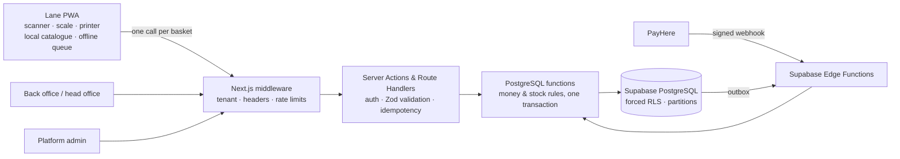
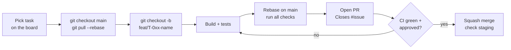

# LaneOS

**White-label, multi-tenant POS SaaS for Sri Lankan grocery shops, supermarkets and franchise chains.**

One codebase serves a single shop with one checkout lane and a 30-shop chain. The plan decides how many shops, lanes and features a business can use. Distributors can rebrand it with their own logo, colours and domain.

> 🔒 Private repository. Proprietary and confidential. Do not share code, keys or data outside the team.

---

## Contents

- [Features](#features)
- [Architecture](#architecture)
- [Tech stack](#tech-stack)
- [Repository structure](#repository-structure)
- [Getting started](#getting-started)
- [Environment variables](#environment-variables)
- [Common commands](#common-commands)
- [Database and migrations](#database-and-migrations)
- [Testing](#testing)
- [How we work (Git workflow)](#how-we-work-git-workflow)
- [Team and code ownership](#team-and-code-ownership)
- [Test logins (local and staging only)](#test-logins-local-and-staging-only)
- [Security rules](#security-rules)
- [Deployment](#deployment)
- [Documentation](#documentation)

---

## Features

| Area | What it does |
| --- | --- |
| **Checkout lane** | Fast scan-first checkout, quick keys, weighed items and scale labels (embedded-price barcodes), cash / card / LankaQR / split payments, 80 mm receipts, cash drawer, customer display |
| **Offline mode** | Lanes keep selling without internet; sales sync exactly once when the connection returns |
| **Returns & credit notes** | Refund, exchange or a printed credit note (credit bill) that can be spent later, in part or in full |
| **Credit customers** | Sell on credit within a limit, settle later, print statements |
| **Inventory** | Stock per shop, batches and expiry (FEFO), wastage, stock counts, transfers between shops |
| **Damaged goods** | Separate damaged stock with manager decisions: return to supplier, sell reduced, write off, use in store |
| **Purchasing** | Suppliers, purchase orders, GRN with free issues and expiry, sale-or-return suppliers, supplier payments |
| **Promotions & loyalty** | % / amount off, multi-buy, buy X get Y, mix and match, spend thresholds, loyalty points |
| **Chains** | Head office dashboard, central price lists with scheduled changes, shelf-label lists, transfers |
| **Security** | Tenant isolation with Row Level Security, 2FA, cashier PIN on registered lanes, access reset per device / user / lane / shop / tenant, audit logs and fraud alerts |
| **SaaS platform** | Tenants, plans and limits, PayHere subscription billing, white-label branding |

## Architecture



Key rules:

- Every row has a `tenant_id`; **Row Level Security is forced on every table**.
- Money and stock change **only** inside `api.*` database functions (financial tables are read-only to clients).
- Money is stored as **integer cents**; quantities as **integer milli-units** (grams for weighed items).
- The lane prices baskets with `packages/pricing`; the server recalculates with the same rules and has the final say.

## Tech stack

| Layer | Technology |
| --- | --- |
| App | Next.js (App Router) + TypeScript |
| UI | Tailwind CSS, shadcn/ui, next-intl (English, Sinhala, Tamil) |
| Database | Supabase PostgreSQL (RLS, pg_cron, Vault) |
| Auth | Supabase Auth (email + TOTP 2FA; cashier PIN on registered lanes) |
| Backend jobs | Supabase Edge Functions (webhooks, SMS/email outbox) |
| Devices | QZ Tray / browser print (ESC/POS), Web Serial (scales) |
| Monorepo | pnpm workspaces + Turborepo |
| Testing | Vitest, pgTAP, Playwright, k6 |
| Hosting | Vercel + Supabase (Singapore region) |

## Repository structure

```text
laneos/
├─ apps/
│  └─ web/                          # Next.js app (single deployment)
│     ├─ app/(platform)/admin/      # platform admin
│     ├─ app/(tenant)/backoffice/   # owner, head office, store manager
│     ├─ app/(lane)/lane/[laneId]/  # checkout PWA
│     ├─ app/(auth)/                # login, 2FA, password reset
│     ├─ app/api/lane/              # lane route handlers
│     ├─ lib/server/                # server helpers (auth, errors, idempotency)
│     ├─ lib/lane/                  # catalogue cache, cart, offline queue
│     ├─ lib/security/              # permissions, step-up, session resets
│     └─ middleware.ts
├─ packages/
│  ├─ core/        # Zod schemas, money/qty helpers, error codes
│  ├─ pricing/     # basket pricing, promotions, tax, rounding (lane + server)
│  ├─ barcode/     # EAN/UPC/ITF check digits, PLU, scale labels
│  ├─ devices/     # receipt/label templates, ESC/POS, QZ Tray, scale
│  ├─ ui/          # design system and theme tokens
│  └─ db-types/    # generated Supabase types (do not edit by hand)
├─ supabase/
│  ├─ migrations/  # SQL migrations (created with the CLI only)
│  ├─ functions/   # Edge Functions
│  ├─ tests/       # pgTAP tests
│  └─ seed.sql     # synthetic local/staging data
├─ e2e/            # Playwright end-to-end tests
├─ load/           # k6 load tests
├─ docs/           # blueprint, requirements, ADRs, runbooks
└─ .github/        # CI workflows, issue/PR templates, CODEOWNERS
```

## Getting started

### Prerequisites

- **Node.js 22 LTS** and **pnpm 9** (`corepack enable`)
- **Docker Desktop** (running) and the **Supabase CLI**
- **Git** with an SSH key added to GitHub, and the **GitHub CLI** (`gh auth login`)
- 2FA turned on for GitHub, Supabase and Vercel

### First run

```bash
git clone git@github.com:<your-org>/laneos.git
cd laneos
pnpm install
supabase start                 # starts local Postgres, Auth, Storage, Studio
cp .env.example .env.local     # fill values printed by `supabase status`
supabase db reset              # applies all migrations + seed data
pnpm db:types                  # generates packages/db-types
pnpm dev                       # http://localhost:3000
```

| URL (local) | What |
| --- | --- |
| http://localhost:3000/login | Owner / staff login |
| http://localhost:3000/backoffice | Back office |
| http://localhost:3000/admin | Platform admin |
| http://localhost:3000/lane/register | Register this browser as a lane |
| http://localhost:54323 | Supabase Studio (local only) |

## Environment variables

Copy `.env.example` to `.env.local`. **Never commit `.env.local`.** Staging and production values live only in the team password manager and in Vercel / Supabase settings.

| Variable | Where used | Notes |
| --- | --- | --- |
| `NEXT_PUBLIC_SUPABASE_URL` | browser + server | From `supabase status` locally |
| `NEXT_PUBLIC_SUPABASE_ANON_KEY` | browser + server | Public anon key |
| `SUPABASE_SERVICE_ROLE_KEY` | server only | **Secret.** Only `apps/web/lib/server/admin.ts` may read it |
| `NEXT_PUBLIC_ROOT_DOMAIN` | middleware | e.g. `localhost:3000` / `laneos.lk` |
| `QZ_PRIVATE_KEY` | server only | Signs QZ Tray print requests |
| `UPSTASH_REDIS_REST_URL`, `UPSTASH_REDIS_REST_TOKEN` | server only | Rate limits (optional) |
| `SENTRY_DSN` | browser + server | Error tracking |

PayHere, SMS and email keys are stored as **Supabase Edge Function secrets**, not in `.env.local`.

## Common commands

| Command | What it does |
| --- | --- |
| `pnpm dev` | Run the app locally |
| `pnpm build` | Production build |
| `pnpm lint` / `pnpm typecheck` | Lint and type-check all packages |
| `pnpm test` | Unit tests (Vitest) |
| `pnpm test:e2e` | Playwright tests (needs the app running) |
| `pnpm db:types` | Regenerate Supabase types |
| `supabase migration new <name>` | Create a new migration file |
| `supabase db reset` | Rebuild local DB from migrations + seed |
| `supabase test db` | Run pgTAP tests |

## Database and migrations

- Create migrations **only** with `supabase migration new <snake_name>`. Never rename or edit a migration after it is merged; write a new one.
- **One migration per pull request** where possible.
- Every new table must **enable and force RLS** in the same migration. CI fails if any table has no RLS.
- Financial tables get **SELECT policies only**; writes go through `api.*` functions declared `SECURITY DEFINER` with `set search_path = ''`.
- Before opening a PR that touches SQL:

```bash
git pull --rebase origin main
supabase db reset && supabase test db && pnpm db:types
```

- Migrations run automatically on **staging** after merge to `main`, and on **production** only from a release tag with approval.

## Testing

| Suite | Tool | Runs |
| --- | --- | --- |
| Unit | Vitest (100% coverage required for `packages/pricing` and `packages/barcode`) | Every PR |
| Database & security | pgTAP (RLS isolation, business rules) | Every PR |
| Price parity | Random baskets: lane engine vs server function | Every PR |
| End-to-end | Playwright (checkout, offline, returns, credit notes …) | After staging deploy |
| Load | k6 (8 lanes × 30 sales/min) | Before releases |
| Security scans | gitleaks, `pnpm audit`, CodeQL, OWASP ZAP (staging) | Every PR / weekly |

## How we work (Git workflow)



| Thing | Rule | Example |
| --- | --- | --- |
| Branch | `<type>/<Task ID>-<short-name>` (types: `feat`, `fix`, `chore`, `test`, `docs`) | `feat/T-030-create-sale` |
| Bug branch | `fix/BUG-<issue>-<short-name>` | `fix/BUG-214-rounding-cash` |
| Commit / PR title | [Conventional Commits](https://www.conventionalcommits.org): `type(scope): summary (Task ID)` | `feat(db): create_sale with idempotency (T-030)` |
| PR body | Must include `Closes #<issue>` and the milestone | — |
| Merge | **Squash merge only**; branch deleted after merge | — |
| Milestones | `M0 · Foundations ready` … `M9 · Production go-live` | — |
| Releases | SemVer tags | `v1.0.0-rc.1`, `v1.1.0` |

`main` is protected: pull request, passing CI and a CODEOWNERS approval are required. No direct pushes.

## Team and code ownership

| Member | Role | Owns |
| --- | --- | --- |
| **Chathuka** | Tech lead & integration | Project structure, database schema, pricing/barcode engines, lane cart & offline, releases |
| **Sashika** | Security lead | Auth, RLS policies, permissions, sessions & access reset, secrets, CI security, production environment |
| **Thimira** | Backend | Server layer, API routes, database business functions, Edge Functions, imports, reports |
| **Dinuka** | Front end | Design system, all screens, printing templates, E2E tests, translations |

Reviewers are assigned automatically from [`.github/CODEOWNERS`](.github/CODEOWNERS). Migrations and security files need Sashika or Chathuka.

## Test logins (local and staging only)

`supabase/seed.sql` creates synthetic tenants: **Demo Single Shop**, **Demo Chain** (3 shops) and **Other Tenant** (used for isolation tests).

| Login | Role |
| --- | --- |
| `platform.admin@laneos.test` | Platform super admin |
| `owner.single@laneos.test` | Owner, single shop |
| `owner.chain@laneos.test` | Owner, chain |
| `manager.kdy1@laneos.test` | Store manager |
| Cashier codes `C101`, `C102` | Cashiers (PIN login on a registered lane) |
| `owner.other@laneos.test` | Owner of the isolation-test tenant |

Passwords and PINs for these synthetic accounts are in `supabase/seed.sql` comments. **They must never exist in production.**

## Security rules

1. **No secrets in Git**: no keys, passwords or `.env` files. Push protection and gitleaks will block them; if one slips through, tell Sashika immediately so it can be rotated.
2. **No real customer data** in seed files, tests, issues, screenshots or logs.
3. **Never use the service role key in browser code**; only `lib/server/admin.ts`.
4. **Never trust the client for money**: prices and totals are recalculated in the database.
5. **Every new table** gets RLS in the same migration, and pgTAP isolation tests.
6. Report security issues privately to Sashika, not in public issues.

## Deployment

| Environment | Trigger | Database migrations |
| --- | --- | --- |
| Preview | Every pull request (Vercel) | Local CI database |
| Staging | Merge to `main` | Automatic (`supabase db push`) |
| Production | Git tag `vX.Y.Z` + approval by Tech Lead and Product Owner | Automatic in the release workflow |

Rollback: redeploy the previous Vercel deployment; database changes are forward-only and backward-compatible for one release (expand → migrate → contract). See `docs/14-operations.md`.

## Documentation

| Document | Path |
| --- | --- |
| System blueprint & integration plan | `docs/01-blueprint.md` |
| Delivery task plan (all tasks, milestones) | `docs/delivery/LaneOS_Delivery_Task_Plan.docx` |
| Personal schedules | `docs/delivery/LaneOS_Schedule_<Name>.docx` |
| Data model | `docs/08-data-model.md` |
| API & integrations | `docs/09-api.md` |
| Security & privacy | `docs/11-security.md` |
| Operations & runbook | `docs/14-operations.md` |
| Architecture decisions | `docs/adr/` |

---

© 2026 LaneOS. All rights reserved. Proprietary and confidential; not for distribution.
