# Grocery & Supermarket POS SaaS — System Blueprint and Integration Plan

**SDD Template Suite | 01 — Master System Blueprint (filled) + Integration and Team Delivery Plan**

| Field | Value | Field | Value |
| --- | --- | --- | --- |
| **Document ID** | 01 | **Project / System** | White-label Grocery & Supermarket POS SaaS (working name: *LaneOS*) |
| **Version / Date** | v0.2 / 2026-10-15 | **Owner** | Tech Lead (P1) |
| **Status** | Draft | **Classification** | Internal |

> **How to read this file.** Part I fills the Master System Blueprint template section by section (sections 1–20). Part II is the integration plan: how data, the database, API calls, validation, the backend and security fit together for a single shop and for a franchise/chain. Part III is the team plan: how four people build it in parallel on GitHub, with phases, milestones, requirements, bug handling and templates. Diagrams use Mermaid, which GitHub renders automatically.
>
> **Assumptions:** stack is Next.js + TypeScript + Supabase (PostgreSQL, Auth, Edge Functions) on Vercel; market is Sri Lanka (LKR); four developers; project starts Monday 2 November 2026. Replace assumptions as decisions are made and record each change as a CR (section 18).

## Contents

- **Part I — Master System Blueprint:** [1 Purpose](#1-blueprint-purpose-authority-and-boundary) · [2 Definition](#2-executive-system-definition) · [3 Scope](#3-scope-boundaries-and-exclusions) · [4 Actors](#4-stakeholders-actors-and-access-model) · [5 Principles](#5-product-principles-and-constraints) · [6 Capabilities](#6-capability-and-feature-catalog) · [7 Quality](#7-requirements-and-quality-summary) · [8 Domain](#8-domain-model-and-business-rule-summary) · [9 Workflows](#9-end-to-end-system-workflows) · [10 Architecture](#10-architecture-and-technology-map) · [11 Data & integrations](#11-data-and-integration-inventory) · [12 Posture](#12-ux-security-and-operational-posture) · [13 Environments](#13-environments-delivery-and-release-model) · [14 Testing](#14-test-strategy-and-system-acceptance) · [15 Roadmap](#15-delivery-roadmap-and-vertical-slice-plan) · [16 RAID](#16-risk-assumption-dependency-and-open-question-register) · [17 Documents](#17-canonical-document-register-and-cross-links) · [18 Decisions](#18-top-level-decisions-and-change-protocol) · [19 Approval](#19-system-level-completion-and-approval) · [20 Glossary](#20-glossary)
- **Part II — Integration plan:** [21 Data architecture](#21-data-architecture) · [22 Database](#22-database-design-and-migrations) · [23 API calling](#23-api-design-and-calling-pattern) · [24 Validation](#24-validation-pipeline) · [25 Backend structure](#25-backend-and-repository-structure) · [26 Single shop vs franchise](#26-single-shop-vs-franchise-behaviour) · [27 Security integration](#27-security-integration) · [28 Workflow sequences](#28-workflow-sequences) · [29 Errors and observability](#29-error-handling-and-observability) · [30 Damaged goods & credit notes](#30-damaged-goods-and-customer-credit-notes)
- **Part III — Team delivery plan:** [31 Team](#31-team-structure-and-ownership) · [32 GitHub](#32-github-collaboration-setup) · [33 Phases and milestones](#33-phases-milestones-and-parallel-work) · [34 Cadence](#34-sprint-cadence-and-communication) · [35 Requirements](#35-requirement-management) · [36 Bugs](#36-bug-and-error-management) · [37 Ready and Done](#37-definition-of-ready-and-definition-of-done) · [Appendices](#appendix-a--github-templates) · [E UI design map](#appendix-e--ui-design-map-figma)

---

# Part I — Master System Blueprint

# 1. Blueprint purpose, authority and boundary

This document is the single source of truth for **what** the system is, **where** each detail lives and **how** the team changes it. Detailed contracts (field dictionary, endpoint schemas, test cases) live in the specialist documents listed in section 17; when this file and a specialist document disagree, the specialist document wins for its topic and this file is corrected through a change request.

| Field | Definition |
| --- | --- |
| System / product name | LaneOS — white-label, multi-tenant POS for convenience stores, grocery shops and supermarket chains |
| Business owner / sponsor | Product Owner (founder) |
| Technical owner | Tech Lead (P1) |
| Specification baseline | `spec-v0.1` tag on `main`, 2026-10-15 |
| System boundary | **Inside:** platform admin, tenant back office, head office, checkout lane PWA, database, APIs, SaaS billing integration, device integration (printer, drawer, scanner, scale). **Outside:** bank card terminals, LankaQR acquirer apps, accounting software, e-commerce sites (integrated later through the public API) |
| Canonical storage | GitHub repository `laneos/laneos`, folder `docs/` (Markdown); diagrams in Mermaid inside the docs |
| Approval authority | Scope and priority: Product Owner. Architecture, data and security: Tech Lead. Release: Product Owner + Tech Lead together |
| Conflict rule | Topic owner wins (section 17). Raise an issue labelled `type:change-request`, update the affected docs and code in one PR, re-approve the baseline tag |

# 2. Executive system definition

**Business summary.** Small grocery shops and regional supermarket chains in Sri Lanka need a checkout system that is fast at busy times, works when the internet drops, handles loose goods sold by weight, tracks expiry, and lets a chain owner control prices and stock across shops. LaneOS is sold as a monthly subscription and can be rebranded by distributors (white-label). One shop with one lane and a 30-shop chain run on the same system; the plan only changes how many shops, lanes and features they may use.

**Technical synopsis.** A Next.js application serves three surfaces (platform admin, back office, lane PWA). Supabase PostgreSQL stores every tenant's data in one schema separated by `tenant_id` and enforced by forced Row Level Security (RLS). All money and stock changes run inside PostgreSQL functions as single transactions. Lanes keep a local catalogue so scanning never waits for the network, and they sync finished sales idempotently.

**Why change is needed.** Local general-retail POS products (about Rs 4,800/month) rarely offer franchise head-office control or white-labeling, and global grocery POS products are priced in USD and quote-based.

| ID | Outcome / objective | Measure and target | Measurement window / source | Owner |
| --- | --- | --- | --- | --- |
| OUT-001 | Fast checkout | Scan-to-display < 50 ms (p95); 20-item basket server commit < 400 ms (p95) | Lane telemetry + API logs, weekly from pilot | P3 / P2 |
| OUT-002 | No lost sales during outages | 100% of offline sales synced exactly once | Sync audit report, daily during pilot | P3 |
| OUT-003 | Tenant data isolation | 0 cross-tenant reads in automated tests and pen-test | CI pgTAP suite every PR; pre-launch test | P1 |
| OUT-004 | Fast onboarding | New single shop live in < 1 day including 3,000-item CSV import | Onboarding checklist timing | P4 |
| OUT-005 | Commercial traction | 5 paying shops and 1 chain (≥ 3 shops) within 3 months of launch | Billing records | Product Owner |
| OUT-006 | Pricing accuracy | Lane and server totals match in 100% of synced sales (drift flags < 0.1%) | `PRICE_DRIFT` report | P2 / P3 |

# 3. Scope, boundaries and exclusions

| ID | Capability / boundary | In / out / later | Rationale | Owner / dependency |
| --- | --- | --- | --- | --- |
| SCP-001 | Multi-tenant platform: tenants, plans, entitlements, white-label branding | In | Core of the SaaS business model | P1 |
| SCP-002 | Single shop and franchise/chain operation (head office, central pricing, transfers) | In | Both customer types targeted | P2 / P4 |
| SCP-003 | Checkout lane: scan, PLU, weighed items, promotions, mixed payments, receipts, drawer | In | Primary daily use | P3 |
| SCP-004 | Inventory: stock per shop, batches and expiry, wastage, counts, transfers | In | Grocery margin control | P2 / P4 |
| SCP-005 | Suppliers: GRN, purchase orders, sale-or-return, supplier payments | In | Daily operations | P2 / P4 |
| SCP-006 | Credit customers and loyalty | In | Common in Sri Lankan grocery | P2 / P3 |
| SCP-007 | SaaS billing through PayHere + manual payments | In | Revenue collection | P2 |
| SCP-008 | Card payment processing inside the POS | Out | Bank terminals are standalone; POS records reference only (keeps PCI scope out) | — |
| SCP-009 | Accounting general ledger | Later | Export journals first; GL is a separate product | P2 |
| SCP-010 | E-commerce / delivery orders | Later | Via public API in Phase 3+ | P2 |
| SCP-011 | Repairs, IMEI and serial tracking | Out | Belongs to the mobile-shop edition | — |
| SCP-012 | Self-checkout kiosks | Later | Needs hardware partners | — |
| SCP-013 | Damaged goods: separate damaged stock, manager decisions, supplier returns | In | Grocery margin protection | P2 / P4 |
| SCP-014 | Customer credit notes (credit bills) on returns, redeemable later | In | Customers want something else instead of cash | P2 / P3 |
| SCP-015 | Session and access reset at device, user, lane, shop, tenant and platform level; tenant security settings | In | Shared shop computers, staff turnover | P1 / P4 |

# 4. Stakeholders, actors and access model

| ID | Actor / stakeholder | Goals / concerns | Trust level / access boundary | Decision or consultation role |
| --- | --- | --- | --- | --- |
| ACT-001 | Platform super admin (us) | Manage tenants, plans, billing, support | Highest; separate admin app, 2FA, IP allowlist, every tenant-data read audited | Owner |
| ACT-002 | Platform support | Help tenants, read-only diagnosis | Read-only, time-limited impersonation | Consulted |
| ACT-003 | Tenant owner | Profit, control, fraud prevention | Whole tenant; 2FA required | Approver for their tenant |
| ACT-004 | Head office / category manager (chain) | Central prices, promotions, purchasing | All or selected shops of one tenant | User |
| ACT-005 | Store manager / supervisor | Shifts, cash, overrides, stock counts | One shop | User |
| ACT-006 | Cashier | Fast, simple checkout | One shop, registered lane only, PIN | User |
| ACT-007 | Stock keeper | GRN, wastage, counts | One shop, inventory only | User |
| ACT-008 | Accountant | Reports, supplier payments | Tenant, finance only | User |
| ACT-009 | Customer (shopper) | Correct price, receipt, loyalty points | No login; digital receipt by tokenised link | Consulted (pilot feedback) |
| ACT-010 | Distributor / reseller | Rebrand and resell | Partner scope over own tenants (later) | Consulted |
| ACT-011 | PayHere | Recurring SaaS payments | External; signed webhooks only | External system |
| ACT-012 | SMS gateway | Receipts, reminders, loyalty messages | External; outbound only | External system |

# 5. Product principles and constraints

| ID | Principle / constraint | Type | Reason / evidence | How compliance is checked |
| --- | --- | --- | --- | --- |
| PRN-001 | Deny by default: RLS forced on every table | Principle | One bug must never leak another shop's data | CI test fails if any table lacks RLS |
| PRN-002 | Never trust the client for money | Principle | Lanes can be tampered with | Server recomputes price, promotions, totals; `PRICE_MISMATCH` tests |
| PRN-003 | Append-only financial data | Principle | Audit trail, safe offline sync | No UPDATE/DELETE grants on ledgers; review checklist |
| PRN-004 | Every money/stock write is idempotent | Principle | Retries and offline sync must not double-post | Idempotency tests |
| PRN-005 | Hot paths O(1) or O(log n) | Principle | Busy lanes | `EXPLAIN` check in CI; k6 load test |
| PRN-006 | Privacy by default: minimum personal data | Principle / legal | Sri Lanka PDPA No. 9 of 2022 | Data review per new field |
| PRN-007 | Configuration over code: plans, promotions, tax classes are data | Principle | Gazettes and plans change often | No hard-coded rates in code review |
| CST-001 | Stack: Next.js, TypeScript, Supabase, PostgreSQL | Technical | Team skills, cost | ADR-0001 |
| CST-002 | Infrastructure budget ≤ USD 100/month until 20 paying shops | Budget | Bootstrapped | Monthly cost review |
| CST-003 | Must work on low-cost Windows PCs and Android tablets with Chrome | Technical | Customer hardware | Device test matrix |
| CST-004 | Card numbers never stored | Legal / security | PCI DSS scope | Schema review |
| CST-005 | Four developers, part-time-capable schedule | Resource | Team size | Sprint capacity planning |

# 6. Capability and feature catalog

Requirement IDs are defined in section 35 and the issues in GitHub; slices are in section 15.

| Capability ID | Name / user outcome | Requirement IDs | Priority | Slice IDs | Status / release |
| --- | --- | --- | --- | --- | --- |
| CAP-001 | Tenancy, plans, entitlements, platform admin | REQ-PLT-001..010 | Must | SLICE-001 | Planned / v0.1 |
| CAP-002 | Auth: owners (email + 2FA), cashiers (PIN on registered lane) | REQ-AUTH-001..008 | Must | SLICE-001 | Planned / v0.1 |
| CAP-003 | Catalogue: items, units, barcodes, PLU, weighed items, tax classes, MRP | REQ-CAT-001..009 | Must | SLICE-002 | Planned / v0.2 |
| CAP-004 | Checkout lane: scan, quick keys, cart, payments, rounding, receipt, drawer | REQ-SAL-001..010 | Must | SLICE-003 | Planned / v0.3 |
| CAP-005 | Embedded-price/weight barcodes and lane scale | REQ-BAR-001..005 | Must | SLICE-003 | Planned / v0.3 |
| CAP-006 | Offline lane with idempotent sync | REQ-OFF-001..006 | Must | SLICE-004 | Planned / v0.4 |
| CAP-007 | Returns and refunds | REQ-RET-001..004 | Must | SLICE-005 | Planned / v0.5 |
| CAP-008 | Credit customers and partial payments | REQ-PAY-001..004 | Must | SLICE-005 | Planned / v0.5 |
| CAP-009 | Shifts, cash pickups, Z-report | REQ-SHF-001..003 | Must | SLICE-005 | Planned / v0.5 |
| CAP-010 | Simple promotions | REQ-PRM-001 | Must | SLICE-006 | Planned / v0.6 |
| CAP-011 | Stock per shop, adjustments, wastage, counts | REQ-INV-001..008 | Must / Should | SLICE-006, SLICE-008 | Planned |
| CAP-012 | Suppliers, GRN, batches and expiry, sale-or-return | REQ-PUR-001..007 | Should | SLICE-008 | Planned / v1.1 |
| CAP-013 | Full promotions and loyalty | REQ-PRM-002..005 | Should | SLICE-009 | Planned / v1.1 |
| CAP-014 | Chain: central pricing, head office, transfers | REQ-CHN-001..006 | Should | SLICE-010 | Planned / v1.2 |
| CAP-015 | SaaS billing (PayHere) | REQ-BIL-001..005 | Should | SLICE-011 | Planned / v1.2 |
| CAP-016 | Reports and dashboards | REQ-RPT-001..008 | Must / Should | SLICE-007, SLICE-012 | Planned |
| CAP-017 | White-label branding and custom domains | REQ-WL-001..005 | Should / Could | SLICE-007, SLICE-013 | Planned |
| CAP-018 | Public API, keys, webhooks | REQ-API-001..006 | Could | SLICE-013 | Planned / v2.0 |
| CAP-019 | Damaged goods management | REQ-DMG-001..008 | Must / Should | SLICE-006, SLICE-008 | Planned / v0.6 |
| CAP-020 | Customer credit notes | REQ-CRN-001..010 | Must / Should | SLICE-005 | Planned / v0.5 |
| CAP-021 | Sessions, access reset and tenant security settings | REQ-SES-001..010 | Must | SLICE-001, SLICE-007 | Planned / v0.1 + v0.7 |

# 7. Requirements and quality summary

| Topic | Canonical document / IDs | Critical obligation or target | Verification evidence | Status / gap |
| --- | --- | --- | --- | --- |
| Functional | `docs/03-functional-requirements.md` / REQ-* | Checkout, stock, returns, credit, promotions correct to the cent | Playwright E2E + pgTAP business-rule tests | Draft |
| Performance / capacity | `docs/04-nfr.md` / NFR-PERF-* | Scan < 50 ms; checkout < 400 ms p95; 8 lanes × 30 sales/min per shop without deadlock | k6 load test report | Draft |
| Availability / recovery | NFR-AVL-* | 99.5% monthly for API; lanes keep selling offline; RPO ≤ 5 min (PITR), RTO ≤ 4 h | Restore drill each quarter | Draft |
| Accessibility / usability | NFR-UX-* | Lane usable with keyboard only; touch targets ≥ 44 px; contrast WCAG 2.2 AA on back office | Manual audit + axe in CI | Draft |
| Compatibility | NFR-CMP-* | Chrome/Edge latest 2 versions on Windows 10+, Android 10+; 1366×768 minimum | Device matrix test | Draft |
| Security / privacy | `docs/11-security.md` / SEC-* | Tenant isolation, OWASP Top 10 controls, PDPA duties | ZAP scan, pgTAP, review | Draft |

# 8. Domain model and business-rule summary

| Domain / term | Canonical definition source | Critical rule IDs | Policy owner | Known ambiguity |
| --- | --- | --- | --- | --- |
| Tenant | `docs/05-domain.md` | BR-001 every row belongs to exactly one tenant | P1 | None |
| Shop / Lane | domain doc | BR-002 lanes count toward `max_lanes_per_shop`; BR-003 invoice numbers are per lane | P1 | None |
| Item (standard / weighed / pack / open price) | domain doc | BR-010 weighed qty in grams; BR-011 never sell above MRP | Product Owner | Q-003 open-price limits |
| Price list / promotion | domain doc | BR-020 server price wins; BR-021 best price for customer when promotions overlap | Product Owner | Q-004 stacking default |
| Stock / batch | domain doc | BR-030 stock changes only via movements; BR-031 FEFO when batches tracked; BR-032 checkout never blocked by negative stock | P2 | None |
| Sale / payment | domain doc | BR-040 refund ≤ paid; BR-041 balance due needs named customer within credit limit; BR-042 cash rounding configurable | Product Owner | Q-005 rounding unit |
| Supplier / GRN | domain doc | BR-050 sale-or-return credit only for unsold delivered qty | Product Owner | None |
| Tax class | domain doc | BR-060 tax classes and rates are effective-dated data | Product Owner | ASM-003 exempt list |
| Damaged stock | domain doc | BR-070 damaged qty is never sellable; BR-071 every damaged unit ends in one decision | Product Owner | None |
| Credit note | domain doc | BR-080 redeem online only, once per unit of balance; BR-081 goods paid by credit note refund to credit | Product Owner | Q-006 cash-out default |
| Session | security doc | BR-090 any role, shop or password change ends that user's sessions | P1 | None |

# 9. End-to-end system workflows

Each workflow has a sequence diagram in section 28.

| Workflow ID | Name / trigger | Primary actors | Key states / systems | Spec location | Acceptance / test IDs |
| --- | --- | --- | --- | --- | --- |
| WF-001 | Tenant onboarding: sale closed → shop selling | Platform admin, owner | tenant `trial → active`; lane registration | §28.1 | TC-PLT-001..005 |
| WF-002 | Checkout: first scan → receipt printed | Cashier, customer | cart → `create_sale` → printed | §28.2 | TC-SAL-001..020 |
| WF-003 | Offline sale → synced exactly once | Lane | `queued → syncing → synced / flagged` | §28.3 | TC-OFF-001..006 |
| WF-004 | Return and refund | Cashier, supervisor | sale → return → refund / credit note | §28.4 | TC-RET-001..008 |
| WF-005 | GRN with batches and expiry | Stock keeper | `draft → posted` | §28.5 | TC-PUR-001..010 |
| WF-006 | Stock transfer between shops | Managers | `requested → approved → in_transit → received` | §28.6 | TC-CHN-001..006 |
| WF-007 | Central price change → shelf labels → lanes | Head office | `scheduled → applied → synced` | §28.7 | TC-CHN-007..010 |
| WF-008 | SaaS subscription billing | Owner, PayHere | `trialing → active → past_due → read_only` | §28.8 | TC-BIL-001..006 |
| WF-009 | Shift open → pickups → close with variance | Cashier, manager | `open → closed` | §28.9 | TC-SHF-001..004 |
| WF-010 | Damaged goods: report → decision → supplier / markdown / write-off | Stock keeper, manager | damage report states | §30.1 | TC-DMG-001..005 |
| WF-011 | Return settled as credit note → later redemption | Cashier, customer | `active → partially_used → used` | §30.2 | TC-CRN-001..007 |
| WF-012 | Access reset (user, lane, shop, tenant) | Owner, manager, admin | session `active → revoked` | §27.5 | TC-SEC-011..013 |

# 10. Architecture and technology map

The system has one codebase and one database. Scans and promotion previews run on the lane; the server receives one finished basket; PostgreSQL functions decide the final result.

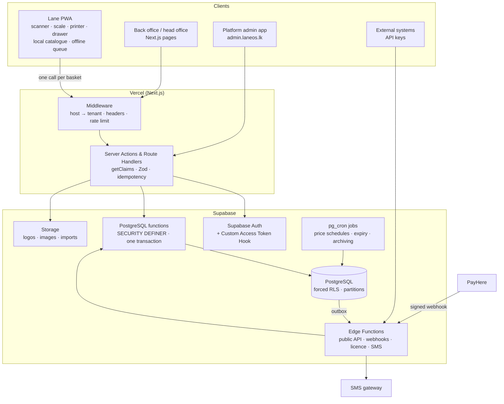

| Component / boundary | Responsibility | Owner / runtime | Data in / out | Dependencies | Critical failure / fallback |
| --- | --- | --- | --- | --- | --- |
| CMP-001 Lane PWA | Checkout UI, devices, local catalogue, offline queue, pricing preview | P3 / browser (Chrome) | Catalogue delta in; baskets out | `packages/pricing`, `packages/barcode`, QZ Tray | Network down → offline queue; printer down → digital receipt |
| CMP-002 Back office | Items, prices, promotions, purchasing, reports, users | P4 / Next.js | Forms → Server Actions | CMP-004 | Read-only mode if subscription lapsed |
| CMP-003 Platform admin | Tenants, plans, entitlements, billing, impersonation | P4 (UI) + P1 (security) / Next.js separate route group + domain | Admin actions → service-role server code | Audit log | Locked if 2FA fails |
| CMP-004 Server layer | Auth verification, validation, idempotency, calls DB functions | P2 / Vercel Node runtime | JSON in/out | Supabase | Retries with same idempotency key |
| CMP-005 Database functions | All money and stock rules, locks, ledgers | P1 + P2 / PostgreSQL | Validated payloads | Tables, RLS | Lock timeout → `409 BUSY_RETRY` |
| CMP-006 Edge Functions | Public API, PayHere webhook, licence tokens, SMS outbox worker | P2 / Supabase Deno | HTTP in/out | PayHere, SMS | Outbox retries with backoff |
| CMP-007 Scheduled jobs | Price schedules, expiry alerts, summaries, archiving, drift check | P1 / pg_cron | Tables | — | Alert on job failure |
| CMP-008 CI/CD | Lint, tests, migrations, deploy | P4 / GitHub Actions | Repo | Supabase CLI, Vercel | Block merge on failure |

# 11. Data and integration inventory

| ID | Asset / interface | Owner document | Sensitivity / criticality | Retention / versioning | Owner |
| --- | --- | --- | --- | --- | --- |
| DATA-001 | Tenants, plans, entitlements, subscriptions | `docs/08-data-model.md` | Confidential / critical | Life of account + 7 years for invoices | P1 |
| DATA-002 | Catalogue (items, barcodes, prices, promotions) | data doc | Internal / critical for checkout | Current + price history 2 years | P2 |
| DATA-003 | Sales, payments, refunds, ledgers | data doc | Confidential financial / critical | 2 years hot, archive to 7 years | P2 |
| DATA-004 | Stock, batches, movements | data doc | Internal / critical | 18 months detail, monthly balances after | P2 |
| DATA-005 | Customers, loyalty members (name, phone, NIC optional) | data doc + security doc | Personal data (PDPA) | Until deletion request or 2 years inactive | P1 |
| DATA-006 | Users, PIN hashes, roles | security doc | Secret (hashes) | Life of account | P1 |
| DATA-007 | Audit logs | security doc | Confidential | 2 years hot, archive | P1 |
| DATA-008 | Damage reports and photos | data doc | Internal | 2 years; photos 12 months after closing | P2 |
| DATA-009 | Credit notes and redemptions | data doc | Confidential financial (liability) | Like sales: 2 years hot, archive to 7 years | P2 |
| DATA-010 | Sessions (`auth.sessions`) and reset markers | security doc | Secret / critical | Sessions until expiry; reset markers 1 year | P1 |
| INT-001 | Internal API: Server Actions + `rpc()` | `docs/09-api.md` | Critical | Versioned with app | P2 |
| INT-002 | Public REST API `/v1` | API doc | High | `/v1` supported 12 months after `/v2` | P2 |
| INT-003 | Lane catalogue delta sync | API doc | Critical | Catalogue version number | P2 / P3 |
| INT-004 | PayHere Recurring API + webhook | API doc | High (revenue) | PayHere versioning | P2 |
| INT-005 | SMS gateway | API doc | Medium | Provider versioning | P2 |
| INT-006 | Devices: ESC/POS printer, drawer, scale (QZ Tray / Web Serial) | `docs/10-ui.md` device appendix | Critical at lane | Device adapter versions | P3 |
| INT-007 | CSV import/export (items, customers) | API doc | Medium | Template version in header row | P4 |

# 12. UX, security and operational posture

| Concern | System-level commitment | Canonical source | Verification / evidence | Exception owner |
| --- | --- | --- | --- | --- |
| UX / accessibility | Lane: scan-first, keyboard-only capable, large touch targets, Sinhala/Tamil/English labels. Back office: WCAG 2.2 AA | `docs/10-ui.md`; screen map and tokens in Appendix E | axe CI, pilot cashier test | P3 / P4 |
| Identity and authorization | Supabase Auth; JWT claims; forced RLS; bitmask permissions; manager PIN override; least privilege; host-only secure cookies; automatic and manual access reset at every scope (§27.5) | `docs/11-security.md` | pgTAP isolation suite, review | P1 |
| Privacy / retention | Minimum data, consent for marketing SMS, deletion on request, retention table §11 | security + data docs | Delete test, quarterly review | P1 |
| Observability / support | Structured logs with request ID, Sentry, uptime checks, business alerts (voids, refunds, drift) | `docs/15-errors-observability.md` | Alert drill each release | P4 |

# 13. Environments, delivery and release model

| Environment / stage | Purpose | Data policy | Access / promotion rule | Operational owner |
| --- | --- | --- | --- | --- |
| Local | Each developer: `supabase start` + `next dev` | Seed script with synthetic shops and 3,000 fake items | Anyone | Each developer |
| Preview | One per pull request (Vercel preview + Supabase branch or shared dev DB) | Synthetic | Auto on PR | P4 |
| Staging | Integration and pilot rehearsal | Synthetic + masked pilot copy | Merge to `main` deploys automatically | P4 |
| Production | Live shops | Real data | Git tag `vX.Y.Z` + approval by PO and Tech Lead; migrations run by CI only | P1 + P4 |

Release model: trunk-based. `main` is always deployable to staging; production releases every two weeks at sprint end (or hotfix tags). Database migrations are forward-only and backward-compatible for one release (expand → migrate → contract).

# 14. Test strategy and system acceptance

**Automated:** unit tests, database business-rule tests, RLS isolation, API contract tests, E2E lane flows, load tests, security scans. **Human judgement:** cashier usability with real hardware, receipt layout, pilot shop sign-off.

**Severity levels** (release-blocking = S1 and S2):

| Severity | Meaning | Example | Release blocking? |
| --- | --- | --- | --- |
| S1 Critical | Data leak, wrong money, lost sales, checkout down | Tenant sees other tenant's sales; refund above paid | Yes — fix before any release; hotfix in production within 4 h |
| S2 Major | Core flow broken with no workaround | Weighed item price wrong; offline sync stuck | Yes |
| S3 Minor | Flow works with workaround | Report filter wrong; label alignment | No (fix next sprint) |
| S4 Cosmetic | Text, spacing, colour | Typo on receipt footer | No |

| Quality level | Coverage / entry criteria | Exit criteria | Evidence location | Owner |
| --- | --- | --- | --- | --- |
| Unit / component | `packages/*` pricing, barcode, money helpers; React components | 100% lines on `pricing` and `barcode`; ≥ 70% elsewhere | GitHub Actions coverage report | Each author |
| Database | pgTAP: RLS isolation, functions, triggers | All pass; RLS-coverage query returns 0 tables | Actions log | P1 |
| Contract / integration | API schemas (Zod → OpenAPI), PayHere sandbox, catalogue sync | Contracts pass; no breaking diff on `/v1` | Actions + OpenAPI diff | P2 |
| End-to-end / acceptance | Playwright: WF-001..WF-009 | All critical journeys pass on staging | Playwright report + videos | P4 |
| Security / performance / accessibility | ZAP baseline, gitleaks, npm audit, k6, axe | No high findings; p95 targets met | Reports attached to release issue | P1 / P4 |
| UAT / business sign-off | Pilot shop scenarios (2 weeks live) | Product Owner + pilot owner sign | `docs/19-release-readiness.md` | Product Owner |

# 15. Delivery roadmap and vertical-slice plan

A **vertical slice** delivers one user outcome end to end (database → function → API → UI → test). The team builds slices, not layers, so something demonstrable exists every sprint.

| Order | Slice ID / name | User outcome | Included capabilities | Dependencies | Demo / acceptance gate | Target release |
| --- | --- | --- | --- | --- | --- | --- |
| 1 | SLICE-001 Tenant & login | Platform admin creates a tenant; owner logs in with 2FA; cashier logs in by PIN on a registered lane | CAP-001, CAP-002 | — | Isolation tests pass; demo login flows | v0.1 |
| 2 | SLICE-002 Catalogue | Owner imports 3,000 items by CSV; edits prices, barcodes, PLU, weighed items | CAP-003 | SLICE-001 | Import < 2 min; validation errors shown per row | v0.2 |
| 3 | SLICE-003 First sale | Cashier scans items (incl. scale label), takes cash/card/LankaQR, prints receipt, drawer opens | CAP-004, CAP-005 | SLICE-002 | 20-item sale end-to-end on real printer | v0.3 |
| 4 | SLICE-004 Offline lane | Lane sells with network off and syncs once | CAP-006 | SLICE-003 | 30 offline sales sync, 0 duplicates | v0.4 |
| 5 | SLICE-005 After-sale & cash | Returns with refund, exchange or **credit note**, credit customers, shifts, Z-report | CAP-007..009, CAP-020 | SLICE-003 | Shift variance correct; refund ≤ paid enforced | v0.5 |
| 6 | SLICE-006 Stock & simple promotions | Stock levels, adjustments, wastage, **damaged stock with decisions**, % / amount promotions | CAP-010, CAP-011, CAP-019 | SLICE-003 | Promo on receipt; stock report correct | v0.6 |
| 7 | SLICE-007 Reports, branding & security settings | Daily/hourly sales, margin, top items; tenant logo and receipt text; active sessions, access reset buttons, tenant security options | CAP-016, CAP-017, CAP-021 | SLICE-005 | Owner dashboard demo | v0.7 → **MVP v1.0** |
| 8 | SLICE-008 Purchasing | Suppliers, POs, GRN with batches/expiry, sale-or-return, supplier payments, counts | CAP-011, CAP-012 | MVP | Expiry alert fires; supplier credit correct | v1.1 |
| 9 | SLICE-009 Promotions+ & loyalty | Multi-buy, mix & match, loyalty points | CAP-013 | SLICE-006 | Best-price rule tests pass | v1.1 |
| 10 | SLICE-010 Chain | Head office, central price lists and schedules, transfers | CAP-014 | SLICE-008 | 3-shop chain demo | v1.2 |
| 11 | SLICE-011 SaaS billing | PayHere recurring, grace, read-only mode | CAP-015 | SLICE-001 | Sandbox webhook flow | v1.2 |
| 12 | SLICE-012 Advanced reports | Shrinkage, expiry, promotion effect, chain roll-ups | CAP-016 | SLICE-010 | Report review with pilot | v1.3 |
| 13 | SLICE-013 Platform+ | Public API, custom domains, PowerSync offline, scale PLU export | CAP-017, CAP-018 | v1.2 | API key demo | v2.0 |

# 16. Risk, assumption, dependency and open-question register

| ID | Type | Statement / impact | Likelihood / severity | Mitigation / validation | Owner / due / status |
| --- | --- | --- | --- | --- | --- |
| RSK-001 | Risk | RLS mistake leaks tenant data | L / Critical | Forced RLS, select-only policies, pgTAP on every PR, external review before launch | P1 / ongoing / open |
| RSK-002 | Risk | Lane and server prices differ → disputes | M / High | One shared pricing package, parity tests, `PRICE_DRIFT` report | P3 + P2 / M2 / open |
| RSK-003 | Risk | Cheap printers/scales behave differently | H / Medium | Buy 2 printer models + 1 scale for the team; device test matrix | P3 / M1 / open |
| RSK-004 | Risk | Migration conflicts between 4 developers | M / Medium | One migration per PR, timestamp names, P1 reviews all migrations (CODEOWNERS) | P1 / M0 / open |
| RSK-005 | Risk | Scope creep from pilot requests | H / Medium | Change requests go to backlog; PO prioritises at sprint planning | PO / ongoing |
| RSK-006 | Risk | Supabase/Vercel cost spike | L / Medium | Spend caps and alerts; archiving from year 2 | P4 / M3 |
| RSK-007 | Risk | Credit note slips copied or guessed | L / High | Random codes, hashed storage, online-only locked redemption, lookup rate limit | P2 / M3 / open |
| RSK-008 | Risk | Staff mark good stock as damaged and take it | M / Medium | Two-person approval above threshold, photos, per-staff damage report, count variances | P2 + P4 / M3 / open |
| ASM-001 | Assumption | Shops have Chrome-capable PCs/tablets | High confidence | Survey 5 target shops | PO / M0 |
| ASM-002 | Assumption | PayHere PLUS plan approval for recurring billing within 2 weeks | Medium | Apply in Phase 1 | PO / M2 |
| ASM-003 | Assumption | VAT-exempt list can be modelled as tax classes | Medium | Accountant review | PO / M3 |
| DEP-001 | Dependency | Pilot shop willing to run 2 weeks | Blocker for M4 | Sign pilot agreement in Phase 1 | PO / M2 |
| DEP-002 | Dependency | Thermal printer, drawer, scanner, label scale hardware | Blocker for SLICE-003 | Purchase in Phase 0 | P3 / M0 |
| Q-001 | Question | Cash rounding unit: Rs 1 or 50 cents? | Affects receipts | Ask pilot + accountant | PO / M2 |
| Q-002 | Question | Promotion stacking default: best single or stack? | Affects pricing engine | Decide before SLICE-009 | PO / M4 |
| Q-003 | Question | Limits on open-price items (vegetables without barcode)? | Fraud risk | Pilot interview | PO / M2 |
| Q-006 | Question | Default credit-note validity and cash-out policy? | Customer trust vs. cash control | Ask pilot owner + accountant | PO / M2 |

# 17. Canonical document register and cross-links

All documents live in the repository under `docs/`. Each has one owner who approves changes to it.

| Doc ID | Document / topic | Canonical path | Owner | Version / status | Depends on / related IDs |
| --- | --- | --- | --- | --- | --- |
| DOC-00 | SDD Playbook (how we write and change docs) | `docs/00-playbook.md` | P1 | v0.1 draft | All |
| DOC-01 | Master System Blueprint (this file) | `docs/01-blueprint.md` | P1 | v0.1 draft | All |
| DOC-02 | Product Intent & Scope | `docs/02-product-scope.md` | PO | draft | OUT, SCP |
| DOC-03 | Functional Requirements | `docs/03-functional-requirements.md` | PO + P2 | draft | REQ |
| DOC-04 | Non-functional Requirements | `docs/04-nfr.md` | P1 | draft | NFR |
| DOC-05 | Domain & Business Rules | `docs/05-domain.md` | PO + P2 | draft | BR |
| DOC-06 | Workflow & State Transitions | `docs/06-workflows.md` | P2 | draft | WF, ST |
| DOC-07 | Architecture & Technical Design | `docs/07-architecture.md` | P1 | draft | CMP, ADR |
| DOC-08 | Data Model & Database | `docs/08-data-model.md` | P1 | draft | ENT, FLD |
| DOC-09 | API & Integrations | `docs/09-api.md` + generated `openapi.yaml` | P2 | draft | API, EVT |
| DOC-10 | UI/UX & Interaction (+ devices) | `docs/10-ui.md` | P3 + P4 | draft | UI |
| DOC-11 | Security & Privacy | `docs/11-security.md` | P1 | draft | THR, SEC |
| DOC-12 | Test Strategy & Cases | `docs/12-tests.md` | P4 | draft | TC |
| DOC-13 | Environment & Configuration | `docs/13-environments.md` | P4 | draft | CFG |
| DOC-14 | Deployment & Operations | `docs/14-operations.md` | P4 | draft | REL, OPS |
| DOC-15 | Error Handling & Observability | `docs/15-errors-observability.md` | P2 | draft | ERR, MET |
| DOC-16 | Vertical Slice Packets | `docs/slices/SLICE-xxx.md` | Slice lead | draft | SLICE |
| DOC-17 | Traceability & Change Control | `docs/17-traceability.md` | PO | draft | CR |
| DOC-18 | Architecture Decision Records | `docs/adr/ADR-xxxx.md` | P1 | draft | ADR |
| DOC-19 | Release Readiness & Acceptance | `docs/19-release-readiness.md` | P4 | draft | REL |

# 18. Top-level decisions and change protocol

**Change protocol:** (1) open an issue with the `type:change-request` form; (2) PO and Tech Lead assess impact on scope, data, security and schedule; (3) if approved, one PR updates docs, code and tests together and references `CR-…`; (4) the baseline tag moves only after CI passes and both approve.

| Decision / change ID | Summary | Status | Affected artifacts | Decision owner | Effective baseline / date |
| --- | --- | --- | --- | --- | --- |
| ADR-0001 | Next.js + Supabase + PostgreSQL stack | Accepted | DOC-07 | P1 | spec-v0.1 / 2026-10-15 |
| ADR-0002 | Shared schema with `tenant_id` + forced RLS (not schema-per-tenant) | Accepted | DOC-08, DOC-11 | P1 | spec-v0.1 |
| ADR-0003 | All money/stock writes through `SECURITY DEFINER` functions; select-only RLS on financial tables | Accepted | DOC-08, DOC-09 | P1 | spec-v0.1 |
| ADR-0004 | Money as `bigint` cents; quantities as integer milli-units (grams for weighed) | Accepted | DOC-08 | P1 | spec-v0.1 |
| ADR-0005 | Local catalogue on lane + one call per basket; offline queue in MVP | Accepted | DOC-07, DOC-10 | P3 | spec-v0.1 |
| ADR-0006 | One shared TypeScript pricing engine for lane and server | Accepted | DOC-05, DOC-09 | P2 + P3 | spec-v0.1 |
| ADR-0007 | Trunk-based development with short-lived branches and squash merges | Accepted | DOC-00 | P1 | spec-v0.1 |
| ADR-0008 | PayHere for SaaS billing (Stripe unavailable in Sri Lanka) | Proposed | DOC-09 | PO | — |
| CR-2026-001 | (example) Add carrier-bag charge item to MVP | Proposed | REQ-SAL-010, SLICE-003 | PO | — |

# 19. System-level completion and approval

| Approval area | Decision | Approver / role | Date | Conditions / exception IDs |
| --- | --- | --- | --- | --- |
| Business outcomes / scope | Pending | Product Owner | — | — |
| Technical / architecture | Pending | Tech Lead (P1) | — | — |
| Quality / security / operations | Pending | P1 + P4 | — | — |

- [ ] All in-scope capabilities are delivered and verified, or deferred with an owner and release decision.
- [ ] No orphan requirements (every REQ has a test and a slice), unowned critical risks or unresolved contradictions.
- [ ] Critical journeys WF-001..WF-009 and failure/recovery behaviour (offline, lock timeout, webhook retry) have evidence.
- [ ] Migrations, rollback plan, backup/restore, monitoring, access controls and support runbook are ready.
- [ ] Security/privacy and accessibility reviews completed.
- [ ] Every deviation from spec is recorded as an accepted CR.
- [ ] Product Owner and Tech Lead have signed the release issue.

# 20. Glossary

| Term / acronym | Canonical definition | Preferred usage / avoid synonym | Owner / source |
| --- | --- | --- | --- |
| Tenant | One paying customer business (single shop or chain) | "tenant", not "client" or "company" | DOC-05 |
| Shop | One physical store of a tenant | not "branch" in code | DOC-05 |
| Lane | One registered checkout terminal | not "counter" in code; "lane" in UI is fine | DOC-05 |
| Entitlements | Limits and feature flags a tenant's plan allows | — | DOC-05 |
| PLU | Price look-up code: short number for loose items and scale labels | — | DOC-05 |
| Embedded-price barcode | EAN-13 starting with 2, holding PLU and price or weight | — | DOC-05 |
| FEFO | First expiry, first out: sell the batch that expires soonest | not "FIFO" for expiry | DOC-05 |
| GRN | Goods received note | — | DOC-05 |
| MRP | Maximum retail price printed on the pack | — | DOC-05 |
| RLS | Row Level Security in PostgreSQL | — | DOC-11 |
| Idempotency key | Client UUID that makes a repeated request return the first result | — | DOC-09 |
| Slice | Vertical, demonstrable increment of one user outcome | not "module" | DOC-16 |
| CR / ADR | Change request / architecture decision record | — | DOC-17 / DOC-18 |
| Credit note | Slip giving a customer stored value after a return, spendable later | "credit note" in code; "credit bill" fine in UI | DOC-05 |
| Damaged stock | Quantity kept aside, not sellable, until a manager decision | not "wastage" (wastage is the write-off outcome) | DOC-05 |
| Access reset | Ending sessions for a scope so tokens and cookies stop working | not "logout" (logout is one device) | DOC-11 |

---

# Part II — Integration plan

This part explains how the pieces connect. Read it in order: data first, then the database, then how API calls reach the database, then validation, structure, single vs franchise behaviour, security, the full workflow sequences and error handling.

# 21. Data architecture

## 21.1 Tenancy model

Every business record carries `tenant_id`. Shop-level records also carry `shop_id`. A **single shop** is simply a tenant with one shop; a **franchise/chain** is a tenant with many shops. There is no separate code path, only different entitlements and a few head-office features turned on.

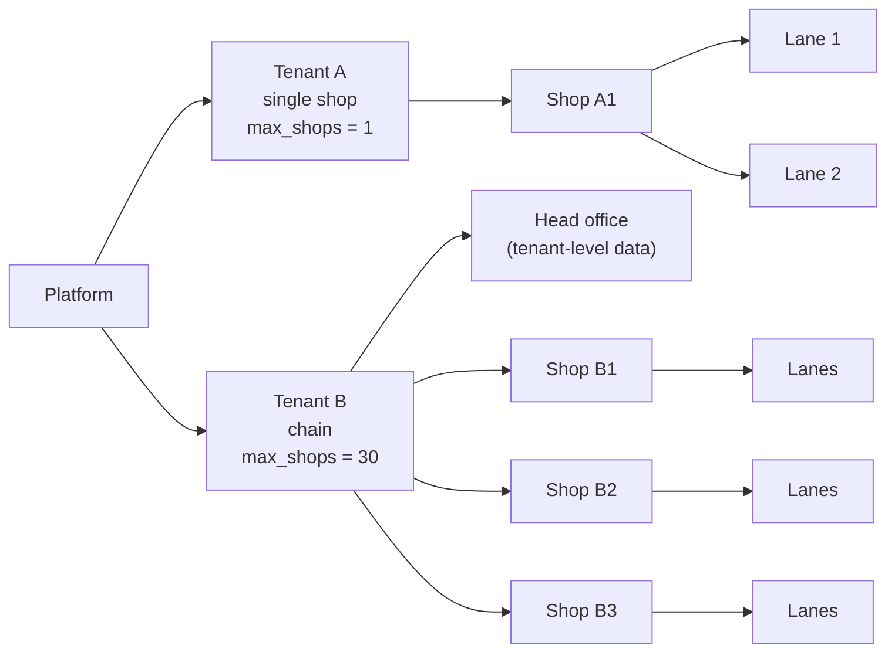

## 21.2 Where data lives: tenant level vs shop level

This split is what makes franchise control possible.

| Level | Data | Who edits | Single shop | Franchise |
| --- | --- | --- | --- | --- |
| Platform | plans, tenants, entitlements, subscriptions, SaaS invoices | Platform admin | Same | Same |
| Tenant | items, barcodes, units, departments, suppliers, customers, loyalty members, credit notes, promotions, base price lists, tax classes, roles, security settings, branding | Owner / head office | Owner edits everything | Head office edits; shops read |
| Shop | stock levels (sellable + damaged), batches, movements, damage reports, GRNs, counts, wastage, shifts, sales, lanes, shop price overrides | Store manager | Same shop | Each shop its own; head office reads all |
| Lane | local catalogue cache, offline queue, device settings | System | Same | Same |

## 21.3 Core entity relationships

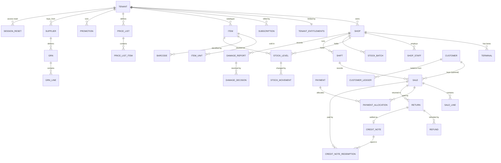

## 21.4 How data flows

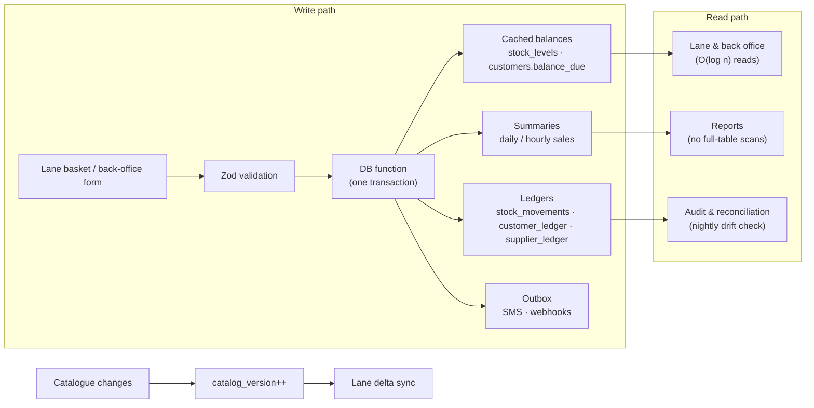

**Three rules keep data correct:**

1. **Ledger + cached balance in the same transaction.** The ledger is the history; the cached row is the fast answer. They cannot disagree because they commit together, and a nightly job double-checks.
2. **Append-only money.** Mistakes are fixed with reversing entries, never by editing a sale.
3. **Catalogue versioning.** Every change to items, barcodes, prices or promotions increments a per-tenant `catalog_version`; lanes ask "what changed since version N?".

# 22. Database design and migrations

## 22.1 Conventions

| Topic | Rule |
| --- | --- |
| Primary keys | `uuid` v7 (time-ordered) generated in the database or on the lane for offline records |
| Money | `bigint` cents. Rs 1,250.50 → `125050` |
| Quantity | `integer` milli-units: 1 piece = 1000; weighed items 1 g = 1 (1 kg = 1000) |
| Tax rate | `smallint` basis points (18% = 1800) |
| Status fields | PostgreSQL enums |
| Timestamps | `timestamptz` in UTC; display in Asia/Colombo |
| Names | `snake_case`, plural table names, `*_id` foreign keys, `*_cents` money, `*_milli` quantities |
| Required columns | `id`, `tenant_id`, (`shop_id`), `created_at`, `created_by`; master data also `updated_at`, `is_active` |
| Schemas | `public` tables; `app` helper functions; `api` callable functions; `private` service-only |

## 22.2 Key DDL (abridged)

```sql
create type item_type as enum ('standard','weighed','pack','open_price');
create type tax_class as enum ('standard','exempt','zero');

create table items (
  id            uuid primary key default uuidv7(),
  tenant_id     uuid not null references tenants(id),
  department_id uuid references departments(id),
  name          text not null check (char_length(name) between 1 and 120),
  item_type     item_type not null default 'standard',
  tax_class     tax_class not null default 'standard',
  plu           integer check (plu between 1 and 99999),
  mrp_cents     bigint check (mrp_cents >= 0),
  track_batches boolean not null default false,
  is_returnable boolean not null default true,
  is_active     boolean not null default true,
  created_at    timestamptz not null default now(),
  updated_at    timestamptz not null default now()
);
create unique index items_tenant_plu on items(tenant_id, plu) where plu is not null;
create index items_name_trgm on items using gin (name gin_trgm_ops);

create table barcodes (
  tenant_id uuid not null,
  code      text not null check (code ~ '^[0-9A-Z-]{1,32}$'),
  item_id   uuid not null references items(id),
  unit_id   uuid references item_units(id),      -- case barcode → case unit
  primary key (tenant_id, code)
);

create table stock_levels (
  shop_id    uuid not null references shops(id),
  item_id    uuid not null references items(id),
  tenant_id  uuid not null,
  qty_milli  bigint not null default 0,
  avg_cost_cents bigint not null default 0,
  primary key (shop_id, item_id)
) with (fillfactor = 80);

create table sales (
  id uuid not null default uuidv7(),
  tenant_id uuid not null, shop_id uuid not null, lane_id uuid not null, shift_id uuid not null,
  invoice_no text not null, customer_id uuid,
  subtotal_cents bigint not null, promo_cents bigint not null default 0,
  rounding_cents integer not null default 0, total_cents bigint not null,
  paid_cents bigint not null, balance_due_cents bigint not null,
  client_uuid uuid not null, created_by uuid not null,
  created_at timestamptz not null default now(),
  primary key (id, created_at)
) partition by range (created_at);
create unique index sales_idem on sales(tenant_id, client_uuid, created_at);
```

## 22.3 RLS template (applied to every table by a migration helper)

```sql
alter table sales enable row level security;
alter table sales force row level security;
create policy sel on sales for select to authenticated
  using (tenant_id = (select app.tenant_id()) and (select app.can_shop(shop_id)));
-- financial tables: no insert/update/delete policy → writes only via api.* functions
```

Master data (items, customers) gets insert/update policies with `with check (tenant_id = (select app.tenant_id()))`, plus a trigger that forbids changing `tenant_id` or `id`.

## 22.4 Indexes that make the hot paths fast

| Query | Index | Cost |
| --- | --- | --- |
| Barcode lookup | PK `(tenant_id, code)` | O(log n) |
| PLU lookup | `UNIQUE (tenant_id, plu)` partial | O(log n) |
| Stock of item in shop | PK `(shop_id, item_id)` | O(log n) |
| Next FEFO batch | `(shop_id, item_id, expiry) where qty_milli > 0` | O(log n) |
| Idempotency | `UNIQUE (tenant_id, client_uuid, created_at)` | O(log n) |
| Customer by phone | `UNIQUE (tenant_id, phone)` | O(log n) |
| Item search | trigram GIN | O(log n + k) |
| Date-range reports | monthly partitions + BRIN on `created_at` | partition pruning |

## 22.5 Migration workflow for four developers

Migration conflicts are the most common team problem with a shared database. These rules prevent them:

1. **Create with the CLI only:** `supabase migration new <short_name>` makes a timestamped file such as `20261105093012_items_plu.sql`. Never rename or edit a migration after it is merged.
2. **One logical change per migration, at most one migration per PR** (exceptions approved by P1).
3. **CODEOWNERS:** every file in `supabase/migrations/` needs P1's review.
4. **Before opening the PR:** `git pull --rebase origin main`, then `supabase db reset` locally to replay all migrations in order and run `supabase test db`.
5. **If two PRs touch the same table**, the second rebases after the first merges and regenerates types (`supabase gen types typescript`).
6. **Expand → migrate → contract** for breaking changes: add the new column, deploy code that writes both, backfill, switch reads, remove the old column in a later release.
7. **Seed data** lives in `supabase/seed.sql` (synthetic only) so every developer and preview has the same 2 tenants, 4 shops and 3,000 items.

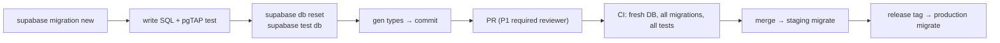

# 23. API design and calling pattern

## 23.1 Three ways the system is called

| Caller | Mechanism | Used for | Auth |
| --- | --- | --- | --- |
| Back office / admin pages | Next.js **Server Actions** | Forms, edits, reports | Session cookie → `getClaims()` |
| Lane PWA | **Route Handlers** `/api/lane/*` (JSON) | Checkout, sync, shift actions | Session cookie + lane key header |
| External systems | **Edge Functions** `/v1/*` (REST) | Integrations, e-commerce, accounting | API key (Bearer) |

All three end in the same place: a PostgreSQL function in the `api` schema called with `supabase.rpc()`. Business rules therefore exist once.

## 23.2 Request lifecycle

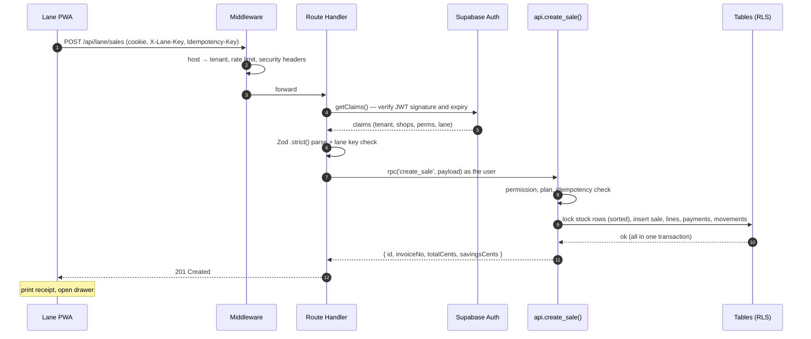

## 23.3 Conventions

- **JSON**, camelCase in APIs, snake_case in SQL (mapped in one place: `packages/core/mappers.ts`).
- **Money** in cents, **quantity** in milli-units, **time** ISO 8601 UTC.
- **`Idempotency-Key`** required on every POST that changes money or stock; the server stores the first result for 7 days.
- **Pagination** by cursor (`?limit=50&after=…`), never offset.
- **Errors** use one envelope (section 29) and stable `code` values the UI can translate.
- **Versioning:** internal routes move with the app; public `/v1` is frozen and documented in `openapi.yaml` generated from Zod schemas.

## 23.4 Endpoint catalog (summary)

| Area | Method + path | Calls function | Permission |
| --- | --- | --- | --- |
| Lane sync | `GET /api/lane/catalog?since=` | `api.catalog_delta` | lane key |
| Lane | `POST /api/lane/shifts/open` · `/pickup` · `/close` | `api.shift_*` | `sale.create` / `cash.pickup` |
| Lane | `POST /api/lane/sales` | `api.create_sale` | `sale.create` |
| Lane | `POST /api/lane/returns` (refund, exchange or credit note) | `api.process_return` | `return.create` |
| Lane | `GET /api/lane/credit-notes/:code` | `api.check_credit_note` | `sale.create` |
| Lane / back office | damage report and decisions | `api.report_damage`, `api.decide_damage` | `wastage.post` / `stock.adjust` |
| Back office | Sessions and access reset | `api.list_sessions`, `api.end_session`, `api.reset_access` | self / owner / manager (§27.5) |
| Lane | `POST /api/lane/payments` (credit settlement) | `api.receive_payment` | `sale.create` |
| Lane | `GET /api/lane/customers/:phone` | select (RLS) | `sale.create` |
| Back office | Server Actions `items.*`, `prices.*`, `promotions.*` | direct RLS writes / `api.apply_price_schedule` | `item.edit` / `promotion.manage` |
| Back office | `grn.create` / `grn.post` | `api.post_grn` | `grn.post` |
| Back office | `wastage.post`, `counts.post` | `api.post_wastage`, `api.post_stock_count` | `stock.adjust` |
| Head office | `transfers.*` | `api.dispatch_transfer`, `api.receive_transfer` | `transfer.approve` |
| Billing | `POST /v1/webhooks/payhere` | `private.payhere_notify` (service role) | signature |
| Public | `GET /v1/items`, `GET /v1/stock`, `POST /v1/sales` | same functions | API key scopes |

## 23.5 Calling code (lane side)

```ts
// apps/web/lib/lane/api.ts
export async function submitSale(basket: Basket): Promise<SaleResult> {
  const body = CreateSale.parse(basket);                 // same Zod schema as the server
  const res = await fetch('/api/lane/sales', {
    method: 'POST',
    headers: {
      'Content-Type': 'application/json',
      'Idempotency-Key': body.clientUuid,                // stable across retries
      'X-Lane-Key': await laneKey(),
    },
    body: JSON.stringify(body),
    signal: AbortSignal.timeout(8000),
  });
  if (res.status === 201) return res.json();
  const { error } = await res.json().catch(() => ({ error: { code: 'NETWORK' } }));
  if (['NETWORK', 'BUSY_RETRY'].includes(error.code) || res.status >= 500) throw new RetryableError(error);
  throw new BusinessError(error);                        // shown to cashier, not retried
}
```

```ts
// apps/web/app/api/lane/sales/route.ts
export async function POST(req: Request) {
  const supabase = await createServerClient();
  const { data: claims } = await supabase.auth.getClaims();
  if (!claims) return apiError(401, 'UNAUTHENTICATED');
  const parsed = CreateSale.safeParse(await req.json());
  if (!parsed.success) return apiError(400, 'VALIDATION_ERROR', parsed.error.flatten());
  await assertLaneKey(req, claims, parsed.data.laneId);
  const { data, error } = await supabase.rpc('create_sale', { p: parsed.data });
  if (error) return mapDbError(error);                   // P0001 messages → stable codes
  return Response.json(data, { status: 201 });
}
```

# 24. Validation pipeline

Validation happens in four layers. Each layer catches a different kind of mistake, and the last two cannot be bypassed by a modified lane.

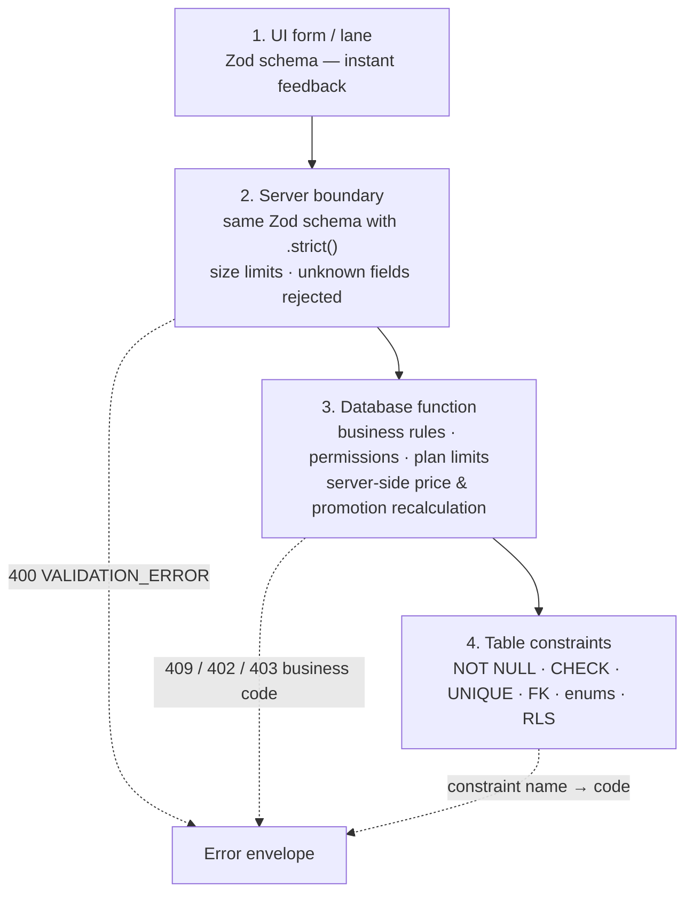

| Layer | Catches | Example | Owner |
| --- | --- | --- | --- |
| 1 UI | Typos, empty fields | Phone not `+947XXXXXXXX` | P3 / P4 |
| 2 Server | Wrong shape, extra fields, oversized payloads | Client sends `totalCents` or 5,000 cart lines | P2 |
| 3 Function | Business rules | Refund above paid, price above MRP, credit limit | P2 |
| 4 Constraints | Anything that slipped through | Duplicate barcode, negative money | P1 |

**Shared schemas** live in `packages/core/schemas/*.ts` and are imported by both the browser and the server, so they never drift. Examples of rules (full tables in DOC-03):

| Field | Rule |
| --- | --- |
| Barcode | EAN-13/UPC-A/ITF-14 check digit; embedded-price prefix 20–29 with known PLU |
| Weight | Integer grams 1–100,000 per line; must equal the scale reading if from a lane scale |
| Money | Integer cents ≥ 0, ≤ Rs 100 million per line |
| Cart | 1–300 lines; ≤ 6 payments |
| Expiry date | ≥ today on GRN (warn within 7 days), ≤ today + 10 years |
| CSV import | ≤ 10 MB, header row must match template version; errors returned per row and column |

**Database errors become stable codes.** Functions raise `P0001` with a message like `ABOVE_MRP`; `mapDbError()` turns it into `{ status: 409, code: 'ABOVE_MRP' }`. Constraint violations map by constraint name (`barcodes_pkey` → `DUPLICATE_BARCODE`).

# 25. Backend and repository structure

One monorepo (pnpm workspaces + Turborepo) so all four people share types, schemas and tests.

```text
laneos/
├─ apps/
│  └─ web/                          # Next.js app (one deploy)
│     ├─ app/(platform)/admin/      # platform admin pages            → P4 UI, P1 security
│     ├─ app/(tenant)/backoffice/   # owner, head office, store mgr   → P4
│     ├─ app/(lane)/lane/[laneId]/  # checkout PWA                    → P3
│     ├─ app/api/lane/              # lane route handlers             → P2
│     ├─ lib/server/                # supabase server client, errors, auth helpers → P2
│     └─ middleware.ts              # host → tenant, headers          → P1
├─ packages/
│  ├─ core/                         # Zod schemas, money/qty helpers, error codes → P2
│  ├─ pricing/                      # price lists, promotions, rounding, tax      → P3 (P2 reviews)
│  ├─ barcode/                      # EAN/PLU/embedded-price parsing             → P3
│  ├─ devices/                      # printer, drawer, scale, display adapters   → P3
│  ├─ ui/                           # shared components, theme tokens            → P4
│  └─ db-types/                     # generated Supabase types (never hand-edit) → CI
├─ supabase/
│  ├─ migrations/                   # SQL migrations                  → P1 (CODEOWNER)
│  ├─ functions/                    # Edge Functions: v1 api, payhere, licence, sms → P2
│  ├─ tests/                        # pgTAP                           → P1 + P2
│  └─ seed.sql                      # synthetic data                  → P1
├─ e2e/                             # Playwright                      → P4
├─ load/                            # k6 scripts                      → P4
├─ docs/                            # SDD documents (section 17)      → owners
└─ .github/                         # workflows, templates, CODEOWNERS → P4 + P1
```

**Module boundaries (import rules, enforced with ESLint `no-restricted-imports`):**

- `packages/*` never import from `apps/*`.
- `packages/pricing` and `packages/barcode` are pure (no network, no React), so they run on the lane, the server and in tests.
- UI code never calls `supabase.from(...).insert()` on financial tables; it calls a Route Handler or Server Action.
- Only `lib/server/admin.ts` may use the service role key, and only from `app/(platform)` code.

# 26. Single shop vs franchise behaviour

The same features behave slightly differently depending on the tenant's entitlements.

| Feature | Single shop | Franchise / chain |
| --- | --- | --- |
| Dashboard | Back office for the shop | Head office (all shops) + shop back office |
| Price lists | One price list | Central list + optional shop overrides; scheduled changes pushed to all shops |
| Promotions | Shop-wide | All shops or selected shops; created by head office only |
| Items and suppliers | Owner edits | Head office edits; shops read (optional "local items" flag) |
| Stock | One shop | Per shop; head office sees totals; transfers between shops |
| Purchasing | Shop buys | Central PO with delivery per shop, or shop-level POs |
| Customers / loyalty | Shop | Shared across shops (points earned anywhere, redeemed anywhere) |
| Credit notes | Redeem in the shop | Tenant setting: issuing shop only, or any shop of the chain |
| Damaged stock | Shop manager decides | Shop reports; head office sees damage across shops and can decide supplier returns centrally |
| Access reset | Owner resets user, lane or shop | + head office resets any shop; owner resets whole tenant |
| Reports | Shop | Per shop + roll-ups + shop comparison |
| Users | Owner + staff | Head-office roles + per-shop roles |
| Entitlements | `max_shops = 1`, `head_office = false` | `max_shops = N`, `head_office = true`, `transfers = true` |

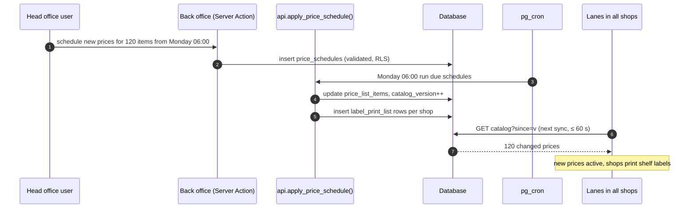

# 27. Security integration

Security is built into each layer instead of added at the end. This table shows what each layer does and who owns it.

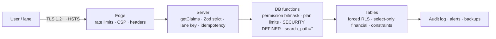

## 27.1 Threat model (STRIDE)

| ID | Threat | Where | Control | Test |
| --- | --- | --- | --- | --- |
| THR-001 | **S**poofing a cashier | Lane login | PIN (Argon2id) valid only with that shop's registered lane key; 5 failures → 15-min lock | TC-SEC-001 |
| THR-002 | **S**poofing PayHere | Webhook | MD5 signature with merchant secret; amount and order matched; idempotent | TC-SEC-002 |
| THR-003 | **T**ampering with prices from the lane | Checkout | Server recomputes prices, MRP, promotions; mismatch → `PRICE_MISMATCH` or drift flag | TC-SEC-003 |
| THR-004 | **T**ampering with sales history | Database | No UPDATE/DELETE on ledgers; append-only audit log | TC-SEC-004 |
| THR-005 | **R**epudiation of voids/refunds | Lane | Every void, no-sale, override, refund logged with user, lane, time, approver | TC-SEC-005 |
| THR-006 | **I**nformation disclosure across tenants | All reads | Forced RLS, 404 for foreign IDs, isolation tests | TC-SEC-006 |
| THR-007 | **I**nformation disclosure of secrets | Repo / logs | gitleaks + push protection; log redaction; env vars only | TC-SEC-007 |
| THR-008 | **D**enial of service | API | Rate limits per IP/user/lane/key; lane works offline | TC-SEC-008 |
| THR-009 | **E**levation of privilege | Roles | Permission bitmask in JWT with `perm_v` revocation; manager override needs PIN | TC-SEC-009 |
| THR-010 | **E**levation via platform staff | Admin app | 2FA, IP allowlist, audited time-limited impersonation visible to owner | TC-SEC-010 |

## 27.2 Controls by layer

| Layer | Controls | Owner |
| --- | --- | --- |
| Transport | TLS everywhere, HSTS preload, secure cookies (`httpOnly`, `Secure`, `SameSite=Lax`) | P4 |
| Edge | Rate limits, CSP with nonces, `X-Frame-Options: DENY`, `nosniff`, Permissions-Policy (camera only on count screens, serial only on lane) | P1 |
| Server | `getClaims()` on every request, Zod `.strict()`, lane key check, idempotency, no service role outside admin | P2 |
| Functions | `SECURITY DEFINER`, `set search_path = ''`, permission and entitlement checks first, `revoke all from public, anon` | P1 + P2 |
| Data | Forced RLS, select-only financial tables, constraints, Vault encryption for NIC, hashed PINs and keys | P1 |
| Supply chain | Dependabot, `npm audit`, pinned lockfile, CodeQL, gitleaks in CI | P4 |
| Operations | Audit logs, fraud alerts, backups + PITR, quarterly restore drill, incident runbook | P1 + P4 |

## 27.3 Secrets handling

| Secret | Stored in | Who can see | Rotation |
| --- | --- | --- | --- |
| Supabase service role key | Vercel env (production/staging), Supabase function secrets | P1 only | 90 days + on staff exit |
| JWT secret / signing keys | Supabase | P1 | On incident |
| PayHere merchant secret, app secret | Supabase function secrets | P1, P2 | Yearly + on incident |
| QZ Tray signing key | Server env | P1, P3 | Yearly |
| SMS gateway key | Supabase function secrets | P2 | Yearly |
| Local `.env.local` | Developer machines (in `.gitignore`) | Each dev, local keys only | — |

Rule: production secrets never go into chat, issues, PRs or screenshots. `.env.example` lists names only.

## 27.4 Security checks in CI (every PR)

1. `gitleaks` — no secrets committed.
2. `npm audit --audit-level=high` and Dependabot alerts.
3. CodeQL for TypeScript.
4. pgTAP: RLS coverage query returns 0 unprotected tables; cross-tenant read tests pass.
5. Lint rule: no `service_role` import outside `lib/server/admin.ts`.
6. Weekly: OWASP ZAP baseline scan against staging.

## 27.5 Sessions, cookies and access reset

A **session** is what keeps a person logged in. In LaneOS it lives in secure browser cookies set by Supabase Auth: a short-lived **access token** (proves who you are on each request) and a **refresh token** (used to get a new access token). "Resetting cookies" means ending sessions so the stored tokens stop working and the person must log in again. LaneOS supports this automatically after risky events and manually at every level of access: one device, one user, one lane, one shop, a whole tenant, or the whole platform in an emergency.

### 27.5.1 Cookie settings

| Cookie / storage | Holds | Attributes | Why |
| --- | --- | --- | --- |
| `sb-<project>-auth-token` (Supabase, may be split into `.0`, `.1`) | Access + refresh token | `HttpOnly`, `Secure`, `SameSite=Lax`, `Path=/`, **no `Domain`** (host-only) | JavaScript cannot read it; it is never sent over plain HTTP; a tenant's custom domain cannot read another tenant's cookie |
| Same, on `admin.laneos.lk` | Platform admin session | As above + `SameSite=Strict`, shorter lifetime | Admin links from other sites never carry the session |
| `__Host-laneos-ctx` | Selected shop and lane ID (not secret) | `__Host-` prefix forces `Secure`, `Path=/`, no `Domain` | Cannot be overwritten by a subdomain |
| Lane key | Device binding secret | **Not a cookie**: stored in IndexedDB, sent as `X-Lane-Key` header, server stores only its hash | Not sent automatically, so cross-site requests cannot use it |
| `localStorage` | Nothing sensitive | — | Tokens are never stored here |

All cookies are set and cleared only by server code (`@supabase/ssr`). Pages that show tenant data send `Cache-Control: no-store` so a shared computer's browser cache never keeps them after logout.

### 27.5.2 Session lifetimes per access level

| Access level | Access token | Idle timeout | Maximum session length | Re-authentication for sensitive actions |
| --- | --- | --- | --- | --- |
| Platform admin | 5 min | 15 min | 8 h | Password + TOTP within the last 5 min before impersonation, plan edits, data export |
| Tenant owner / head office | 15 min | 30 min | 7 days | TOTP within the last 10 min before role changes, security settings, exports, cash-out of credit notes |
| Store manager / supervisor | 15 min | 30 min on back office; lane uses PIN override | 12 h | PIN for each override action |
| Cashier (lane) | 15 min | Lane locks after 3 min idle (PIN to unlock) | Length of shift; ends at shift close | PIN for each lane unlock |
| Stock keeper / accountant | 15 min | 30 min | 12 h | Password for exports |
| API key | No cookie | — | Until key expiry (max 1 year) | Key rotation |

Supabase project settings: JWT expiry 900 s, refresh-token rotation on, reuse interval 10 s, plus Supabase's session time-box and inactivity timeout where the plan supports them. The app enforces the stricter per-role limits above with the reset mechanism in 27.5.4.

### 27.5.3 Automatic resets (no one has to press a button)

| Event | What is reset | Why |
| --- | --- | --- |
| Login | New session cookie issued; any pre-login cookie discarded | Stops session-fixation attacks |
| Logout | Current session ended on the server and cookies cleared | Shared shop computers |
| Password or PIN changed | All sessions of that user except the current one | A stolen password stops working everywhere |
| 2FA turned on or reset | All sessions of that user | New security level applies everywhere |
| Role, shop assignment or permission changed | All sessions of that user (they re-login with new claims) | Removed access ends immediately, not at token expiry |
| User deactivated | All sessions of that user + PIN disabled | Staff leaving |
| Shift closed | That lane's cashier session | Next cashier starts clean |
| Lane deregistered or lane key rotated | All sessions on that lane | Lost or stolen device |
| Tenant suspended or cancelled | All sessions of the tenant (owner keeps a billing-only session) | Unpaid or terminated account |
| Impersonation ends or times out (30 min) | The support session | Support access never lingers |
| Refresh-token reuse detected by Supabase | That whole token family | Sign of token theft |
| 10 failed PINs on a lane in 15 min | Lane locked; supervisor must unlock | Brute-force attempt |
| Login from a new country or impossible travel (owner/admin) | That new session held for TOTP; owner notified | Account takeover |

### 27.5.4 Manual reset options (the "reset access" buttons)

| Reset scope | Button location | Who can press it | Effect |
| --- | --- | --- | --- |
| **This device** | User menu → Log out | Anyone | Ends this session and clears cookies |
| **My other devices** | Profile → Security → "Sign out other devices" | Anyone | Ends all the user's sessions except this one |
| **One session** | Profile → Security → Active sessions list → "Sign out" on a row | The user; owner for their staff | Ends that device's session |
| **One user, all devices** | Back office → Users → user → "Reset access" | Owner; store manager for their own shop's staff | Ends all sessions; optional "require new PIN/password" |
| **One lane** | Back office → Lanes → lane → "Reset lane sessions" or "Reset lane binding" | Owner, store manager | Ends sessions on that lane; "binding" also rotates the lane key so the device must be registered again |
| **One shop** | Back office → Shop → Security → "Reset all shop sessions" | Owner, head office | Ends every session for staff and lanes of that shop |
| **Whole tenant** | Back office → Settings → Security → "Reset all access" | Owner (with TOTP) | Ends every session in the tenant, including the owner's other devices |
| **Platform emergency** | Admin app → Security → "Global sign-out" | Platform super admin (2 admins must approve) | Ends every session for every tenant; used after a key leak |

Every reset writes an audit row (who, scope, reason, time) and, for user or tenant resets, emails the affected owner.

### 27.5.5 How a reset works technically

Supabase access tokens are signed JWTs that stay valid until they expire, so deleting a session alone would leave up to 15 minutes of access. LaneOS closes that gap with **reset markers**:

1. The reset function deletes the matching rows in `auth.sessions` (refresh tokens stop working immediately).
2. It writes a reset marker with the current time for the scope (user, lane, shop or tenant).
3. Middleware compares the token's issue time (`iat`) with the newest marker that applies to that user, lane, shop and tenant. If the token is older, the request is refused, cookies are cleared and the user goes to the login or PIN screen.
4. Markers are cached for 30 seconds per tenant, so the check costs O(1) per request and a reset takes effect within 30 seconds everywhere.

```sql
create type reset_scope as enum ('user','lane','shop','tenant','platform');

create table session_resets (
  scope_type reset_scope not null,
  scope_id   uuid        not null,          -- user, terminal, shop or tenant id (platform: zero uuid)
  tenant_id  uuid,                           -- null only for platform scope
  reset_at   timestamptz not null default now(),
  reset_by   uuid        not null,
  reason     text        not null check (char_length(reason) between 3 and 200),
  primary key (scope_type, scope_id)
);

create function api.reset_access(p_scope reset_scope, p_id uuid, p_reason text)
returns void language plpgsql security definer set search_path = '' as $$
begin
  perform app.require_reset_permission(p_scope, p_id);        -- role + scope checks, TOTP freshness for tenant scope
  insert into public.session_resets(scope_type, scope_id, tenant_id, reset_by, reason)
  values (p_scope, p_id, app.tenant_id(), auth.uid(), p_reason)
  on conflict (scope_type, scope_id) do update
    set reset_at = now(), reset_by = excluded.reset_by, reason = excluded.reason;
  delete from auth.sessions s
   where s.user_id in (select user_id from app.users_in_scope(p_scope, p_id));
  perform app.audit('security.reset_access', p_scope::text, p_id, jsonb_build_object('reason', p_reason));
end $$;
revoke all on function api.reset_access from public, anon;
```

```ts
// apps/web/middleware.ts (excerpt)
const claims = await getClaimsFromCookie(req);              // verified JWT
if (claims) {
  const markers = await resetMarkers(claims.tenant_id);     // cached 30 s per tenant
  const newest = Math.max(
    markers.platform ?? 0,
    markers.tenant ?? 0,
    markers.user[claims.sub] ?? 0,
    ...claims.shop_ids.map((s) => markers.shop[s] ?? 0),
    claims.lane_id ? markers.lane[claims.lane_id] ?? 0 : 0,
  );
  if (claims.iat * 1000 < newest) {
    const res = NextResponse.redirect(new URL(claims.lane_id ? '/lane/locked' : '/login?reason=reset', req.url));
    clearAuthCookies(res);                                   // expire sb-* and __Host-laneos-ctx
    return res;
  }
}
```

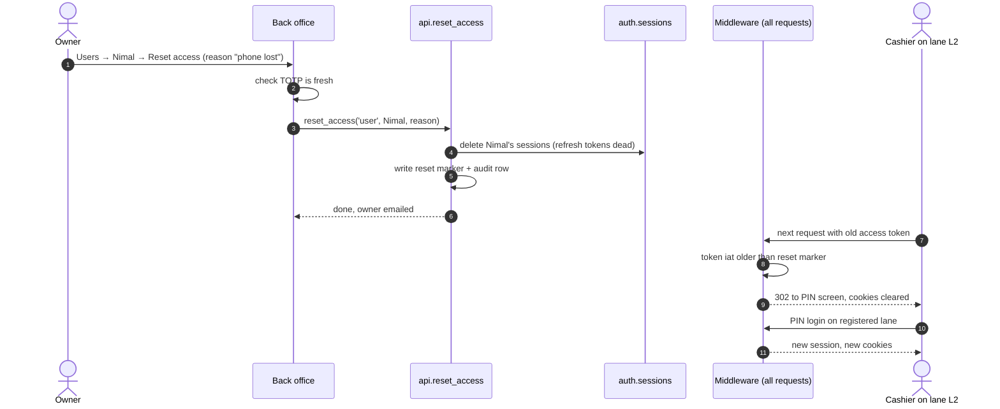

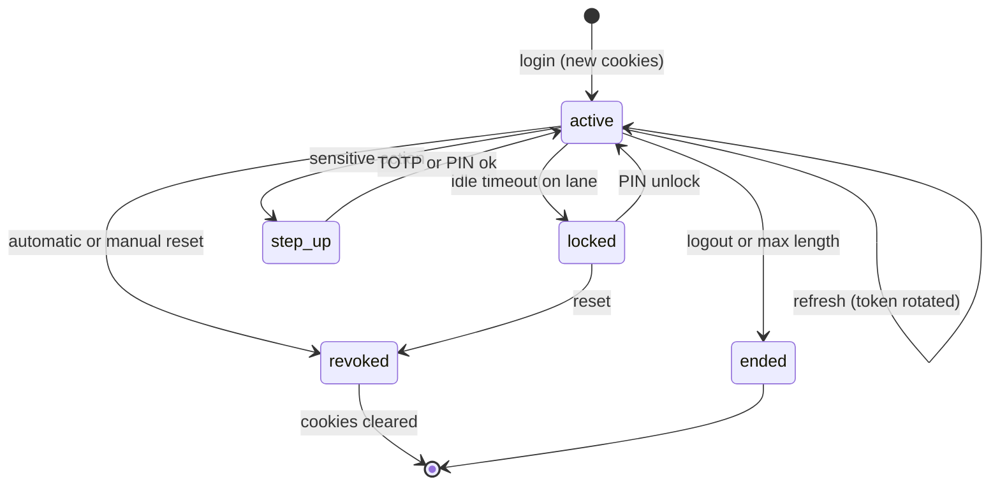

**Why not reset the cookie on every single request?** Replacing tokens on every click would log cashiers out whenever two requests run at the same time (for example a scan and a price check), and it adds load without real benefit. The same protection comes from short access tokens (5–15 minutes), refresh-token rotation, the reset markers above, and **step-up re-authentication** for each sensitive access (refunds above a limit, exports, role changes, cash-out). If a tenant wants the strictest setting, "strict session mode" in 27.6 shortens tokens to 5 minutes and asks for re-authentication before every sensitive screen.

### 27.5.6 Requirements

| ID | Pri. | Requirement |
| --- | --- | --- |
| REQ-SES-001 | M | Auth cookies are HttpOnly, Secure, SameSite (Lax; Strict on admin), host-only; no tokens in localStorage |
| REQ-SES-002 | M | Automatic resets for every event in 27.5.3 |
| REQ-SES-003 | M | Owner/manager can reset one user's access on all devices |
| REQ-SES-004 | M | Owner/manager can reset a lane's sessions and rotate its binding |
| REQ-SES-005 | M | Owner/head office can reset a shop; owner (with TOTP) can reset the whole tenant |
| REQ-SES-006 | S | Platform global sign-out with two-admin approval |
| REQ-SES-007 | M | Any reset takes effect within 30 seconds on every device; cookies are cleared on the next request |
| REQ-SES-008 | M | Users see and end their own active sessions |
| REQ-SES-009 | M | Step-up re-authentication before sensitive actions (27.5.2) |
| REQ-SES-010 | S | Tenant security options in 27.6, audited, changed only with fresh TOTP |

### 27.5.7 Active sessions screen

Profile → Security (and Users → user → Sessions for owners) lists each session from `auth.sessions` through a tenant-scoped function: device/browser, lane name, approximate location from IP (country/city only, IP itself not shown), started, last active, and a **Sign out** button. The list is read through `api.list_sessions(user_id)`, which checks that the caller is the user or their owner/manager.

## 27.6 Tenant security options (Settings → Security)

Owners can tighten security for their business without code changes. Defaults are safe; every change is audited and needs a fresh TOTP.

| Option | Default | Range / choices | Who it affects |
| --- | --- | --- | --- |
| Require 2FA | Owners and head office | + managers, + all back-office users | Back office users |
| Strict session mode | Off | On: 5-min tokens, step-up before every sensitive screen | Back office users |
| Idle timeout (back office) | 30 min | 10–120 min | Back office users |
| Lane auto-lock | 3 min | 1–15 min | Cashiers |
| Maximum session length | 7 days owners, 12 h staff | 1 h – 30 days | Per role |
| Back-office IP allowlist | Off | List of IP ranges (e.g. head-office network) | Back office users (lanes excluded) |
| Cashier login hours | Off | Per shop opening hours ± 1 h | Cashiers |
| New device approval | Off | Owner must approve first login from a new browser | Back office users |
| PIN rules | 4 digits, no change interval | 4–6 digits; change every 30–180 days; block 1234/0000-style PINs | Cashiers, supervisors |
| Failed login lock | 5 attempts → 15 min | 3–10 attempts, 5–60 min | Everyone |
| Refund approval threshold | Supervisor above Rs 5,000 | Any amount | Cashiers |
| Credit note cash-out | Not allowed | Not allowed / manager approval | Lanes |
| Data export permission | Owner only | Owner, accountant | Back office |
| Login alerts | Owner gets email on new-device and off-hours logins | On/off per alert | Owners |
| Reset all access | Button | — | Whole tenant |

## 27.7 New threats covered

| ID | Threat | Control | Test |
| --- | --- | --- | --- |
| THR-011 | Stolen or shared laptop keeps a logged-in back office | Idle timeout, max session length, remote sign-out, `no-store` caching | TC-SEC-011 |
| THR-012 | Former employee keeps access | Deactivation resets all sessions; role change resets; reset markers within 30 s | TC-SEC-012 |
| THR-013 | Session fixation or cookie injection from a subdomain | New cookie at login, host-only cookies, `__Host-` prefix | TC-SEC-013 |
| THR-014 | Forged or copied credit note slips | Random 12-character code, only a keyed hash stored, online-only redemption with row lock, audit | TC-CRN-006 |
| THR-015 | Damaged-stock fraud (good stock written off and taken) | Two-person rule above a value, photo required, damage reports per staff member, count variance alerts | TC-DMG-005 |

# 28. Workflow sequences

Each workflow from section 9 is shown as a sequence diagram (who talks to whom, in order) and, where useful, a state diagram (which states a record moves through).

## 28.1 WF-001 Tenant onboarding

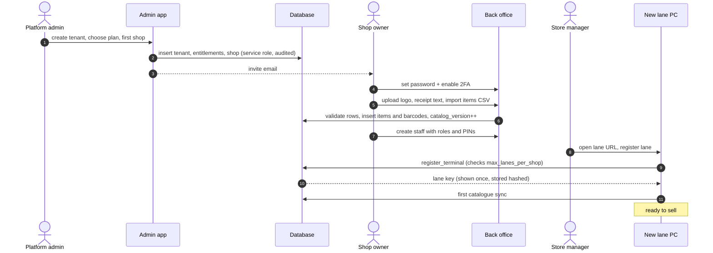

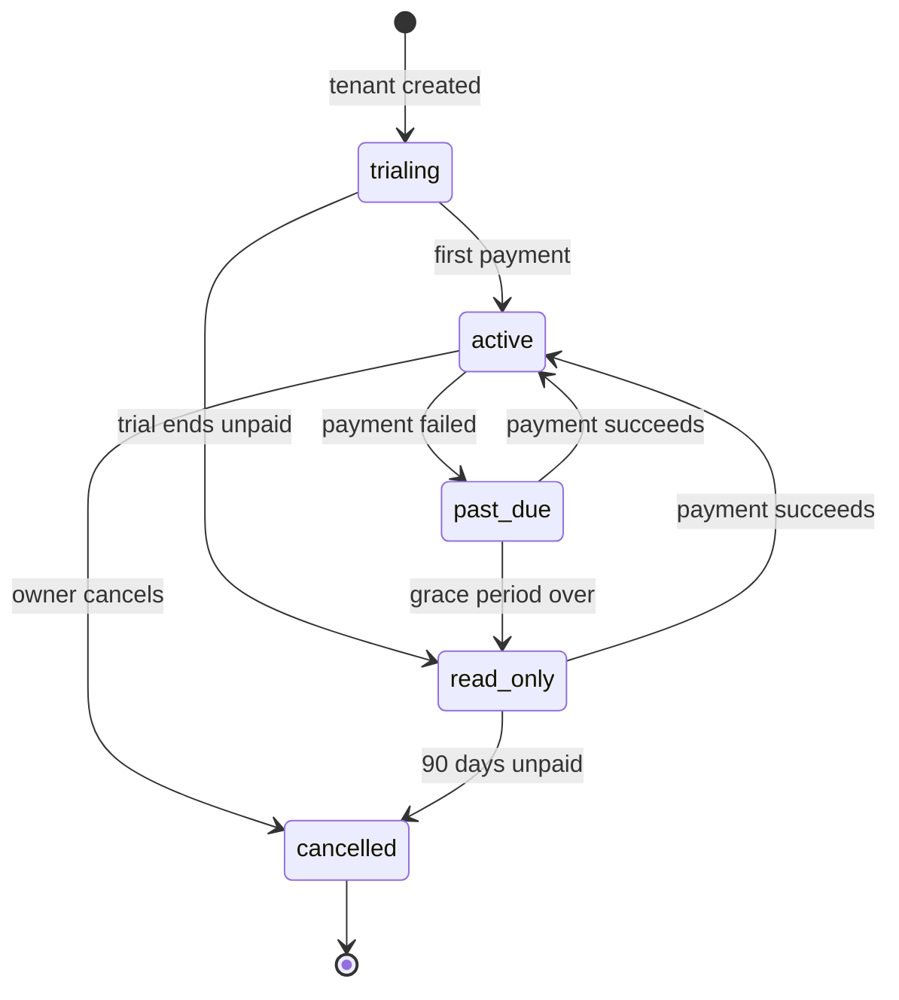

## 28.2 WF-002 Checkout

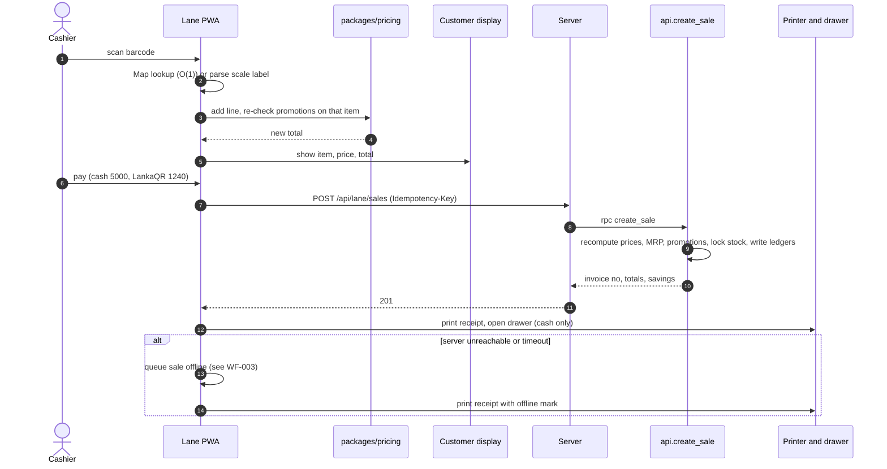

## 28.3 WF-003 Offline sale and sync

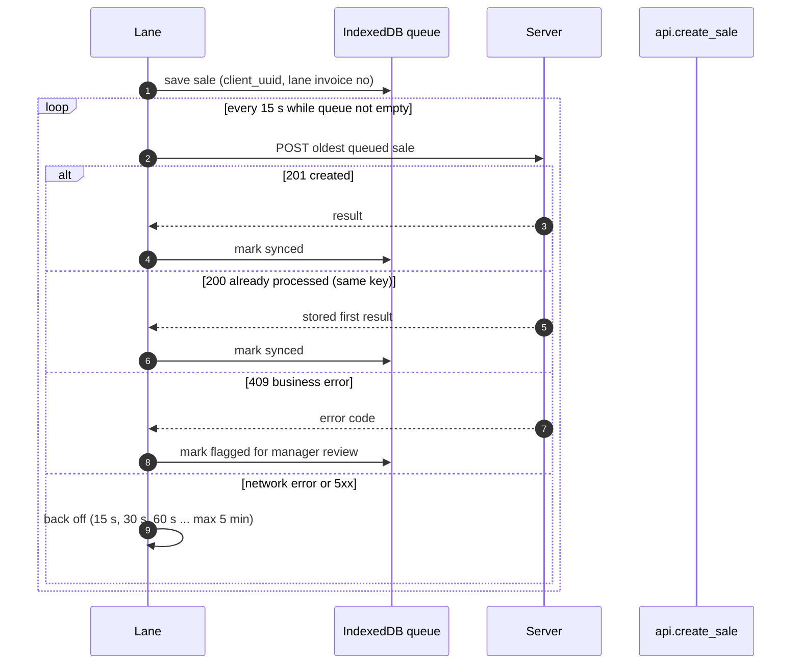

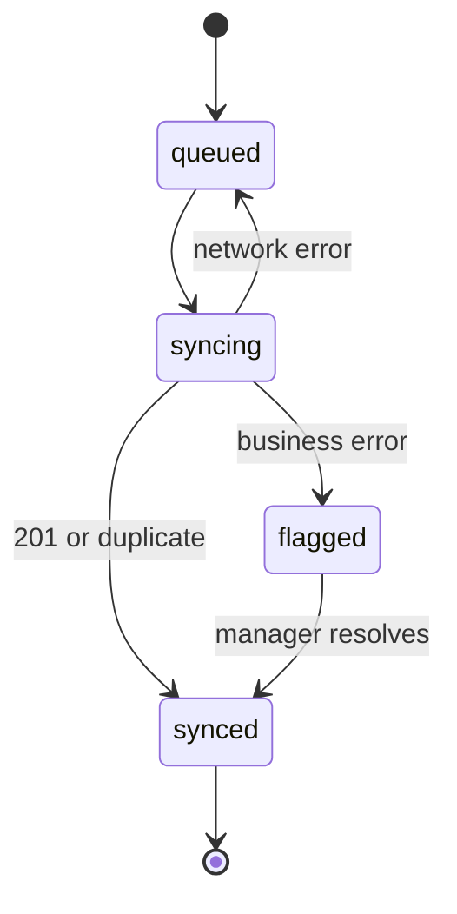

## 28.4 WF-004 Return and refund

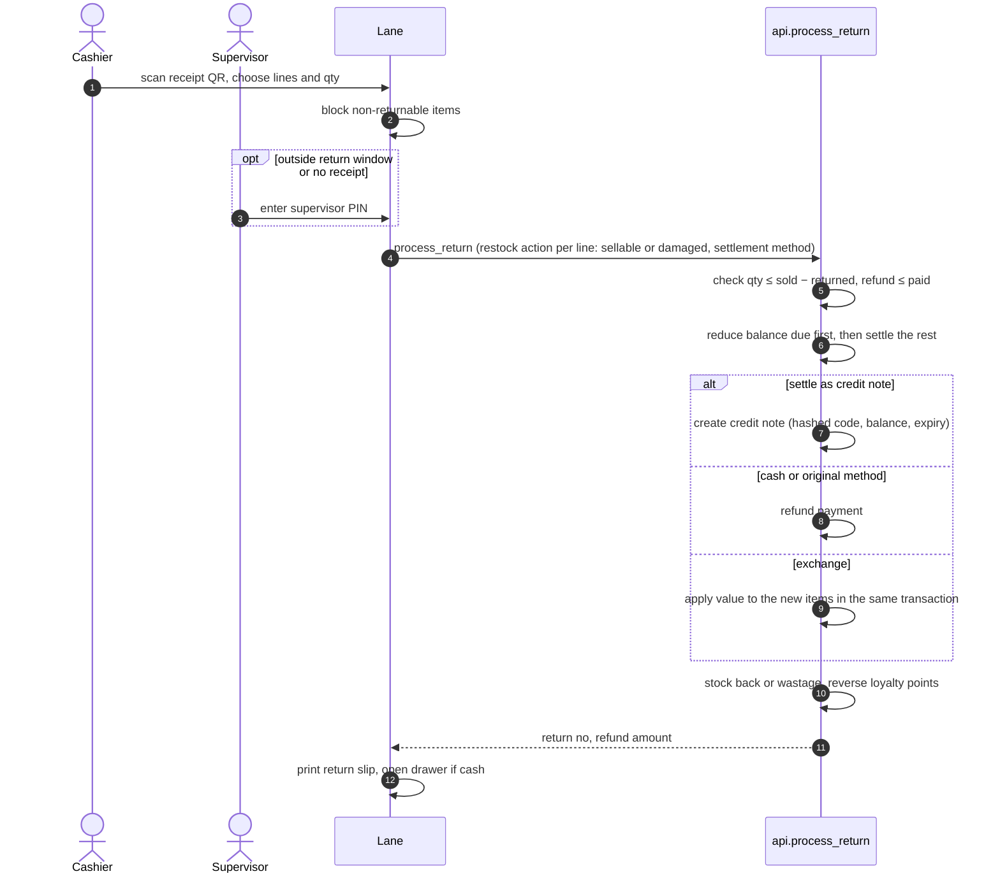

## 28.5 WF-005 GRN with batches

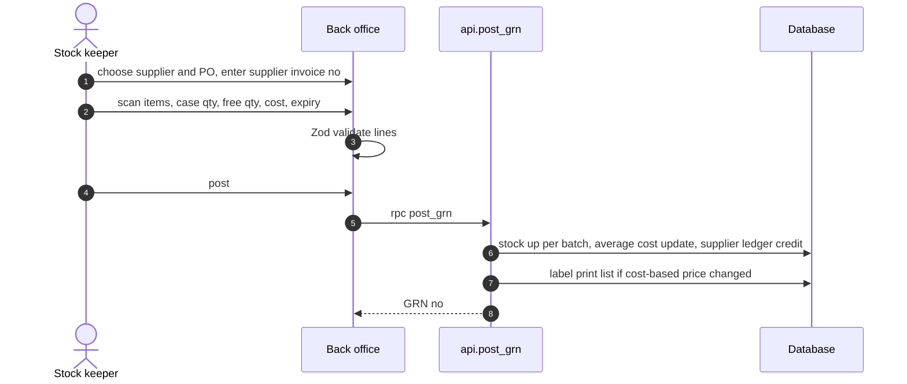

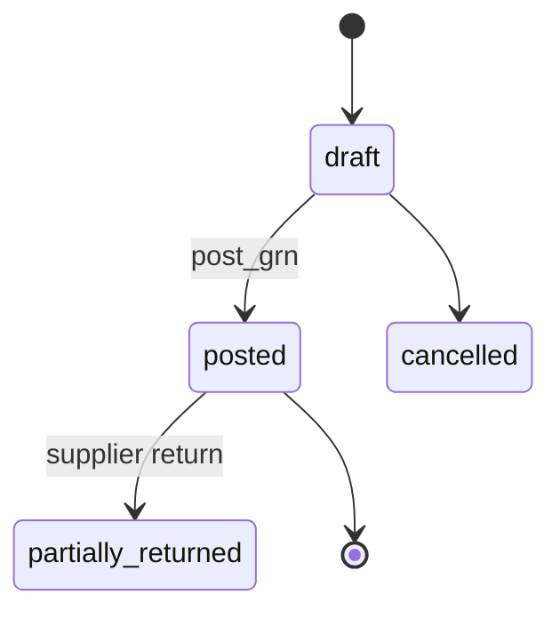

## 28.6 WF-006 Stock transfer

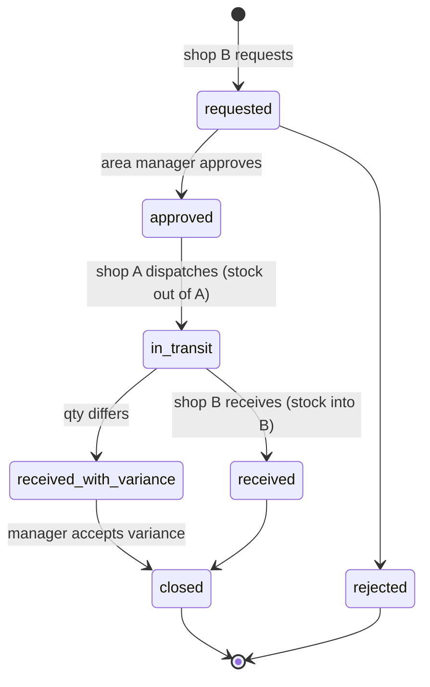

## 28.7 WF-007 Central price change

See the sequence in section 26.

## 28.8 WF-008 SaaS billing with PayHere

```mermaid
sequenceDiagram
    autonumber
    actor OW as Owner
    participant BO as Back office
    participant PH as PayHere
    participant EF as Edge Function webhook
    participant DB as Database
    OW->>BO: choose plan
    BO->>DB: subscription pending
    BO->>PH: redirect to recurring checkout
    PH-->>OW: card entry
    PH->>EF: notify (status, md5sig)
    EF->>EF: verify signature, amount, order id
    EF->>DB: subscription active, invoice, entitlements recomputed
    loop each month
        PH->>EF: RECURRING_INSTALLMENT_SUCCESS or FAILED
        EF->>DB: update status (active or past_due)
    end
    Note over DB: past_due beyond grace → read_only
```

## 28.9 WF-009 Shift and cash

```mermaid
sequenceDiagram
    autonumber
    actor C as Cashier
    actor M as Manager
    participant L as Lane
    participant F as DB functions
    C->>L: open shift, count float
    L->>F: shift_open
    loop during shift
        M->>L: cash pickup (supervisor PIN)
        L->>F: shift_pickup
    end
    C->>L: close shift, count cash by note
    L->>F: shift_close
    F-->>L: expected cash, counted, variance
    L->>L: print Z-report
    opt variance above tenant limit
        F->>F: alert owner (outbox)
    end
```

# 29. Error handling and observability

## 29.1 One error envelope everywhere

```json
{ "error": { "code": "ABOVE_MRP", "message": "Price is above the maximum retail price",
             "details": { "itemId": "…", "mrpCents": 45000 }, "requestId": "req_01J…" } }
```

`code` is stable and translated in the UI (English, Sinhala, Tamil). `message` is for developers. `requestId` links the error to logs.

## 29.2 Error catalog (excerpt — full list in DOC-15)

| Code | HTTP | Layer | Meaning | Lane behaviour | Retry? |
| --- | --- | --- | --- | --- | --- |
| `VALIDATION_ERROR` | 400 | Server | Bad shape or field | Show field errors | No |
| `UNAUTHENTICATED` | 401 | Server | No/expired session | Return to PIN screen | After login |
| `FORBIDDEN` | 403 | Function | Missing permission | Offer supervisor override | After override |
| `FEATURE_NOT_IN_PLAN` / `PLAN_LIMIT_*` | 402 | Function | Entitlement | Show upgrade message (back office) | No |
| `SUBSCRIPTION_READ_ONLY` | 402 | Function | Unpaid beyond grace | Banner; selling blocked | After payment |
| `PRICE_MISMATCH` / `ABOVE_MRP` | 409 | Function | Price rule | Reload catalogue, rescan | After sync |
| `BARCODE_MISMATCH` | 409 | Function | Scale label invalid | Rescan or weigh | No |
| `CREDIT_LIMIT` | 409 | Function | Over limit | Supervisor override or pay | After override |
| `REFUND_EXCEEDS_PAID` | 409 | Function | Refund rule | Show allowed amount | No |
| `NO_OPEN_SHIFT` | 409 | Function | Shift missing | Open shift | After fix |
| `BUSY_RETRY` | 409 | Function | Lock timeout | Silent retry, same key | Yes |
| `IDEMPOTENCY_CONFLICT` | 409 | Server | Same key, different body | Log as bug (S2) | No |
| `CREDIT_NOTE_NOT_FOUND` / `_EXPIRED` / `_USED` / `_OTHER_SHOP` | 409 | Function | Credit note cannot be used | Show reason; offer other payment | No |
| `CREDIT_NOTE_INSUFFICIENT` | 409 | Function | Amount above balance | Use remaining balance | No |
| `CREDIT_NOTE_OFFLINE` | 409 | Lane | No connection | Ask for another payment | After reconnect |
| `DAMAGED_QTY_EXCEEDED` / `DAMAGE_APPROVAL_REQUIRED` | 409 | Function | Damage rule | Show allowed qty / ask approver | After approval |
| `SESSION_RESET` | 401 | Middleware | Access was reset | Clear cookies, go to login or PIN | After login |
| `STEP_UP_REQUIRED` | 401 | Server | Sensitive action needs fresh TOTP/PIN | Show re-authentication dialog | After step-up |
| `RATE_LIMITED` | 429 | Edge | Too many requests | Wait `Retry-After` | Yes |
| `INTERNAL` | 500 | Any | Unexpected | Queue offline, alert | Yes |

## 29.3 Logging and metrics

| Signal | Tool | What | Owner |
| --- | --- | --- | --- |
| Structured logs | Vercel logs + Supabase logs (JSON: `requestId`, `tenantId`, `shopId`, `laneId`, `code`, `durationMs`) | Every API call; no personal data or secrets | P2 |
| Errors | Sentry (browser + server, PII scrubbing on) | Exceptions with release version | P4 |
| Lane telemetry | Batched metrics endpoint | scan latency, queue length, print failures | P3 |
| Database | `pg_stat_statements`, Supabase dashboard | Slow queries, locks, connections | P1 |
| Business alerts | Outbox → email/Slack | Voids, no-sale opens, refunds, cash variance, `PRICE_DRIFT`, sync backlog > 50 | P2 |
| Uptime | External monitor every 1 min | API, lane app, status page | P4 |

**Alert severity routing:** S1 alerts (checkout API down, cross-tenant RLS denial spike, sync backlog in many shops) notify all four developers by phone; S2 alerts go to the on-call developer of the week; S3 alerts go to the weekly triage issue.

# 30. Damaged goods and customer credit notes

This section designs two features end to end: keeping damaged stock aside until a decision is made, and giving customers a **credit note** (credit bill) on a return that they can spend later on something else or, if the shop allows, take as money.

## 30.1 Damaged goods management

### How it works

Every item in every shop has two stock buckets: **sellable** and **damaged**. Damaged stock is counted but cannot be scanned at the lane. Each damaged quantity is linked to a **damage report**, and a manager decides what happens to it.

| Where damage is found | How it enters the damaged bucket |
| --- | --- |
| On the shelf or in the store room | Staff creates a damage report (item, qty, reason, photo) |
| At delivery (GRN) | Stock keeper marks lines or quantities as "received damaged" |
| Customer return | Cashier chooses "damaged" as the restock action on the return line |
| Shop transfer arrives damaged | Receiving shop marks the damaged quantity |
| Stock count | Counter records damaged units separately |

| Decision | What the system does |
| --- | --- |
| **Return to supplier** | Adds the qty to a supplier return (debit note); supplier ledger credited when posted |
| **Sell at reduced price** | Moves qty back to sellable with a markdown price and prints "reduced" stickers with an in-store barcode tied to that report |
| **Write off** | Removes qty as wastage with the reason code; cost goes to the wastage report |
| **Use in store** | Removes qty as internal use (e.g. cleaning products), reported separately |

### Requirements

| ID | Pri. | Requirement |
| --- | --- | --- |
| REQ-DMG-001 | M | Each shop item has sellable and damaged quantities; damaged stock is never sold at the lane |
| REQ-DMG-002 | M | Damage report: item, batch (if tracked), qty, source, reason (broken, leaking, crushed, pest, expired, temperature, other), optional photo, note |
| REQ-DMG-003 | M | Damage can be recorded from shelf, GRN, customer return, transfer receipt and stock count |
| REQ-DMG-004 | M | Manager decision per report: return to supplier, sell reduced, write off, use in store; partial decisions allowed (e.g. 6 returned, 4 written off) |
| REQ-DMG-005 | S | Reports above a tenant value threshold (default Rs 10,000) need a second approver and a photo |
| REQ-DMG-006 | S | Supplier return created from damage reports; if the supplier rejects, the qty returns to "awaiting decision" |
| REQ-DMG-007 | M | Reports: damaged stock awaiting decision (age, value), damage by reason/supplier/category/staff, recovered value from suppliers and markdown sales |
| REQ-DMG-008 | S | Alert when damaged stock waits more than 7 days or a staff member's damage value is unusually high |

### Damage report states

```mermaid
stateDiagram-v2
    [*] --> reported: staff records damage (stock moves to damaged bucket)
    reported --> awaiting_approval: value above threshold
    awaiting_approval --> awaiting_decision: second approver confirms
    awaiting_approval --> rejected: not damaged (stock back to sellable)
    reported --> awaiting_decision
    awaiting_decision --> sent_to_supplier: return to supplier
    sent_to_supplier --> closed: supplier credit received
    sent_to_supplier --> awaiting_decision: supplier rejects
    awaiting_decision --> reduced_for_sale: markdown price set
    reduced_for_sale --> closed: sold or later written off
    awaiting_decision --> written_off: wastage posted
    awaiting_decision --> used_in_store
    written_off --> closed
    used_in_store --> closed
    rejected --> [*]
    closed --> [*]
```

### Sequence: damage found on the shelf, returned to supplier

```mermaid
sequenceDiagram
    autonumber
    actor K as Stock keeper
    participant BO as Back office (tablet)
    participant F1 as api.report_damage
    actor M as Store manager
    participant F2 as api.decide_damage
    participant F3 as api.post_supplier_return
    participant D as Database
    K->>BO: scan item, qty 6, reason "leaking", photo
    BO->>F1: report_damage
    F1->>D: stock sellable -6, damaged +6 (movements), report = reported
    F1-->>BO: DMG-KDY1-000045
    M->>BO: open "Damaged stock awaiting decision"
    M->>F2: decide: 6 → return to supplier "ABC Foods"
    F2->>D: report = sent_to_supplier, supplier return draft line
    M->>F3: post supplier return when collected
    F3->>D: damaged -6, supplier ledger credit, report closed
```

### Data

```sql
alter table stock_levels add column damaged_qty_milli bigint not null default 0
  check (damaged_qty_milli >= 0);

create type damage_source   as enum ('shelf','grn','customer_return','transfer','count');
create type damage_reason   as enum ('broken','leaking','crushed','pest','expired','temperature','other');
create type damage_status   as enum ('reported','awaiting_approval','awaiting_decision','sent_to_supplier',
                                     'reduced_for_sale','written_off','used_in_store','rejected','closed');
create type damage_decision as enum ('supplier_return','reduced_sale','write_off','internal_use');

create table damage_reports (
  id            uuid primary key default uuidv7(),
  tenant_id     uuid not null, shop_id uuid not null,
  report_no     text not null,
  item_id       uuid not null references items(id),
  batch_id      uuid references stock_batches(id),
  qty_milli     bigint not null check (qty_milli > 0),
  remaining_milli bigint not null,                 -- qty still awaiting a decision
  unit_cost_cents bigint not null,                 -- snapshot for value reports
  source        damage_source not null,
  source_ref_id uuid,                              -- GRN line, return line, transfer line, count line
  reason        damage_reason not null,
  photo_path    text,                              -- private storage path
  note          text check (char_length(note) <= 500),
  status        damage_status not null default 'reported',
  reported_by   uuid not null, approved_by uuid,
  created_at    timestamptz not null default now(),
  unique (shop_id, report_no)
);
create index damage_open on damage_reports(shop_id, created_at) where status in ('reported','awaiting_approval','awaiting_decision');

create table damage_decisions (
  id uuid primary key default uuidv7(),
  tenant_id uuid not null, damage_report_id uuid not null references damage_reports(id),
  decision damage_decision not null,
  qty_milli bigint not null check (qty_milli > 0),
  markdown_price_cents bigint,                     -- for reduced_sale
  supplier_return_id uuid,                         -- for supplier_return
  decided_by uuid not null, decided_at timestamptz not null default now()
);
```

New stock movement types: `to_damaged`, `from_damaged_to_sellable`, `damaged_supplier_return`, `damaged_write_off`, `damaged_internal_use`. The checkout function reads only the sellable quantity.

## 30.2 Customer returns and credit notes

### How it works

When a customer returns goods, the cashier picks how to give the value back:

| Option | What happens | When to use |
| --- | --- | --- |
| **Cash refund** | Money from the drawer | Customer wants money back and the shop allows it |
| **Refund to original method** | Card or LankaQR reference recorded; bank refund done on the terminal | Paid by card/QR |
| **Exchange now** | Return and new sale in one transaction; customer pays or receives the difference | Customer picks something else immediately |
| **Credit note (credit bill)** | A printed slip with a code and amount; spend it later on anything | Customer wants something else later, or shop policy prefers credit |
| **Reduce balance** | Lowers what a credit customer owes | Credit customers |

A credit note is **money the shop owes the customer**, so it is protected like cash: it has a unique unguessable code, can only be spent online with the database locking it, and keeps a balance if only part is used.

### Credit note slip (80 mm)

```text
================================================
            ABC SUPERMARKET - KANDY
               CREDIT NOTE / ණය පත
================================================
Credit note no : CN-KDY1-000123
Issued         : 15/10/2026 14:32   Lane L2
Against return : RTN-KDY1-000077 (Inv KDY1-L2-004512)
Customer       : 07X XXX 4521 (optional)
------------------------------------------------
Amount                               Rs 1,450.00
Valid until                          13/01/2027
------------------------------------------------
     [ Code 128 + QR: K7QF-9M2X-HD4T ]
  Use as payment at any ABC Supermarket shop.
  Not exchangeable for cash. Keep this slip;
  lost slips can be replaced only with the
  registered phone number.
================================================
```

### Requirements

| ID | Pri. | Requirement |
| --- | --- | --- |
| REQ-CRN-001 | M | A return can be settled as cash, original method, exchange, credit note or balance reduction, subject to tenant policy |
| REQ-CRN-002 | M | Credit note has a number (`CN-<shop>-<seq>`), a random 12-character redemption code (Crockford Base32, printed as Code 128 and QR), amount, balance, expiry and optional customer phone |
| REQ-CRN-003 | M | Credit note can pay all or part of a new bill; the remaining balance stays on the note |
| REQ-CRN-004 | M | Redemption is online only and locks the note row so it cannot be spent twice at two lanes |
| REQ-CRN-005 | M | Default validity 90 days (tenant setting 30–365); expired notes cannot be used; owner can extend with reason |
| REQ-CRN-006 | S | Lost slip: manager reissues the remaining balance with a new code after phone verification; the old code is cancelled |
| REQ-CRN-007 | S | Cash-out of a credit note only if tenant policy allows, with manager approval |
| REQ-CRN-008 | S | Chain setting: redeem at the issuing shop only, or at any shop of the tenant |
| REQ-CRN-009 | M | Reports: credit notes outstanding (liability), issued, redeemed, expired, by shop and cashier |
| REQ-CRN-010 | S | Manager can issue a goodwill credit note without a return (reason required, above Rs 2,000 needs owner) |

### Credit note states

```mermaid
stateDiagram-v2
    [*] --> active: issued on return
    active --> partially_used: part redeemed
    partially_used --> partially_used: more redeemed
    partially_used --> used: balance reaches 0
    active --> used: fully redeemed
    active --> expired: expiry date passed
    partially_used --> expired
    expired --> active: owner extends (audited)
    active --> cancelled: lost-slip reissue or void
    partially_used --> cancelled: lost-slip reissue
    active --> cashed_out: policy allows, manager approves
    partially_used --> cashed_out
    used --> [*]
    expired --> [*]
    cancelled --> [*]
    cashed_out --> [*]
```

### Sequence: return with credit note, then spend it on another visit

```mermaid
sequenceDiagram
    autonumber
    actor CU as Customer
    actor C as Cashier
    participant L as Lane
    participant R as api.process_return
    participant S as api.create_sale
    participant D as Database
    CU->>C: return 2 items, wants something else later
    C->>L: scan receipt, choose lines, restock action, settle as credit note
    L->>R: process_return (settlement = credit_note)
    R->>D: return lines, stock back (sellable or damaged), credit_notes row (hash of code, balance 1450.00)
    R-->>L: CN-KDY1-000123 + code (returned once, never stored in plain text)
    L->>L: print credit note slip
    Note over CU,L: days later, any shop of the chain
    CU->>C: buys groceries worth Rs 2,100, hands slip
    C->>L: scan slip code as payment
    L->>S: create_sale (payments: credit_note 1450.00 + cash 650.00)
    S->>D: lock credit note row, check tenant, shop rule, expiry, balance
    S->>D: redemption row, balance 0, status used, sale and cash payment
    S-->>L: invoice, remaining credit 0.00
    L->>L: receipt shows "Credit note CN-KDY1-000123 used: 1450.00"
```

### Data

```sql
create type credit_note_status as enum ('active','partially_used','used','expired','cancelled','cashed_out');

create table credit_notes (
  id             uuid primary key default uuidv7(),
  tenant_id      uuid not null, shop_id uuid not null,
  note_no        text not null,
  code_hash      bytea not null,                    -- HMAC-SHA256(code, server secret)
  code_last4     char(4) not null,                  -- for display and support
  return_id      uuid references returns(id),       -- null for goodwill notes
  customer_id    uuid references customers(id),
  phone_e164     text,
  amount_cents   bigint not null check (amount_cents > 0),
  balance_cents  bigint not null check (balance_cents >= 0 and balance_cents <= amount_cents),
  expires_on     date not null,
  status         credit_note_status not null default 'active',
  issued_by      uuid not null, reason text,
  replaced_by    uuid references credit_notes(id),  -- lost-slip reissue chain
  created_at     timestamptz not null default now(),
  unique (tenant_id, code_hash),
  unique (shop_id, note_no)
);
create index credit_notes_open on credit_notes(tenant_id, expires_on) where status in ('active','partially_used');

create table credit_note_redemptions (
  id uuid primary key default uuidv7(),
  tenant_id uuid not null, credit_note_id uuid not null references credit_notes(id),
  sale_id uuid not null, shop_id uuid not null, lane_id uuid not null,
  amount_cents bigint not null check (amount_cents > 0),
  redeemed_by uuid not null, created_at timestamptz not null default now()
);
```

**Why a hash, not the code itself:** the printed code works like a password. Storing only a keyed hash means someone who reads a database backup still cannot create a working slip. Lookup is still O(log n): the lane sends the scanned code, the server computes the same hash and finds the row through the unique index.

### Rules inside `create_sale` for a credit note payment

1. Compute `hmac(code)`; find the note with `FOR UPDATE` (blocks a second lane until this sale commits).
2. Reject if not found (`CREDIT_NOTE_NOT_FOUND`), wrong tenant, shop rule fails (`CREDIT_NOTE_OTHER_SHOP`), expired (`CREDIT_NOTE_EXPIRED`), already used or cancelled (`CREDIT_NOTE_USED`).
3. Amount used = min(requested, balance, bill total); reject if requested > balance (`CREDIT_NOTE_INSUFFICIENT`).
4. Insert redemption, reduce balance, set status `partially_used` or `used`.
5. A later return of goods paid with a credit note is refunded **back to a credit note**, never to cash, unless the owner approves.
6. Offline lanes show "Credit notes need a connection" (`CREDIT_NOTE_OFFLINE`) and cannot accept them.

### Accounting

| Event | Effect |
| --- | --- |
| Credit note issued on return | Sales reversed; **credit note liability** up; no cash leaves the drawer |
| Credit note redeemed | Liability down; counts as payment for the new sale |
| Credit note expires | Liability released to "expired credit" income (confirm treatment with accountant) |
| Cash-out | Liability down; cash down (shift cash movement) |

## 30.3 API additions

| Method + path | Function | Permission |
| --- | --- | --- |
| `POST /api/lane/damage` · Server Action `damage.report` | `api.report_damage` | `wastage.post` |
| Server Action `damage.approve` | `api.approve_damage` | `stock.adjust` (second person) |
| Server Action `damage.decide` | `api.decide_damage` | `stock.adjust` |
| `GET /api/lane/credit-notes/:code` | `api.check_credit_note` (balance, expiry, shop rule; rate limited) | `sale.create` |
| `POST /api/lane/returns` (settlement `credit_note`) | `api.process_return` | `return.create` |
| `POST /api/lane/sales` (payment `credit_note`) | `api.create_sale` | `sale.create` |
| Server Action `creditNotes.reissue` | `api.reissue_credit_note` | `refund.cash` + phone check |
| Server Action `creditNotes.extend` / `cashOut` / `goodwill` | `api.extend_credit_note` / `api.cash_out_credit_note` / `api.issue_goodwill_credit_note` | owner / manager per policy |
| Server Action `security.resetAccess` | `api.reset_access` | per scope (27.5.4) |
| Server Action `security.listSessions` / `signOutSession` | `api.list_sessions` / `api.end_session` | self, owner, manager |

The credit-note check endpoint is limited to 10 lookups per minute per lane, and 5 failed codes in a row lock the lookup for 5 minutes, which makes guessing codes impractical.

## 30.4 Tests

| Test ID | Checks |
| --- | --- |
| TC-DMG-001 | Damaged qty cannot be sold; lane shows sellable qty only |
| TC-DMG-002 | Partial decisions add up to the reported qty; no negative damaged stock |
| TC-DMG-003 | Supplier rejection returns qty to awaiting decision |
| TC-DMG-004 | Reduced-sale barcode sells at markdown price and closes the report when sold out |
| TC-DMG-005 | Above-threshold report blocked until a different user approves |
| TC-CRN-001 | Return settled as credit note: no cash movement, liability up, slip printed once |
| TC-CRN-002 | Partial redemption keeps the correct balance across two visits |
| TC-CRN-003 | Two lanes redeem the same note at the same time: exactly one succeeds |
| TC-CRN-004 | Expired, cancelled, other-tenant and wrong-shop notes rejected with the right code |
| TC-CRN-005 | Lost-slip reissue cancels the old code; old slip rejected |
| TC-CRN-006 | Plain code never stored; 5 wrong codes lock lookup; guessing test |
| TC-CRN-007 | Return of goods bought with a credit note goes back to credit, not cash |
| TC-SEC-011..013 | Session reset by user, lane, shop and tenant scope ends access within 30 s; cookies cleared; host-only cookie attributes present |

---

# Part III — Team delivery plan

# 31. Team structure and ownership

Four developers each **own** an area (they decide and review it) but every slice needs work from several people, so everyone also **contributes** outside their area. Owning means "must review and approve", not "only person allowed to touch".

| Person | Role | Owns | Also contributes |
| --- | --- | --- | --- |
| **P1** | Tech Lead · Database & Security | Schema, migrations, RLS, auth hook, permissions, `SECURITY DEFINER` functions review, security reviews, ADRs, release approval | Core DB functions with P2, pgTAP, seed data |
| **P2** | Backend & Integrations | DB business functions (`create_sale`, `post_grn`, …), Route Handlers, Edge Functions, `packages/core`, error catalog, PayHere, SMS, catalogue sync, public API | Pricing engine SQL parity with P3, contract tests |
| **P3** | Lane (POS) & Devices | Lane PWA, `packages/pricing`, `packages/barcode`, `packages/devices`, offline queue, printing, scale, customer display | Lane E2E tests, device test matrix, receipt templates |
| **P4** | Back office, QA & DevOps | Back office and admin UI, `packages/ui`, CI/CD, environments, Playwright/k6, Sentry, release process | Reports UI, CSV import UI, docs site |
| **PO** | Product Owner (can be one of the four, or the founder) | Priorities, requirements, acceptance, pilot relationship | Sprint demo, UAT |

## 31.1 RACI for recurring work

R = does the work, A = accountable (final say), C = consulted, I = informed.

| Activity | P1 | P2 | P3 | P4 | PO |
| --- | --- | --- | --- | --- | --- |
| Write / change requirements | C | C | C | C | **A/R** |
| Database migration | **A/R** | R | C | I | I |
| DB business function | A | **R** | C | I | C |
| Lane feature | C | C | **A/R** | C | C |
| Back office feature | C | C | I | **A/R** | C |
| Pricing engine change | C | R | **A/R** | I | C |
| Security review | **A/R** | C | C | C | I |
| CI/CD and environments | C | I | I | **A/R** | I |
| Release to production | **A** | R | R | R | A |
| Bug triage (weekly) | R | R | R | **A/R** | C |

## 31.2 Expected effort split (whole project)

```mermaid
pie showData
    title Estimated effort by area (person-weeks, total ≈ 120)
    "Database, security & functions (P1/P2)" : 34
    "Backend APIs & integrations (P2)" : 20
    "Lane PWA, pricing & devices (P3)" : 28
    "Back office & admin UI (P4)" : 22
    "QA, CI/CD & operations (P4)" : 10
    "Docs, ADRs & reviews (all)" : 6
```

# 32. GitHub collaboration setup

## 32.1 Repository settings (set up by P4 in Phase 0)

| Setting | Value | Why |
| --- | --- | --- |
| Visibility | Private | Commercial product |
| Default branch | `main`, protected | Always deployable to staging |
| Merge method | **Squash merge only**; delete branch after merge | One clean commit per PR, easy revert |
| Branch protection on `main` | Require PR · ≥ 1 approval · approval from CODEOWNERS · all status checks pass · branch up to date · linear history · no force push · no deletion | Nobody can break `main` alone |
| Extra protection | Changes in `supabase/migrations/**`, `apps/web/middleware.ts`, `lib/server/admin.ts` need **2 approvals including P1** | Highest-risk files |
| Secret scanning + push protection | On | Stops committed keys |
| Dependabot | Weekly, grouped minor updates | Supply chain |
| Environments | `staging` (auto), `production` (required reviewers: P1 + PO) | Controlled releases |

## 32.2 Branching and commits

Trunk-based development: short branches (1–3 days), merged back to `main` through PRs. Unfinished features hide behind feature flags in `tenant_entitlements.features` or a dev-only flag, so `main` stays releasable.

```mermaid
gitGraph
    commit id: "v1.0.0"
    branch feat-SAL-004
    checkout feat-SAL-004
    commit id: "parse scale label"
    commit id: "weighed line UI"
    checkout main
    branch feat-INV-002
    checkout feat-INV-002
    commit id: "migration stock_batches"
    checkout main
    merge feat-SAL-004 id: "squash SAL-004"
    checkout feat-INV-002
    commit id: "FEFO consume"
    checkout main
    merge feat-INV-002 id: "squash INV-002"
    commit id: "v1.1.0" tag: "v1.1.0"
    branch hotfix-BUG-231
    checkout hotfix-BUG-231
    commit id: "fix rounding"
    checkout main
    merge hotfix-BUG-231 id: "v1.1.1" tag: "v1.1.1"
```

| Item | Convention | Example |
| --- | --- | --- |
| Branch | `type/ISSUE-short-name` | `feat/SAL-004-weighed-items`, `fix/BUG-231-rounding`, `docs/ADR-0009` |
| Commit message | [Conventional Commits](https://www.conventionalcommits.org) | `feat(lane): parse embedded-price barcodes (#142)` |
| PR title | Same as squash commit | `feat(db): add stock_batches with FEFO index (#150)` |
| Release tag | SemVer `vMAJOR.MINOR.PATCH` | `v1.1.0` |

## 32.3 Labels

| Group | Labels |
| --- | --- |
| Type | `type:requirement` · `type:task` · `type:bug` · `type:change-request` · `type:spike` · `type:docs` |
| Area | `area:db` · `area:security` · `area:api` · `area:lane` · `area:devices` · `area:backoffice` · `area:admin` · `area:ci` |
| Severity (bugs) | `sev:S1` · `sev:S2` · `sev:S3` · `sev:S4` |
| Priority | `prio:P0` (now) · `prio:P1` (this sprint) · `prio:P2` (next) · `prio:P3` (later) |
| Slice | `slice:001` … `slice:013` |
| State helpers | `blocked` · `needs-info` · `good-first-task` |

## 32.4 GitHub Project board

One GitHub Project (table + board views) for all work. **Custom fields:** Status, Priority, Size (XS 1h · S ½ day · M 1–2 days · L 3–5 days, split anything larger), Sprint (iteration, 2 weeks), Slice, Owner, Milestone (M0–M6), Requirement ID.

```mermaid
flowchart LR
    BL["Backlog"] --> RD["Ready<br/>(meets Definition of Ready)"]
    RD --> IP["In progress<br/>(WIP limit 2 per person)"]
    IP --> RV["In review<br/>(PR open, CI green)"]
    RV --> QA["QA on staging"]
    QA --> DN["Done<br/>(meets Definition of Done)"]
    RV -->|"changes requested"| IP
    QA -->|"bug found"| IP
```

**Views:** "My work" (filter Owner = @me), "Sprint board" (current iteration by Status), "Bugs" (type:bug sorted by severity), "Roadmap" (by Milestone and Slice), "Requirements traceability" (REQ issues with linked PRs and tests).

## 32.5 Pull request flow

```mermaid
sequenceDiagram
    autonumber
    actor Dev as Author
    participant GH as GitHub
    participant CI as GitHub Actions
    actor Rev as Reviewer (CODEOWNER)
    participant VP as Vercel preview
    Dev->>GH: push branch, open PR (template filled, links issue)
    GH->>CI: run checks
    CI->>CI: lint · typecheck · unit · pgTAP · build · gitleaks · audit
    CI->>VP: deploy preview
    CI-->>GH: status checks
    GH->>Rev: auto-request review (CODEOWNERS)
    Rev->>VP: try the change
    alt changes needed
        Rev->>GH: request changes
        Dev->>GH: push fixes
    else approved
        Rev->>GH: approve
        Dev->>GH: squash merge
        GH->>CI: deploy main to staging, run migrations, E2E
    end
```

**Review rules:** review within one working day; reviewer checks requirement acceptance criteria, tests, security checklist, migrations, error codes; small PRs (< 400 changed lines) get faster reviews.

## 32.6 CI/CD pipeline

```mermaid
flowchart LR
    subgraph PR["On every pull request"]
        A["install (pnpm, cache)"] --> B["lint + typecheck"]
        B --> C["unit tests<br/>(Vitest)"]
        A --> D["supabase start<br/>apply migrations"]
        D --> E["pgTAP tests<br/>RLS coverage"]
        A --> F["security<br/>gitleaks · audit · CodeQL"]
        C --> G["build"]
        E --> G
        F --> G
        G --> H["Vercel preview"]
    end
    subgraph Main["On merge to main"]
        I["migrate staging DB"] --> J["deploy staging"] --> K["Playwright E2E<br/>k6 smoke"]
    end
    subgraph Release["On tag vX.Y.Z"]
        L["approval: P1 + PO"] --> M["migrate production"] --> N["deploy production"] --> O["smoke test + Sentry release"]
    end
    H --> I
    K --> L
```

## 32.7 How four people avoid stepping on each other

1. **Contract first.** Before parallel work on a slice, P2 merges the Zod schema and function signature (with a stub that returns fake data). P3 and P4 build UI against the stub while P1/P2 write the real function.
2. **Generated types.** After each migration, `packages/db-types` is regenerated and committed in the same PR, so everyone's TypeScript sees new columns immediately.
3. **Feature flags** keep half-finished slices hidden on staging and production.
4. **One owner per file area** (CODEOWNERS) but anyone may open a PR; the owner reviews.
5. **Daily rebase** on `main` for branches older than one day.
6. **Seed data shared** so bug reports reproduce on every machine.
7. **No direct changes to shared databases**; all changes go through migrations.

# 33. Phases, milestones and parallel work

The project runs in four phases and two-week sprints. Each milestone is a **demonstrable result with exit criteria**, not a date alone. Dates assume a start on Monday 2 November 2026, four developers, and a reduced holiday sprint in late December; adjust them in GitHub Milestones if the team's capacity differs.

## 33.1 Timeline

```mermaid
gantt
    title LaneOS delivery plan (2-week sprints)
    dateFormat YYYY-MM-DD
    axisFormat %d %b
    section Phase 0 Foundations
    S0 repo, CI, schema base, auth           :p0, 2026-11-02, 2026-11-13
    M0 Foundations ready                     :milestone, m0, 2026-11-13, 0d
    section Phase 1 MVP
    S1 Tenancy + catalogue (SLICE-001/002)   :s1, 2026-11-16, 2026-11-27
    M1 Catalogue imported                    :milestone, m1, 2026-11-27, 0d
    S2 First sale on hardware (SLICE-003)    :s2, 2026-11-30, 2026-12-11
    M2 First real sale                       :milestone, m2, 2026-12-11, 0d
    S3 Offline lane + returns (SLICE-004/005, holiday sprint) :s3, 2026-12-14, 2027-01-08
    S4 Credit, shifts, stock, promos (SLICE-005/006) :s4, 2027-01-11, 2027-01-22
    S5 Reports, branding, hardening (SLICE-007) :s5, 2027-01-25, 2027-02-05
    M3 MVP v1.0 released                     :milestone, m3, 2027-02-05, 0d
    section Pilot
    Pilot shop live (2 weeks)                :pl, 2027-02-08, 2027-02-19
    M4 Pilot signed off                      :milestone, m4, 2027-02-19, 0d
    section Phase 2 Chain
    S6 Purchasing + batches (SLICE-008)      :s6, 2027-02-22, 2027-03-05
    S7 Promotions+, loyalty, billing (SLICE-009/011) :s7, 2027-03-08, 2027-03-19
    S8 Head office, central prices, transfers (SLICE-010) :s8, 2027-03-22, 2027-04-02
    S9 Advanced reports + hardening (SLICE-012, New Year buffer) :s9, 2027-04-05, 2027-04-23
    M5 v1.2 chain release                    :milestone, m5, 2027-04-23, 0d
    section Phase 3 Scale
    S10-S12 API, domains, PowerSync, scale export (SLICE-013) :s10, 2027-04-26, 2027-06-04
    M6 v2.0 platform release                 :milestone, m6, 2027-06-04, 0d
```

## 33.2 Milestones and exit criteria

| Milestone | Date | Exit criteria (all must be true) | Evidence | Approver |
| --- | --- | --- | --- | --- |
| **M0 Foundations ready** | 13 Nov 2026 | Monorepo, CI green, staging deployed; base schema + forced RLS; auth hook claims; seed data; templates and board live; ADR-0001..0007 merged | CI run, staging URL, board screenshot | P1 |
| **M1 Catalogue imported** | 27 Nov 2026 | Admin creates tenant; owner 2FA login; cashier PIN on registered lane; 3,000-item CSV import < 2 min with per-row errors; isolation suite passes | Demo recording, pgTAP report | PO + P1 |
| **M2 First real sale** | 11 Dec 2026 | 20-item basket with a scale label and a weighed item, cash + LankaQR, receipt printed on 80 mm printer, drawer opens; scan < 50 ms | Demo on real hardware, telemetry | PO |
| **M3 MVP v1.0** | 5 Feb 2027 | SLICE-001..007 done; offline 30-sale sync with 0 duplicates; returns with credit notes, credit customers, shifts, simple promos, stock with damaged goods, reports, branding, access reset at all scopes; no open S1/S2 bugs; security checklist and k6 targets met | Release issue with reports | PO + P1 |
| **M4 Pilot signed off** | 19 Feb 2027 | Real shop used LaneOS for 2 weeks; 0 lost sales; cash variance explained; pilot owner signs; top 10 feedback items triaged | Pilot report, sign-off | PO |
| **M5 v1.2 Chain release** | 23 Apr 2027 | Purchasing with batches and expiry, sale-or-return, full promotions, loyalty, PayHere billing, head office, central prices, transfers; 3-shop demo chain on staging | Release issue | PO + P1 |
| **M6 v2.0 Platform** | 4 Jun 2027 | Public API with keys and docs, custom domains, PowerSync offline, scale PLU export; external security review done | Release issue + review report | PO + P1 |

## 33.3 Who does what, sprint by sprint (parallel work)

Each row is one sprint; each column is one person working **at the same time**. Arrows (→) mark a hand-off another person depends on, so it must land early in the sprint.

| Sprint | P1 — DB & Security | P2 — Backend & Integrations | P3 — Lane & Devices | P4 — Back office, QA & DevOps |
| --- | --- | --- | --- | --- |
| **S0** Foundations | Base schema (tenants, shops, terminals, roles), RLS helpers, auth hook, pgTAP harness, seed → *all* | `packages/core` (money, qty, error codes, Zod base), Supabase server client, error mapper | Lane PWA shell, offline-ready service worker, device spike (printer, drawer, scanner) | Monorepo, Turborepo, CI pipeline, Vercel + Supabase staging, templates, board, CODEOWNERS |
| **S1** Tenancy + catalogue | Entitlement triggers, catalogue tables (items, units, barcodes, price lists, tax classes), RLS tests, **cookie settings, automatic session resets, `session_resets` + middleware check** | Catalogue functions + CSV import Edge Function → P4; `catalog_delta` → P3 | `packages/barcode` (EAN, PLU, embedded price) + tests; local catalogue cache | Platform admin UI (tenants, plans), back office items UI, CSV import screen |
| **S2** First sale | Sales, payments, movements tables with partitions; `next_number`; idempotency table | `create_sale` function, `/api/lane/sales`, contract tests | `packages/pricing` v1, checkout screen, scale label flow, ESC/POS printing, drawer, customer display | Shift UI in back office, Playwright checkout E2E, Sentry |
| **S3** Offline + returns | Return/refund tables, **credit note + redemption tables (hashed codes)**, constraints, ledger reversal rules | `process_return` with **credit note settlement**, **credit note redemption in `create_sale`**, retry/duplicate semantics, sync endpoint hardening | Offline queue (IndexedDB), sync loop, receipts offline mark, return screen, **credit note slip printing and scan-to-pay** | Offline E2E (network off), staging data reset job, holiday on-call rota |
| **S4** Credit, shifts, stock, promos | Customer ledger, shifts, stock adjustments, wastage, promotions, **damage report tables, damaged stock column** | `receive_payment`, shift functions, `post_wastage`, **`report_damage`, `decide_damage`**, simple promotions in SQL | Credit sale UI, shift open/close, supervisor PIN override, simple promos in engine, **damaged option on return lines** | Stock, wastage, **damaged-stock queue and decision screen**, customers, promotions screens; parity tests lane vs server |
| **S5** Reports + hardening | Summary tables, **`reset_access`, `list_sessions`, tenant security settings**, security review, backup/restore drill | Reports functions (incl. credit-note liability, damage), SMS outbox, perf tuning (k6) | Performance pass (scan < 50 ms), Sinhala/Tamil receipt images, device matrix | Dashboard and reports UI, branding settings, **Active sessions screen, Reset access buttons, Security settings page**, release v1.0, runbook |
| **Pilot** | On-call, DB monitoring | On-call, bug fixes | On-site lane support, hardware issues | Feedback triage, release patches |
| **S6** Purchasing | Suppliers, PO, GRN, batches, supplier ledger tables | `post_grn`, supplier returns, payments | Lane FEFO display, expiry warnings | Purchasing UI, GRN screen, counts UI |
| **S7** Promos+ & billing | Loyalty tables, subscription tables | Promotions v2 SQL parity, loyalty functions, **PayHere webhook** | Promotions v2 engine (multi-buy, mix and match), loyalty at lane | Promotions builder UI, billing pages, plan upgrade flow |
| **S8** Chain | Head-office roles, price schedules, transfer tables | `apply_price_schedule` (pg_cron), transfer functions | Lane receives schedules, label print list | Head office dashboard, transfers UI, shop comparison |
| **S9** Reports + hardening | Archiving partitions job, security review v1.2 | Shrinkage, expiry, promo-effect reports | Lane polish from pilot feedback | Release v1.2, load test 8 lanes × 30 sales/min |
| **S10–S12** Platform | API key tables, scopes, external review fixes | Public `/v1` API, OpenAPI, webhooks out, scale PLU export | PowerSync migration of lane | Custom domains (Vercel API), API docs site, v2.0 release |

## 33.4 Dependencies between people (critical path)

```mermaid
flowchart LR
    A["P1: base schema + RLS (S0)"] --> B["P1: catalogue tables (S1)"]
    B --> C["P2: catalogue functions + delta (S1)"]
    C --> D["P3: local catalogue + scanning (S1)"]
    C --> E["P4: items UI + CSV import (S1)"]
    A --> F["P1: sales tables (S2)"]
    F --> G["P2: create_sale (S2)"]
    D --> H["P3: checkout + printing (S2)"]
    G --> H
    H --> I["P3: offline queue (S3)"]
    G --> I
    I --> J["M3 MVP"]
    E --> J
```

The longest chain runs through **schema → `create_sale` → checkout → offline sync**, so P1 and P2 must deliver contracts in the first three days of each sprint.

# 34. Sprint cadence and communication

| When | Meeting / ritual | Length | Output |
| --- | --- | --- | --- |
| Sprint day 1 (Monday) | **Planning**: pick slice issues from Ready, split into tasks ≤ L, assign owners, agree contracts | 60 min | Sprint iteration filled; contracts list |
| Every day | **Async stand-up** in the team chat thread: yesterday, today, blockers | 5 min each | Blockers labelled `blocked` |
| Tue + Thu | **Pairing slot** for cross-area hand-offs (e.g. P2 + P3 on pricing parity) | 60 min | Merged contract or fix |
| Wednesday | **Bug triage** (P4 leads): new bugs get severity, priority, owner | 30 min | Triaged bug list |
| Sprint last day | **Demo** of finished slices on staging to PO | 45 min | Accepted / rejected stories |
| Sprint last day | **Retro**: keep, stop, try | 30 min | 1–3 action items as issues |
| Sprint last day | **Release** (from S5 on): tag, deploy, release notes | 30 min | GitHub Release |

**Capacity rule:** plan only 70% of available hours; the rest absorbs bugs, reviews and surprises. **WIP limit:** each person has at most 2 issues "In progress".

# 35. Requirement management

## 35.1 Requirement lifecycle

```mermaid
stateDiagram-v2
    [*] --> proposed: issue opened (requirement form)
    proposed --> refined: PO + owner add acceptance criteria
    refined --> ready: meets Definition of Ready
    ready --> in_progress: assigned in sprint
    in_progress --> in_review: PR open
    in_review --> verified: tests + demo accepted
    verified --> released: in a tagged release
    proposed --> rejected
    refined --> deferred: not this release
    deferred --> refined
    released --> changed: change request approved
    changed --> refined
```

## 35.2 How a requirement is written

Every requirement is a GitHub issue using the `type:requirement` form (Appendix A) with:

- **ID** `REQ-<AREA>-<NNN>` (e.g. `REQ-SAL-004`) — stable forever, never reused.
- **User story:** *As a cashier, I want to scan a scale label, so that weighed items are priced without typing.*
- **Acceptance criteria** in Given/When/Then form:
  - *Given* an item with PLU 01234 priced Rs 480.00/kg, *when* the cashier scans the price-embedded label `2001234450102` (prefix 20, PLU 01234, price 450.10, check digit 2), *then* a line shows Rs 450.10 and about 0.938 kg (rule from DOC-05).
  - *Given* a label with a wrong check digit, *when* scanned, *then* the lane shows "Rescan label" and adds nothing.
- **Business rules** referenced (`BR-010`), **NFRs** (`NFR-PERF-001`), **slice** (`SLICE-003`), **priority** (MoSCoW).
- **Test IDs** added when tests exist (`TC-SAL-007`, `TC-SAL-008`).

## 35.3 Traceability

The traceability matrix (`docs/17-traceability.md`) is generated weekly from GitHub (issues → linked PRs → test files that mention the REQ ID). Any requirement without a PR or a test is flagged.

| Requirement | Capability | Slice | PRs | Tests | Status |
| --- | --- | --- | --- | --- | --- |
| REQ-SAL-004 Scale labels | CAP-005 | SLICE-003 | #142, #147 | TC-SAL-007, TC-SAL-008 | Verified |
| REQ-OFF-002 Exactly-once sync | CAP-006 | SLICE-004 | #171 | TC-OFF-002 | In review |
| REQ-RET-002 Refund ≤ paid | CAP-007 | SLICE-005 | — | — | Ready |
| REQ-CRN-004 No double spend | CAP-020 | SLICE-005 | — | TC-CRN-003 (planned) | Ready |
| REQ-SES-003 Reset user access | CAP-021 | SLICE-007 | — | TC-SEC-012 (planned) | Refined |

# 36. Bug and error management

## 36.1 Bug lifecycle

```mermaid
stateDiagram-v2
    [*] --> new: bug form submitted
    new --> needs_info: cannot reproduce
    needs_info --> new: info added
    new --> triaged: severity + priority + owner
    triaged --> in_progress
    in_progress --> in_review: PR with regression test
    in_review --> fixed_on_staging: merged
    fixed_on_staging --> verified: reporter or QA confirms
    verified --> closed: released
    fixed_on_staging --> reopened: still failing
    reopened --> in_progress
    new --> wont_fix: by design / duplicate
```

## 36.2 Severity × priority and response times

| Severity | Typical priority | First response | Fix target | Who is paged |
| --- | --- | --- | --- | --- |
| S1 Critical (data leak, wrong money, checkout down, lost sales) | P0 | 15 min | Hotfix ≤ 4 h in production | All four |
| S2 Major (core flow broken, no workaround) | P0 / P1 | 4 h | ≤ 2 days | On-call of the week |
| S3 Minor (workaround exists) | P2 | 1 working day | Next sprint | Triage |
| S4 Cosmetic | P3 | Weekly triage | When convenient | Triage |

## 36.3 Rules

1. **Every bug fix includes a regression test** that fails before the fix.
2. **S1 bugs** get a short **post-incident review** in `docs/incidents/YYYY-MM-DD-title.md`: timeline, cause, fix, prevention (blameless).
3. **Errors in production** (Sentry) with more than 10 events/day automatically open a `type:bug` issue via the Sentry–GitHub integration; P4 triages them on Wednesday.
4. **Lane-reported problems** from shops come through a support form that creates a bug issue with tenant, shop, lane, time and `requestId`.
5. **On-call rota:** one developer per week (rotating P1 → P2 → P3 → P4) watches alerts and handles S2 bugs; S1 involves everyone.
6. **Error codes** are added to the catalog (section 29.2) in the same PR that introduces them.

# 37. Definition of Ready and Definition of Done

**Definition of Ready** (an issue may enter a sprint when):

- [ ] Has an ID, user story and Given/When/Then acceptance criteria
- [ ] Linked to capability, slice and milestone
- [ ] Data changes and API contract sketched (fields, function name, error codes)
- [ ] Size ≤ L (otherwise split)
- [ ] Dependencies on other people identified and scheduled
- [ ] Security or privacy impact noted (or "none")

**Definition of Done** (an issue may close when):

- [ ] Code merged to `main` through a reviewed PR; CI green
- [ ] Acceptance criteria demonstrated on staging
- [ ] Unit, pgTAP and/or E2E tests added; coverage rules met
- [ ] Migrations reviewed by P1; types regenerated
- [ ] New error codes added to the catalog and UI translations
- [ ] Docs updated (requirement status, API doc, ADR if a decision was made)
- [ ] No new high security findings; no secrets; no `console.log` of personal data
- [ ] Feature flag state decided (on/off per plan)

---

# Appendix A — GitHub templates

Copy these into the repository in Phase 0 (P4). Issue forms live in `.github/ISSUE_TEMPLATE/`.

## A.1 Bug report — `.github/ISSUE_TEMPLATE/bug.yml`

```yaml
name: Bug report
description: Something is broken or wrong
title: "[BUG] "
labels: ["type:bug", "needs-triage"]
body:
  - type: dropdown
    id: severity
    attributes:
      label: Severity (reporter's view, triage confirms)
      options: ["S1 Critical - data leak, wrong money, checkout down", "S2 Major - no workaround", "S3 Minor - workaround exists", "S4 Cosmetic"]
    validations: { required: true }
  - type: dropdown
    id: area
    attributes:
      label: Area
      options: [lane, devices, backoffice, admin, api, db, security, billing, reports]
    validations: { required: true }
  - type: input
    id: env
    attributes: { label: "Environment and version", placeholder: "staging v1.0.3 / production v1.1.0" }
    validations: { required: true }
  - type: input
    id: ids
    attributes: { label: "Tenant / shop / lane / requestId (no personal data)", placeholder: "tenant demo-2, shop KDY1, lane L2, req_01J..." }
  - type: textarea
    id: steps
    attributes: { label: Steps to reproduce, placeholder: "1. ...\n2. ...\n3. ..." }
    validations: { required: true }
  - type: textarea
    id: expected
    attributes: { label: Expected result }
    validations: { required: true }
  - type: textarea
    id: actual
    attributes: { label: Actual result (error code, screenshot, Sentry link) }
    validations: { required: true }
  - type: input
    id: req
    attributes: { label: Related requirement ID, placeholder: "REQ-SAL-004" }
```

## A.2 Requirement — `.github/ISSUE_TEMPLATE/requirement.yml`

```yaml
name: Requirement
description: A new or changed system behaviour
title: "REQ-<AREA>-<NNN>: "
labels: ["type:requirement"]
body:
  - type: input
    id: reqid
    attributes: { label: Requirement ID, placeholder: "REQ-SAL-004" }
    validations: { required: true }
  - type: textarea
    id: story
    attributes: { label: User story, placeholder: "As a <role>, I want <capability>, so that <benefit>." }
    validations: { required: true }
  - type: textarea
    id: ac
    attributes: { label: Acceptance criteria (Given / When / Then) }
    validations: { required: true }
  - type: input
    id: links
    attributes: { label: "Capability / slice / business rules / NFRs", placeholder: "CAP-005, SLICE-003, BR-010, NFR-PERF-001" }
  - type: dropdown
    id: moscow
    attributes: { label: Priority, options: [Must, Should, Could, "Won't (this release)"] }
    validations: { required: true }
  - type: textarea
    id: data
    attributes: { label: Data and API impact (tables, functions, error codes) }
  - type: textarea
    id: security
    attributes: { label: Security / privacy impact, placeholder: "none / describe" }
    validations: { required: true }
```

## A.3 Task — `.github/ISSUE_TEMPLATE/task.yml`

```yaml
name: Task
description: A piece of work that implements part of a requirement
labels: ["type:task"]
body:
  - type: input
    id: parent
    attributes: { label: Parent requirement, placeholder: "REQ-SAL-004 (#120)" }
    validations: { required: true }
  - type: textarea
    id: work
    attributes: { label: What to build (files, functions, screens) }
    validations: { required: true }
  - type: dropdown
    id: size
    attributes: { label: Size, options: ["XS (1h)", "S (half day)", "M (1-2 days)", "L (3-5 days)"] }
    validations: { required: true }
  - type: textarea
    id: done
    attributes: { label: Done when, placeholder: "- tests ...\n- demo ..." }
```

## A.4 Change request — `.github/ISSUE_TEMPLATE/change-request.yml`

```yaml
name: Change request
description: Change an approved requirement, scope or decision
title: "CR-2026-<NNN>: "
labels: ["type:change-request"]
body:
  - type: textarea
    id: change
    attributes: { label: What should change and why }
    validations: { required: true }
  - type: input
    id: affected
    attributes: { label: Affected IDs (REQ, SLICE, ADR, DOC) }
    validations: { required: true }
  - type: textarea
    id: impact
    attributes: { label: "Impact: scope, data, security, schedule" }
    validations: { required: true }
```

## A.5 Pull request template — `.github/pull_request_template.md`

```markdown
## What and why
Closes #<issue> · Requirement: REQ-___ · Slice: SLICE-___

## How to test
1. ...
2. ...

## Checklist
- [ ] Tests added/updated (unit / pgTAP / E2E) and passing
- [ ] Migration reviewed by P1 (if any) and types regenerated
- [ ] New error codes added to the catalog + UI translations
- [ ] No secrets, no personal data in logs
- [ ] RLS / permissions considered for new tables or functions
- [ ] Docs updated (requirement status, API, ADR)
- [ ] Screenshots / recording for UI changes
```

## A.6 CODEOWNERS — `.github/CODEOWNERS`

```text
# Default reviewer: anyone on the team
*                                   @laneos/devs

# Database, security and auth (P1)
/supabase/migrations/               @p1-handle
/supabase/tests/                    @p1-handle @p2-handle
/apps/web/middleware.ts             @p1-handle
/apps/web/lib/server/admin.ts       @p1-handle
/docs/11-security.md                @p1-handle
/docs/adr/                          @p1-handle

# Backend and integrations (P2)
/supabase/functions/                @p2-handle
/apps/web/app/api/                  @p2-handle
/packages/core/                     @p2-handle

# Lane and devices (P3)
/apps/web/app/(lane)/               @p3-handle
/packages/pricing/                  @p3-handle @p2-handle
/packages/barcode/                  @p3-handle
/packages/devices/                  @p3-handle

# Back office, QA and DevOps (P4)
/apps/web/app/(tenant)/             @p4-handle
/apps/web/app/(platform)/           @p4-handle @p1-handle
/packages/ui/                       @p4-handle
/.github/                           @p4-handle
/e2e/                               @p4-handle
```

# Appendix B — CI workflow (starting point)

`.github/workflows/ci.yml`

```yaml
name: ci
on:
  pull_request:
  push:
    branches: [main]
concurrency: { group: ci-${{ github.ref }}, cancel-in-progress: true }
jobs:
  test:
    runs-on: ubuntu-latest
    steps:
      - uses: actions/checkout@v4
        with: { fetch-depth: 0 }
      - uses: pnpm/action-setup@v4
      - uses: actions/setup-node@v4
        with: { node-version: 22, cache: pnpm }
      - run: pnpm install --frozen-lockfile
      - run: pnpm lint && pnpm typecheck
      - run: pnpm test -- --coverage
      - uses: supabase/setup-cli@v1
      - run: supabase start
      - run: supabase db reset            # applies all migrations + seed
      - run: supabase test db             # pgTAP incl. RLS coverage
      - run: pnpm build
  security:
    runs-on: ubuntu-latest
    steps:
      - uses: actions/checkout@v4
        with: { fetch-depth: 0 }
      - uses: gitleaks/gitleaks-action@v2
        env: { GITHUB_TOKEN: "${{ secrets.GITHUB_TOKEN }}" }
      - uses: pnpm/action-setup@v4
      - uses: actions/setup-node@v4
        with: { node-version: 22, cache: pnpm }
      - run: pnpm install --frozen-lockfile
      - run: pnpm audit --audit-level high
```

Staging and production deploy workflows (migrations with `supabase db push`, Playwright on staging, tag-triggered production with environment approvals) are added by P4 in S0. Pin action versions to the latest stable releases when you create the files.

# Appendix C — Vertical slice packet template

`docs/slices/SLICE-xxx.md` — one per slice, written at planning, updated at demo.

```markdown
# SLICE-003 First sale
**Outcome:** a cashier sells a 20-item basket with a weighed item and prints a receipt.
**Requirements:** REQ-SAL-001..006, REQ-BAR-001..002 · **Milestone:** M2 · **Lead:** P3

## Contracts (agreed day 1)
- Function: `api.create_sale(p jsonb) returns jsonb` (P2)
- Route: `POST /api/lane/sales` (P2) · Schema: `CreateSale` in packages/core (P2)
- Tables: sales, sale_lines, payments, stock_movements (P1)
- Errors: VALIDATION_ERROR, PRICE_MISMATCH, ABOVE_MRP, BARCODE_MISMATCH, NO_OPEN_SHIFT

## Tasks
| Task | Owner | Size | Issue |
| --- | --- | --- | --- |
| Sales tables + partitions + RLS | P1 | M | #___ |
| create_sale + tests | P2 | L | #___ |
| Checkout screen + printing | P3 | L | #___ |
| Checkout E2E | P4 | M | #___ |

## Demo script
1. ... 2. ... 3. ...

## Acceptance result
Accepted / rejected by PO on <date> · Notes
```

# Appendix D — References

- Supabase: Row Level Security — <https://supabase.com/docs/guides/database/postgres/row-level-security>
- Supabase: Custom Access Token Hook — <https://supabase.com/docs/guides/auth/auth-hooks/custom-access-token-hook>
- Supabase CLI: local development and migrations — <https://supabase.com/docs/guides/local-development>
- Supabase: database testing with pgTAP — <https://supabase.com/docs/guides/database/testing>
- Next.js: Server Actions and Route Handlers — <https://nextjs.org/docs/app>
- GitHub: protected branches — <https://docs.github.com/en/repositories/configuring-branches-and-merges-in-your-repository/managing-protected-branches/about-protected-branches>
- GitHub: CODEOWNERS — <https://docs.github.com/en/repositories/managing-your-repositorys-settings-and-features/customizing-your-repository/about-code-owners>
- GitHub: issue forms syntax — <https://docs.github.com/en/communities/using-templates-to-encourage-useful-issues-and-pull-requests/syntax-for-issue-forms>
- GitHub Projects — <https://docs.github.com/en/issues/planning-and-tracking-with-projects>
- Conventional Commits — <https://www.conventionalcommits.org>
- Mermaid diagram syntax — <https://mermaid.js.org/intro/>
- OWASP Top 10 — <https://owasp.org/www-project-top-ten/>
- Sri Lanka Personal Data Protection Act No. 9 of 2022 — Data Protection Authority, <https://www.dpa.gov.lk>
- PayHere Recurring API — <https://support.payhere.lk/api-&-mobile-sdk/recurring-api>

# Appendix E — UI design map (Figma)

All screens are designed in the Figma file **[Lane OS POS System](https://www.figma.com/design/TchUnJAKdMTE5RnusARL4l/Lane-OS-POS-System)**. This appendix maps every frame to its route so whoever builds a screen opens the right frame. It is the canonical screen index until `docs/10-ui.md` (DOC-10) is written. Route paths are relative to `apps/web/app/`. Frame IDs are Figma node IDs; each one links straight to the frame.

**Rules for building screens**

- Build from the Figma frame using the tokens and sizes in E.6. Use token names in code, never raw hex values.
- Buttons (4 styles), the stat card and the product card come from the UI kit frame [1-4](https://www.figma.com/design/TchUnJAKdMTE5RnusARL4l/Lane-OS-POS-System?node-id=1-4). Figma has **no input or table components**, so build them once in `packages/ui` from the screens and reuse them everywhere.
- Checkout dialogs (payment, hold and recall, price check, loyalty and credit note) are components inside `(lane)/lane/[laneId]`, not separate routes.
- Where a row says "no frame yet", build from the frame named in the notes and raise a design request for the missing frame.

## E.1 Screens for routes that already exist in the scaffold

### E.1.1 Auth

| Screen | Figma frame | Route (`apps/web/app/…`) | Notes |
| --- | --- | --- | --- |
| Login | [1-34](https://www.figma.com/design/TchUnJAKdMTE5RnusARL4l/Lane-OS-POS-System?node-id=1-34) | `(auth)/login` |  |

### E.1.2 Lane (checkout PWA)

| Screen | Figma frame | Route (`apps/web/app/…`) | Notes |
| --- | --- | --- | --- |
| Register device | [11-4125](https://www.figma.com/design/TchUnJAKdMTE5RnusARL4l/Lane-OS-POS-System?node-id=11-4125) | `(lane)/lane/register` | No dedicated frame yet; use the "Register device" flow from Devices & lanes |
| PIN login | [1-198](https://www.figma.com/design/TchUnJAKdMTE5RnusARL4l/Lane-OS-POS-System?node-id=1-198) | `(lane)/lane/[laneId]/pin` |  |
| Checkout (pinned items) | [1-533](https://www.figma.com/design/TchUnJAKdMTE5RnusARL4l/Lane-OS-POS-System?node-id=1-533) | `(lane)/lane/[laneId]` |  |
| Checkout (search + scan) | [1-841](https://www.figma.com/design/TchUnJAKdMTE5RnusARL4l/Lane-OS-POS-System?node-id=1-841) | `(lane)/lane/[laneId]` |  |
| Payment dialog | [1-1159](https://www.figma.com/design/TchUnJAKdMTE5RnusARL4l/Lane-OS-POS-System?node-id=1-1159) | `(lane)/lane/[laneId]` | Dialog on the checkout screen |
| Hold & recall dialog | [11-2931](https://www.figma.com/design/TchUnJAKdMTE5RnusARL4l/Lane-OS-POS-System?node-id=11-2931) | `(lane)/lane/[laneId]` | Dialog |
| Price check dialog | [11-2965](https://www.figma.com/design/TchUnJAKdMTE5RnusARL4l/Lane-OS-POS-System?node-id=11-2965) | `(lane)/lane/[laneId]` | Dialog |
| Loyalty / credit note | [11-4756](https://www.figma.com/design/TchUnJAKdMTE5RnusARL4l/Lane-OS-POS-System?node-id=11-4756) | `(lane)/lane/[laneId]` | Dialog |
| Offline mode | [11-3260](https://www.figma.com/design/TchUnJAKdMTE5RnusARL4l/Lane-OS-POS-System?node-id=11-3260) | `(lane)/lane/[laneId]` | Offline banner and queue state |
| Customer display | [11-2973](https://www.figma.com/design/TchUnJAKdMTE5RnusARL4l/Lane-OS-POS-System?node-id=11-2973) | `(lane)/lane/[laneId]/display` |  |
| Return | [1-2580](https://www.figma.com/design/TchUnJAKdMTE5RnusARL4l/Lane-OS-POS-System?node-id=1-2580) | `(lane)/lane/[laneId]/return` |  |
| Shift open | [11-2885](https://www.figma.com/design/TchUnJAKdMTE5RnusARL4l/Lane-OS-POS-System?node-id=11-2885) | `(lane)/lane/[laneId]/shift` |  |
| Shift close / Z-report | [1-4331](https://www.figma.com/design/TchUnJAKdMTE5RnusARL4l/Lane-OS-POS-System?node-id=1-4331) | `(lane)/lane/[laneId]/shift` |  |
| Lane locked | [1-198](https://www.figma.com/design/TchUnJAKdMTE5RnusARL4l/Lane-OS-POS-System?node-id=1-198) | `(lane)/lane/locked` | No frame yet; reuse PIN login |

### E.1.3 Back office (tenant)

| Screen | Figma frame | Route (`apps/web/app/…`) | Notes |
| --- | --- | --- | --- |
| Dashboard | [1-256](https://www.figma.com/design/TchUnJAKdMTE5RnusARL4l/Lane-OS-POS-System?node-id=1-256) | `(tenant)/backoffice` |  |
| Items list | [1-1429](https://www.figma.com/design/TchUnJAKdMTE5RnusARL4l/Lane-OS-POS-System?node-id=1-1429) | `(tenant)/backoffice/items` |  |
| Item new / edit | [1-1846](https://www.figma.com/design/TchUnJAKdMTE5RnusARL4l/Lane-OS-POS-System?node-id=1-1846) | `(tenant)/backoffice/items/new`, `…/items/[id]` | One form for both |
| Items import | [11-4551](https://www.figma.com/design/TchUnJAKdMTE5RnusARL4l/Lane-OS-POS-System?node-id=11-4551) | `(tenant)/backoffice/items/import` |  |
| Promotions | [1-4807](https://www.figma.com/design/TchUnJAKdMTE5RnusARL4l/Lane-OS-POS-System?node-id=1-4807) | `(tenant)/backoffice/promotions` |  |
| Labels | [11-3929](https://www.figma.com/design/TchUnJAKdMTE5RnusARL4l/Lane-OS-POS-System?node-id=11-3929) | `(tenant)/backoffice/labels` |  |
| Damaged goods | [1-1849](https://www.figma.com/design/TchUnJAKdMTE5RnusARL4l/Lane-OS-POS-System?node-id=1-1849) | `(tenant)/backoffice/stock/damage` |  |
| Stock counts | [11-3268](https://www.figma.com/design/TchUnJAKdMTE5RnusARL4l/Lane-OS-POS-System?node-id=11-3268) | `(tenant)/backoffice/stock/counts` |  |
| Expiry | [11-3474](https://www.figma.com/design/TchUnJAKdMTE5RnusARL4l/Lane-OS-POS-System?node-id=11-3474) | `(tenant)/backoffice/stock/expiry` |  |
| Suppliers | [1-2121](https://www.figma.com/design/TchUnJAKdMTE5RnusARL4l/Lane-OS-POS-System?node-id=1-2121) | `(tenant)/backoffice/suppliers` |  |
| Purchase orders | [11-3669](https://www.figma.com/design/TchUnJAKdMTE5RnusARL4l/Lane-OS-POS-System?node-id=11-3669) | `(tenant)/backoffice/purchasing/orders` |  |
| New GRN | [1-2351](https://www.figma.com/design/TchUnJAKdMTE5RnusARL4l/Lane-OS-POS-System?node-id=1-2351) | `(tenant)/backoffice/purchasing/grn/new` |  |
| Supplier payments | [11-3921](https://www.figma.com/design/TchUnJAKdMTE5RnusARL4l/Lane-OS-POS-System?node-id=11-3921) | `(tenant)/backoffice/purchasing/payments` |  |
| Customers | [1-3034](https://www.figma.com/design/TchUnJAKdMTE5RnusARL4l/Lane-OS-POS-System?node-id=1-3034) | `(tenant)/backoffice/customers` |  |
| Credit notes | [1-2808](https://www.figma.com/design/TchUnJAKdMTE5RnusARL4l/Lane-OS-POS-System?node-id=1-2808) | `(tenant)/backoffice/credit-notes` | Same frame as Refunds |
| Staff | [1-3237](https://www.figma.com/design/TchUnJAKdMTE5RnusARL4l/Lane-OS-POS-System?node-id=1-3237) | `(tenant)/backoffice/staff` |  |
| Devices & lanes | [11-4125](https://www.figma.com/design/TchUnJAKdMTE5RnusARL4l/Lane-OS-POS-System?node-id=11-4125) | `(tenant)/backoffice/lanes` |  |
| Reports | [1-4536](https://www.figma.com/design/TchUnJAKdMTE5RnusARL4l/Lane-OS-POS-System?node-id=1-4536) | `(tenant)/backoffice/reports/[report]` |  |
| Sync issues | [11-3260](https://www.figma.com/design/TchUnJAKdMTE5RnusARL4l/Lane-OS-POS-System?node-id=11-3260) | `(tenant)/backoffice/sync-issues` | No back-office frame yet; based on the lane offline queue |
| Billing | [11-4771](https://www.figma.com/design/TchUnJAKdMTE5RnusARL4l/Lane-OS-POS-System?node-id=11-4771) | `(tenant)/backoffice/billing` |  |
| Settings → Branding | [1-3701](https://www.figma.com/design/TchUnJAKdMTE5RnusARL4l/Lane-OS-POS-System?node-id=1-3701) | `(tenant)/backoffice/settings/branding` |  |
| Settings → Security | [11-4365](https://www.figma.com/design/TchUnJAKdMTE5RnusARL4l/Lane-OS-POS-System?node-id=11-4365) | `(tenant)/backoffice/settings/security` |  |
| Profile → Security | [1-3518](https://www.figma.com/design/TchUnJAKdMTE5RnusARL4l/Lane-OS-POS-System?node-id=1-3518) | `(tenant)/backoffice/profile/security` |  |
| Staff active sessions | [1-3518](https://www.figma.com/design/TchUnJAKdMTE5RnusARL4l/Lane-OS-POS-System?node-id=1-3518) | `(tenant)/backoffice/staff/[id]/sessions` | Use the "Active sessions" card |

### E.1.4 Chain / head office (chain tenants)

| Screen | Figma frame | Route (`apps/web/app/…`) | Notes |
| --- | --- | --- | --- |
| Head office | [3-261](https://www.figma.com/design/TchUnJAKdMTE5RnusARL4l/Lane-OS-POS-System?node-id=3-261) | `(tenant)/backoffice/head-office` |  |
| Central pricing | [3-1491](https://www.figma.com/design/TchUnJAKdMTE5RnusARL4l/Lane-OS-POS-System?node-id=3-1491) | `(tenant)/backoffice/pricing` |  |
| Transfers | [3-1283](https://www.figma.com/design/TchUnJAKdMTE5RnusARL4l/Lane-OS-POS-System?node-id=3-1283) | `(tenant)/backoffice/transfers` |  |

### E.1.5 Platform admin

| Screen | Figma frame | Route (`apps/web/app/…`) | Notes |
| --- | --- | --- | --- |
| Overview | [3-2775](https://www.figma.com/design/TchUnJAKdMTE5RnusARL4l/Lane-OS-POS-System?node-id=3-2775) | `(platform)/admin` |  |
| Tenants | [3-3026](https://www.figma.com/design/TchUnJAKdMTE5RnusARL4l/Lane-OS-POS-System?node-id=3-3026) | `(platform)/admin/tenants` |  |
| Tenant detail | [3-3320](https://www.figma.com/design/TchUnJAKdMTE5RnusARL4l/Lane-OS-POS-System?node-id=3-3320) | `(platform)/admin/tenants/[id]` |  |
| Billing | [3-3802](https://www.figma.com/design/TchUnJAKdMTE5RnusARL4l/Lane-OS-POS-System?node-id=3-3802) | `(platform)/admin/billing` |  |
| Security | [3-4959](https://www.figma.com/design/TchUnJAKdMTE5RnusARL4l/Lane-OS-POS-System?node-id=3-4959) | `(platform)/admin/security` |  |

### E.1.6 Public

| Screen | Figma frame | Route (`apps/web/app/…`) | Notes |
| --- | --- | --- | --- |
| Digital receipt | [11-285](https://www.figma.com/design/TchUnJAKdMTE5RnusARL4l/Lane-OS-POS-System?node-id=11-285) | `r/[id]` | Same layout as the 80 mm receipt (logo left) |

## E.2 Designed screens that need a new route folder

Create each folder (with a placeholder `page.tsx`) in the task that builds the screen, and add the route to the permission map in the same PR.

| Screen | Figma frame | Route (`apps/web/app/…`) | Notes |
| --- | --- | --- | --- |
| Owner sign-up | [1-90](https://www.figma.com/design/TchUnJAKdMTE5RnusARL4l/Lane-OS-POS-System?node-id=1-90) | `(auth)/register` |  |
| Wholesale | [1-1162](https://www.figma.com/design/TchUnJAKdMTE5RnusARL4l/Lane-OS-POS-System?node-id=1-1162) | `(tenant)/backoffice/wholesale` |  |
| Refunds | [1-2808](https://www.figma.com/design/TchUnJAKdMTE5RnusARL4l/Lane-OS-POS-System?node-id=1-2808) | `(tenant)/backoffice/refunds` | Same frame as Credit notes |
| Settings → Tax | [1-3902](https://www.figma.com/design/TchUnJAKdMTE5RnusARL4l/Lane-OS-POS-System?node-id=1-3902) | `(tenant)/backoffice/settings/tax` |  |
| Settings → Receipt | [1-4145](https://www.figma.com/design/TchUnJAKdMTE5RnusARL4l/Lane-OS-POS-System?node-id=1-4145) | `(tenant)/backoffice/settings/receipt` |  |
| Shops (chain) | [3-507](https://www.figma.com/design/TchUnJAKdMTE5RnusARL4l/Lane-OS-POS-System?node-id=3-507) | `(tenant)/backoffice/shops` |  |
| Shop detail (chain) | [3-792](https://www.figma.com/design/TchUnJAKdMTE5RnusARL4l/Lane-OS-POS-System?node-id=3-792) | `(tenant)/backoffice/shops/[id]` |  |
| Stock across shops | [3-1035](https://www.figma.com/design/TchUnJAKdMTE5RnusARL4l/Lane-OS-POS-System?node-id=3-1035) | `(tenant)/backoffice/stock-across-shops` |  |
| Revenue (chain reports) | [3-1676](https://www.figma.com/design/TchUnJAKdMTE5RnusARL4l/Lane-OS-POS-System?node-id=3-1676) | `(tenant)/backoffice/revenue` |  |
| Damage across shops | [3-1921](https://www.figma.com/design/TchUnJAKdMTE5RnusARL4l/Lane-OS-POS-System?node-id=3-1921) | `(tenant)/backoffice/damage-across-shops` |  |
| Activity logs | [3-2111](https://www.figma.com/design/TchUnJAKdMTE5RnusARL4l/Lane-OS-POS-System?node-id=3-2111) | `(tenant)/backoffice/activity-logs` |  |
| Chain users and access | [3-2328](https://www.figma.com/design/TchUnJAKdMTE5RnusARL4l/Lane-OS-POS-System?node-id=3-2328) | `(tenant)/backoffice/access` |  |
| Plan (chain billing) | [3-2556](https://www.figma.com/design/TchUnJAKdMTE5RnusARL4l/Lane-OS-POS-System?node-id=3-2556) | `(tenant)/backoffice/plan` |  |
| Admin login | [3-2736](https://www.figma.com/design/TchUnJAKdMTE5RnusARL4l/Lane-OS-POS-System?node-id=3-2736) | `(platform)/admin/login` |  |
| Plans | [3-3565](https://www.figma.com/design/TchUnJAKdMTE5RnusARL4l/Lane-OS-POS-System?node-id=3-3565) | `(platform)/admin/plans` |  |
| Overdue accounts | [3-4028](https://www.figma.com/design/TchUnJAKdMTE5RnusARL4l/Lane-OS-POS-System?node-id=3-4028) | `(platform)/admin/overdue` |  |
| Support tickets | [3-4234](https://www.figma.com/design/TchUnJAKdMTE5RnusARL4l/Lane-OS-POS-System?node-id=3-4234) | `(platform)/admin/tickets` |  |
| Live activity | [3-4387](https://www.figma.com/design/TchUnJAKdMTE5RnusARL4l/Lane-OS-POS-System?node-id=3-4387) | `(platform)/admin/live-activity` |  |
| Impersonation (support view) | [3-4617](https://www.figma.com/design/TchUnJAKdMTE5RnusARL4l/Lane-OS-POS-System?node-id=3-4617) | `(platform)/admin/impersonation` |  |
| Audit | [3-4771](https://www.figma.com/design/TchUnJAKdMTE5RnusARL4l/Lane-OS-POS-System?node-id=3-4771) | `(platform)/admin/audit` |  |

## E.3 Print templates (`packages/devices`)

Receipts and slips use Roboto Mono and print through QZ Tray.

| Template | Figma frame |
| --- | --- |
| Receipt 80 mm, logo left | [11-285](https://www.figma.com/design/TchUnJAKdMTE5RnusARL4l/Lane-OS-POS-System?node-id=11-285) |
| Receipt 80 mm, logo top | [11-608](https://www.figma.com/design/TchUnJAKdMTE5RnusARL4l/Lane-OS-POS-System?node-id=11-608) |
| Receipt 80 mm, no logo | [11-930](https://www.figma.com/design/TchUnJAKdMTE5RnusARL4l/Lane-OS-POS-System?node-id=11-930) |
| Receipt 58 mm | [11-1250](https://www.figma.com/design/TchUnJAKdMTE5RnusARL4l/Lane-OS-POS-System?node-id=11-1250) |
| Credit note slip | [11-1635](https://www.figma.com/design/TchUnJAKdMTE5RnusARL4l/Lane-OS-POS-System?node-id=11-1635) |
| Return receipt | [11-1680](https://www.figma.com/design/TchUnJAKdMTE5RnusARL4l/Lane-OS-POS-System?node-id=11-1680) |
| Z-report | [11-1759](https://www.figma.com/design/TchUnJAKdMTE5RnusARL4l/Lane-OS-POS-System?node-id=11-1759) |
| A4 tax invoice, logo left | [11-1761](https://www.figma.com/design/TchUnJAKdMTE5RnusARL4l/Lane-OS-POS-System?node-id=11-1761) |
| A4 quotation, no logo | [11-2093](https://www.figma.com/design/TchUnJAKdMTE5RnusARL4l/Lane-OS-POS-System?node-id=11-2093) |
| Labels (shelf, reduced, scale) | [11-2830](https://www.figma.com/design/TchUnJAKdMTE5RnusARL4l/Lane-OS-POS-System?node-id=11-2830) |

## E.4 Shared states

Empty and error states for every list and screen: [11-4920](https://www.figma.com/design/TchUnJAKdMTE5RnusARL4l/Lane-OS-POS-System?node-id=11-4920). Pair them with the error envelope in §29.1.

## E.5 Gaps in the design file

| Gap | Interim decision |
| --- | --- |
| Lane register has no dedicated frame | Use the "Register device" flow from Devices & lanes ([11-4125](https://www.figma.com/design/TchUnJAKdMTE5RnusARL4l/Lane-OS-POS-System?node-id=11-4125)) |
| Lane locked has no frame | Reuse PIN login ([1-198](https://www.figma.com/design/TchUnJAKdMTE5RnusARL4l/Lane-OS-POS-System?node-id=1-198)) |
| Back-office sync issues has no frame | Base it on the lane offline queue ([11-3260](https://www.figma.com/design/TchUnJAKdMTE5RnusARL4l/Lane-OS-POS-System?node-id=11-3260)) |
| Credit notes and Refunds share one frame | Both routes use [1-2808](https://www.figma.com/design/TchUnJAKdMTE5RnusARL4l/Lane-OS-POS-System?node-id=1-2808); split the frame if the screens diverge |
| No design tokens, Figma variables or styles; colours are typed into each screen | The tokens in E.6 are the source of truth in code (theme in `packages/ui`) |
| No input or table components | Build them in `packages/ui` from the screens |

## E.6 Design tokens

**Colours**

| Token | Value |
| --- | --- |
| `brand-primary` | `#0E7C66` |
| `brand-dark` | `#095C4C` |
| `brand-light` | `#E6F4F0` |
| `text` | `#0F172A` |
| `text-muted` | `#64748B` |
| `border` | `#E2E8F0` |
| `background` | `#F4F6F8` |
| `surface` | `#FFFFFF` |
| `sidebar` | `#0B1F1A` |
| `danger` | `#DC2626` |
| `warning` | `#B45309` |
| `info` | `#1D4ED8` |
| `success` | `#15803D` |
| `platform-accent` | `#4338CA` |

`platform-accent` is used only in the platform admin area.

**Type and shape**

| Property | Value |
| --- | --- |
| UI font | Inter: Regular, Medium, Semi Bold, Bold |
| Receipt font | Roboto Mono |
| Page title | 24 px |
| Card title | 15 px |
| Body | 13 px |
| Labels | 11–12 px |
| Radius: inputs and buttons | 8 px |
| Radius: cards | 12 px |
| Radius: dialogs | 16 px |

# Document governance

| Version | Date | Author / Role | Change summary | Reviewer / approver |
| --- | --- | --- | --- | --- |
| 0.1 | 2026-10-15 | Tech Lead (P1) | Initial blueprint and integration plan from the template | PO / TBD |
| 0.2 | 2026-10-15 | Tech Lead (P1) | Added damaged goods (§30.1), credit notes (§30.2), session/cookie security and access reset (§27.5), tenant security options (§27.6), new threats, errors, tests and sprint tasks; Part III renumbered to 31–37 | PO / TBD |
| 0.3 | 2026-10-22 | Tech Lead (P1) | Added Appendix E: Figma screen-to-route map, print templates, design gaps and design tokens | PO / TBD |
| [x.y] | [DATE] | [ROLE] | [WHAT CHANGED AND WHY] | [ROLE] |

## Review and approval

| Review gate | Decision | Name / Role | Date | Notes / conditions |
| --- | --- | --- | --- | --- |
| Product / business | Pending | Product Owner | — | — |
| Engineering / architecture | Pending | Tech Lead (P1) | — | — |
| Security / privacy | Pending | Tech Lead (P1) | — | External review before M6 |
