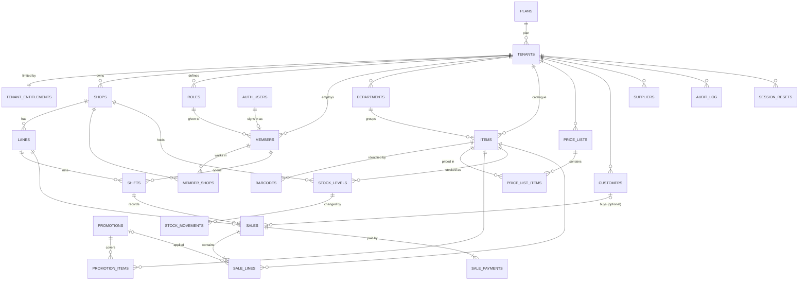

# Data Model & Database

**SDD Template Suite | DOC-08 — Data Model & Database**

| Field | Value | Field | Value |
| --- | --- | --- | --- |
| **Document ID** | DOC-08 | **Owner** | Tech Lead (P1) |
| **Version / Date** | v0.2 / 2026-10-22 | **Status** | Draft — matches the staging database |
| **Database** | Supabase project `ciwuznyiimaxlxmqhvgr` (staging), PostgreSQL 17 | **Source of truth** | `supabase/migrations/*.sql` |

> **Keep this file in step with the database.** Every PR that adds a migration updates this file in the same PR: the table catalogue (§3), the functions (§5) and the migration log (§7). The unit test `scripts/test/data-model-doc.test.ts` fails if a table or migration is missing here.

## Contents

1. [How the data is organised](#1-how-the-data-is-organised)
2. [Entity relationship diagram](#2-entity-relationship-diagram)
3. [Table catalogue](#3-table-catalogue)
4. [Security model (RLS, grants, JWT claims)](#4-security-model)
5. [Functions the app calls](#5-functions-the-app-calls)
6. [Conventions and deliberate deviations](#6-conventions-and-deliberate-deviations)
7. [Migration log](#7-migration-log)
8. [How to change the database](#8-how-to-change-the-database)

## 1. How the data is organised

Four levels, matching blueprint §21.2:

| Level | Tables | Key columns |
| --- | --- | --- |
| **Platform** | `plans`, `permissions`, `platform_admins` | shared by every tenant |
| **Tenant** (business) | `tenants`, `tenant_entitlements`, `roles`, `members`, `member_shops`, `departments`, `items`, `barcodes`, `price_lists`, `price_list_items`, `promotions`, `promotion_items`, `customers`, `suppliers`, `session_resets`, `audit_log` | `tenant_id` |
| **Shop** | `shops`, `lanes`, `stock_levels`, `stock_movements`, `shifts`, `sales`, `sale_lines`, `sale_payments` | `tenant_id` + `shop_id` |
| **Lane** | (browser storage, not in the database) | — |

A single shop is a tenant with one shop; a chain is a tenant with many. There is no separate code path.

**Three rules keep the numbers right** (blueprint §21.4):

1. **Ledger + cached balance in one transaction.** `stock_movements` is the history; `stock_levels` is the fast answer. `app.post_movement` writes both together.
2. **Append-only money.** `sales`, `sale_lines`, `sale_payments`, `stock_movements` and `audit_log` reject UPDATE and DELETE with a trigger. Mistakes are fixed with new rows.
3. **Catalogue versioning.** Any change to `items`, `barcodes`, `price_list_items`, `promotions` or `promotion_items` adds 1 to `tenants.catalog_version`, so lanes can ask "what changed since version N?".

## 2. Entity relationship diagram

`STOCK_LEVELS → STOCK_MOVEMENTS` is a logical link (same `shop_id` + `item_id`), not a foreign key.

## 3. Table catalogue

Money is `bigint` cents, quantities are `bigint` milli-units (1 piece = 1000; weighed: 1 g = 1), ids are uuid v7 from `app.uuid_v7()`. "RLS read" says who can `select`; "Writes" says how rows get in.

### 3.1 Platform

#### `plans`
Subscription plans and their limits. Seeded: `single` (1 shop, 3 lanes), `growth` (3 shops, 6 lanes, transfers), `chain` (30 shops, 12 lanes, head office, transfers).

| Column | Type | Notes |
| --- | --- | --- |
| `id` | text PK | `single`, `growth`, `chain` |
| `name`, `price_cents` | text, bigint | monthly price |
| `max_shops`, `max_lanes_per_shop` | integer | copied into `tenant_entitlements` |
| `head_office`, `transfers`, `is_active` | boolean | |

RLS read: any signed-in user. Writes: migrations / platform admin only.

#### `permissions`
The permission bits used in role masks. Must match `packages/core/src/permissions.ts` (a unit test checks).

| key | bit | key | bit |
| --- | --- | --- | --- |
| `sale.create` | 1 | `reports.view` | 128 |
| `return.create` | 2 | `settings.manage` | 256 |
| `item.edit` | 4 | `cash.pickup` | 512 |
| `stock.adjust` | 8 | `shift.manage` | 1024 |
| `grn.post` | 16 | `transfer.approve` | 2048 |
| `promotion.manage` | 32 | `customer.manage` | 4096 |
| `staff.manage` | 64 | `supplier.manage` | 8192 |

#### `platform_admins`
`user_id` (PK → `auth.users`). LaneOS staff who may see every tenant. RLS: a user can only see their own row.

### 3.2 Tenancy and access

#### `tenants`
One business. `status` (`trial`/`active`/`past_due`/`suspended`/`cancelled`), `plan_id` → `plans`, `slug` (unique), `rounding_unit_cents` (cash rounding; default 100 = nearest rupee), `embedded_barcode_mode` (`weight` or `price` scale labels), `catalog_version`, `timezone` (default `Asia/Colombo`).
RLS read: own tenant (or platform admin). Update: `settings.manage`. Insert: only `api.create_tenant`.

#### `tenant_entitlements`
`tenant_id` PK → `tenants`. `max_shops`, `max_lanes_per_shop`, `head_office`, `transfers` — copied from the plan at sign-up, may be overridden per tenant. Read: own tenant. Writes: functions only.

#### `shops`
`tenant_id` → `tenants`; `code` (e.g. `KDY1`, unique per tenant), `name`, `address`, `phone`, `is_active`. Read: own tenant. Update: `settings.manage`. Insert: `api.create_tenant` (more shops: head-office task).

#### `lanes`
A checkout terminal. `tenant_id`, `shop_id` → `shops`; `code` (`L1`, `L2`… unique per shop), `name`, `status` (`active`/`disabled`), `key_hash` (device binding; key never stored), `registered_at`, `last_seen_at`, `invoice_seq` (per-lane invoice counter, BR-003). Read: own tenant **and** a shop the user can access. Insert: `api.add_lane` (enforces `max_lanes_per_shop`).

#### `roles`
`tenant_id`, `key` (unique per tenant), `name`, `permissions` (bitmask), `is_system`. Five system roles are created per tenant: owner 16383, manager 14079, cashier 3, stock_keeper 24, accountant 8320. Read: own tenant. Writes: functions only.

#### `members`
A person working for a tenant. `tenant_id`, `user_id` → `auth.users` (null for PIN-only cashiers), `role_id` → `roles`, `display_name`, `phone`, `all_shops`, `pin_hash` (Argon2id; never the PIN), `perm_v` (bumped to revoke old tokens), `is_active`. Unique `(tenant_id, user_id)`. Read: own tenant. Writes: functions only.

#### `member_shops`
`(member_id, shop_id)` PK, `tenant_id`. Which shops a member may work in when `all_shops = false`.

#### `session_resets`
Reset markers (blueprint §27.5.5): `(scope_type, scope_id)` PK, `tenant_id`, `reset_at`, `reset_by`, `reason`. Tokens issued before `reset_at` will be refused by the proxy (session-reset task).

#### `audit_log`
Append-only. `tenant_id`, `actor_id`, `action` (e.g. `tenant.create`, `lane.create`, `shift.close`), `entity`, `entity_id`, `data` jsonb. Read: `settings.manage`. Writes: `app.audit()` inside functions.

### 3.3 Catalogue (tenant level)

#### `departments`
`tenant_id`, `name` (unique per tenant), `sort_order`, `is_active`. The category chips on the lane and the "Category" column in Inventory. Read: own tenant. Write: `item.edit`.

#### `items`
`tenant_id`, `department_id` → `departments`, `name`, `item_type` (`standard`/`weighed`/`pack`/`open_price`), `tax_class` (`standard`/`exempt`/`zero`), `plu` (1–99999, unique per tenant), `mrp_cents`, `cost_cents`, `reorder_level_milli`, `track_batches`, `is_returnable`, `is_pinned` (lane "Pinned" chip), `is_active`. Indexes: `items_tenant_plu` (unique, partial), trigram on `name`. Read: own tenant. Insert: `api.upsert_item`. Update: `item.edit` (e.g. deactivate). Never deleted.

#### `barcodes`
PK `(tenant_id, code)` — named `barcodes_pkey` (maps to `DUPLICATE_BARCODE`). `item_id` → `items`. Written by `api.upsert_item`.

#### `price_lists`
`tenant_id`, `name`, `is_default` (exactly one default per tenant, created automatically with the tenant as "Standard").

#### `price_list_items`
PK `(price_list_id, item_id)`, `tenant_id`, `price_cents`. Trigger `app.check_price_vs_mrp` raises `ABOVE_MRP` if the price is above the item's MRP (BR-011). Written by `api.upsert_item`.

#### `promotions`
`tenant_id`, `name`, `kind` (`multi_buy` → `buy_qty` + `bundle_price_cents`, e.g. "3 for Rs 450"; `percent_off` → `percent_bp`), `starts_at`, `ends_at`, `is_active`. Read: own tenant. Write: `promotion.manage`.

#### `promotion_items`
PK `(promotion_id, item_id)`, `tenant_id`. Which items a promotion covers.

### 3.4 Parties (tenant level)

#### `customers`
`tenant_id`, `name`, `phone` (`+947XXXXXXXX`, unique per tenant: `customers_tenant_phone`), `email`, `credit_limit_cents`, `balance_due_cents` (cached; the customer ledger comes with credit sales), `loyalty_points`, `marketing_consent` (PDPA), `is_active`. Read: own tenant. Insert/update: `customer.manage`. Never deleted.

#### `suppliers`
`tenant_id`, `name` (unique per tenant), `phone`, `email`, `payment_terms_days`, `is_sale_or_return`, `balance_due_cents`, `is_active`. Read: own tenant. Insert/update: `supplier.manage`.

### 3.5 Stock (shop level)

#### `stock_levels`
PK `(shop_id, item_id)`, `tenant_id`, `qty_milli` (sellable; may go negative — checkout is never blocked, BR-032), `damaged_milli` (never sellable, BR-070), `avg_cost_cents`. `fillfactor = 80` for frequent updates. Read: own tenant + accessible shop. Writes: only `app.post_movement`.

#### `stock_movements`
Append-only ledger. `tenant_id`, `shop_id`, `item_id`, `qty_milli` (signed), `reason` (`opening`, `sale`, `return`, `grn`, `adjustment`, `wastage`, `damage`, `transfer_in`, `transfer_out`, `count`), `ref_type` + `ref_id` (e.g. `sale` + sale id), `note`, `created_by`.

### 3.6 Sales (shop level)

#### `shifts`
`tenant_id`, `shop_id`, `lane_id` → `lanes`, `shift_no` (identity), `status` (`open`/`closed`), `opened_by`/`closed_by` → `members`, `opening_float_cents`, `expected_cash_cents`, `counted_cash_cents`. At most one open shift per lane (`shifts_one_open_per_lane`). Writes: `api.open_shift`, `api.close_shift`.

#### `sales`
Append-only. `tenant_id`, `shop_id`, `lane_id`, `shift_id` → `shifts`, `invoice_no` (`KDY1-L1-000124`, unique per lane), `customer_id` → `customers` (optional), `member_id` → `members`, `subtotal_cents`, `promo_cents`, `rounding_cents`, `total_cents`, `paid_cents`, `change_cents`, `balance_due_cents`, `client_uuid` (idempotency key; unique per tenant `sales_idem`). Indexes: `(shop_id, created_at desc)`, BRIN on `created_at`. Writes: only `api.create_sale`.

#### `sale_lines`
Append-only. `sale_id` → `sales`, `tenant_id`, `shop_id`, `line_no`, `item_id` → `items`, `item_name` (snapshot), `item_type`, `tax_class`, `qty_milli`, `unit_price_cents`, `gross_cents`, `promo_cents`, `net_cents`, `promotion_id` → `promotions`.

#### `sale_payments`
Append-only. `sale_id` → `sales`, `tenant_id`, `shop_id`, `method` (`cash`/`card`/`lankaqr`/`credit_note`), `amount_cents`, `reference` (approval code or last 4 digits — never a card number, CST-004).

## 4. Security model

**RLS is enabled and forced on every table** (PRN-001; an integration test fails if any `public` table is not). Policies call helper functions in the `app` schema. They are `SECURITY DEFINER`, so their own lookups are not blocked by RLS.

| Helper | Returns |
| --- | --- |
| `app.tenant_id()` | the caller's tenant: JWT claim `tenant_id`, else a lookup in `members` |
| `app.member_id()` | the caller's member id |
| `app.permissions()` / `app.has_perm(key)` / `app.require_perm(key)` | permission mask / check / raise `FORBIDDEN` |
| `app.shop_ids()` / `app.can_shop(shop)` | shops the caller may access |
| `app.is_platform_admin()` | whether the caller is LaneOS staff |
| `app.audit(action, entity, id, data)` | writes an `audit_log` row |

**Policy pattern.** Tenant tables: `tenant_id = (select app.tenant_id())`. Shop tables: the same plus `(select app.can_shop(shop_id))`. Writes to master data also require a permission. Financial tables have **no write policies** and INSERT/UPDATE/DELETE are revoked from `authenticated`. They are written only by `api.*` functions. `anon` has no rights on any table.

**JWT claims.** `public.custom_access_token_hook` (enabled in `supabase/config.toml`) adds `tenant_id`, `member_id`, `app_role`, `perms`, `shop_ids` and `perm_v` to every access token. The standard `role` claim is left alone because PostgREST uses it as the Postgres role (see migration 20261022090500).

## 5. Functions the app calls

All live in the `api` schema (exposed to the REST API). `anon` cannot execute them. Business errors are raised as `P0001` with a stable code (`packages/core/src/errors.ts` maps them).

| Function | Security | What it does | Permission | Error codes |
| --- | --- | --- | --- | --- |
| `api.create_tenant(name, slug, shop_code, shop_name, owner_name, plan)` | definer | Sign-up: tenant, entitlements, 5 roles, shop, owner member, lane L1, default price list | signed in, not yet a member | `UNAUTHENTICATED`, `VALIDATION_ERROR` |
| `api.add_lane(shop, name)` | definer | Adds lane `L<n>` | `staff.manage` | `PLAN_LIMIT`, `NOT_FOUND` |
| `api.upsert_item(p jsonb)` | definer | Item + barcode + default price in one transaction | `item.edit` | `DUPLICATE_BARCODE`, `ABOVE_MRP`, `DUPLICATE_PLU` |
| `api.adjust_stock(shop, item, qty_milli, reason, note)` | definer | Opening stock, counts, corrections via the ledger | `stock.adjust` | `NOT_FOUND`, `VALIDATION_ERROR` |
| `api.open_shift(lane, float)` | definer | Opens a shift on a lane | `sale.create` | `SHIFT_ALREADY_OPEN` |
| `api.close_shift(shift, counted)` | definer | Closes it; returns expected, counted, variance | `sale.create` | `SHIFT_NOT_OPEN` |
| `api.create_sale(p jsonb)` | definer | Re-prices the basket, checks payments, writes sale + lines + payments + stock movements | `sale.create` | `PRICE_MISMATCH`, `UNDERPAID`, `SHIFT_NOT_OPEN`, `ITEM_INACTIVE`, `ABOVE_MRP` |
| `api.dashboard(shop)` | invoker | Today's sales, bills, margin, by-hour, top items, stock alerts, lanes | RLS | `NOT_FOUND` |
| `api.list_items(shop, search, filter, limit, offset)` | invoker | Inventory table with stock and status | RLS | — |
| `api.lane_catalog(lane)` | invoker | Items, prices, barcodes, stock, promotions, open shift for a lane | RLS | `NOT_FOUND` |

**Pricing rules in `api.create_sale`** (same as `packages/pricing`; the integration test checks parity):
- Lines with the same item are merged.
- Weighed line = price per kg × grams ÷ 1000.
- Each item gets the single best active promotion (BR-021); multi-buy counts whole groups of pieces only.
- Cash rounding uses the tenant's `rounding_unit_cents`.
- All rounding is half-up.
- If the lane's `expectedTotalCents` differs from the server total, the sale is refused with `PRICE_MISMATCH`.

Internal helpers (not callable by the app): `app.post_movement`, `app.bump_catalog_version`, `app.check_price_vs_mrp`, `app.create_default_price_list`, `app.touch_updated_at`, `app.protect_keys`, `app.append_only`, `app.div_round`, `app.uuid_v7`.

## 6. Conventions and deliberate deviations

Conventions follow blueprint §22.1. These differ from the blueprint for now and are tracked:

| Blueprint | Now | Why / when |
| --- | --- | --- |
| `sales` partitioned by month | Plain table with BRIN index | Partition before go-live volumes (M5); ids are already uuid v7 |
| `ITEM_UNIT` (case barcodes) | Not yet | Comes with GRN / pack sizes (M6) |
| `PAYMENT` + `PAYMENT_ALLOCATION` | `sale_payments` | Allocation is needed for credit settlement (M4) |
| `RETURN`, `REFUND`, `CREDIT_NOTE*`, `DAMAGE_*`, `GRN*`, `SUPPLIER/CUSTOMER_LEDGER`, batches, transfers | Not yet | Their milestones: M3, M4, M6, M7 |
| `TERMINAL` | `lanes` | Same thing; "lane" is the word used in the UI and routes |
| Lane delta sync `catalog_delta(since)` | `lane_catalog` returns the whole catalogue | Delta sync comes with the offline lane (M3) |
| Back-office paging by cursor | Offset in `list_items` | Fine for back-office tables; lanes will use deltas |

## 7. Migration log

| Migration | What it adds |
| --- | --- |
| `20261022090000_foundation.sql` | Schemas `app`, `api`, `private`; `pg_trgm`, `pgcrypto`; `app.uuid_v7()`; enums; shared triggers |
| `20261022090100_tenancy_access.sql` | `plans`, `permissions`, `platform_admins`, `tenants`, `tenant_entitlements`, `shops`, `lanes`, `roles`, `members`, `member_shops`, `session_resets`, `audit_log`; RLS helpers; access token hook; `api.create_tenant`, `api.add_lane` |
| `20261022090200_catalogue_parties.sql` | `departments`, `items`, `barcodes`, `price_lists`, `price_list_items`, `promotions`, `promotion_items`, `customers`, `suppliers`; catalogue versioning; MRP check; `api.upsert_item` |
| `20261022090300_stock_sales.sql` | `stock_levels`, `stock_movements`, `shifts`, `sales`, `sale_lines`, `sale_payments`; `app.post_movement`; `api.adjust_stock`, `api.open_shift`, `api.close_shift`, `api.create_sale` |
| `20261022090400_read_functions.sql` | `api.dashboard`, `api.list_items`, `api.lane_catalog` |
| `20261022090500_fix_hook_role_claim.sql` | Access token hook writes `app_role` instead of overwriting `role` |
| `20261022090600_fix_create_sale_safeupdate.sql` | `api.create_sale` uses `truncate` / `where true` on its temp table: Supabase's `pg-safeupdate` rejects DELETE/UPDATE without WHERE. Rule for all new functions: always write a WHERE clause |

## 8. How to change the database

1. `pnpm exec supabase migration new <short_name>` and write the SQL. Never edit a migration that has been pushed. Add a new one, as `20261022090500` does.
2. Add RLS (enable + force + policies) for every new table, and revoke what `authenticated` must not write.
3. Push to staging: `pnpm db:push`. Regenerate types: `pnpm db:types`.
4. **Update this file**: the tables in §3, the functions in §5, any new deviation in §6, and a row in §7. Bump the version at the top.
5. Run `pnpm test` (unit, including the doc check) and `pnpm test:db` (integration against staging).
6. Open the PR. Every file in `supabase/migrations/` needs P1's review (blueprint §22.5).

Demo data for staging: `pnpm db:seed` creates the "ABC Supermarket" tenant (shop KDY1, lanes L1–L2, 30 items, a "3 for 450" promotion, 3 customers, 3 suppliers). The owner login is `DEMO_OWNER_EMAIL` / `DEMO_OWNER_PASSWORD` in `apps/web/.env.local`.
