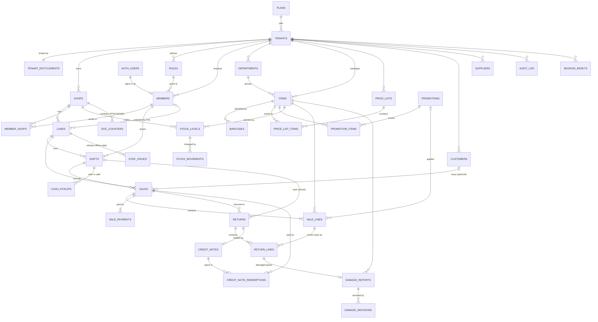

# Data Model & Database

**SDD Template Suite | DOC-08 — Data Model & Database**

| Field | Value | Field | Value |
| --- | --- | --- | --- |
| **Document ID** | DOC-08 | **Owner** | Tech Lead (P1) |
| **Version / Date** | v0.11 / 2026-10-27 | **Status** | Draft — matches the staging database |
| **Database** | Supabase project `ciwuznyiimaxlxmqhvgr` (staging), PostgreSQL 17 | **Source of truth** | `supabase/migrations/*.sql` |

> **Keep this file in step with the database.** Every PR that adds a migration updates this file in the same PR: the table catalogue (§3), the functions (§5) and the migration log (§7). The unit test `scripts/test/data-model-doc.test.ts` fails if a table or migration is missing here.

## Contents

1. [How the data is organised](#1-how-the-data-is-organised)
2. [Entity relationship diagram](#2-entity-relationship-diagram)
3. [Table catalogue](#3-table-catalogue)
4. [Security model (RLS, grants, JWT claims)](#4-security-model)
5. [Functions the app calls](#5-functions-the-app-calls)
6. [Conventions and deliberate deviations](#6-conventions-and-deliberate-deviations)
7. [Migration log](#7-migration-log)
8. [How to change the database](#8-how-to-change-the-database)

## 1. How the data is organised

Four levels, matching blueprint §21.2:

| Level | Tables | Key columns |
| --- | --- | --- |
| **Platform** | `plans`, `permissions`, `platform_admins` | shared by every tenant |
| **Tenant** (business) | `tenants`, `tenant_entitlements`, `roles`, `members`, `member_shops`, `departments`, `items`, `barcodes`, `price_lists`, `price_list_items`, `promotions`, `promotion_items`, `customers`, `suppliers`, `credit_notes`, `credit_note_redemptions`, `damage_decisions`, `supplier_ledger`, `purchase_order_lines`, `grn_lines`, `supplier_payment_allocations`, `session_resets`, `audit_log` | `tenant_id` |
| **Shop** | `shops`, `lanes`, `doc_counters`, `stock_levels`, `stock_movements`, `stock_batches`, `stock_counts`, `stock_count_lines`, `label_queue`, `purchase_orders`, `grns`, `supplier_payments`, `shifts`, `cash_pickups`, `sales`, `sale_lines`, `sale_payments`, `returns`, `return_lines`, `damage_reports`, `sync_issues` | `tenant_id` + `shop_id` |
| **Lane** (device, not in the database) | IndexedDB: lane key, offline sale queue · localStorage: held bills, last lane, reserved-invoice counter | — |

A single shop is a tenant with one shop; a chain is a tenant with many. There is no separate code path.

**Three rules keep the numbers right** (blueprint §21.4):

1. **Ledger + cached balance in one transaction.** `stock_movements` is the history; `stock_levels` is the fast answer. `app.post_movement` writes both together.
2. **Append-only money.** `sales`, `sale_lines`, `sale_payments`, `stock_movements`, `returns`, `return_lines`, `cash_pickups`, `credit_note_redemptions`, `damage_decisions` and `audit_log` reject UPDATE and DELETE with a trigger. Mistakes are fixed with new rows.
3. **Catalogue versioning.** Any change to `items`, `barcodes`, `price_list_items`, `promotions` or `promotion_items` adds 1 to `tenants.catalog_version`, so lanes can ask "what changed since version N?".

## 2. Entity relationship diagram

`STOCK_LEVELS → STOCK_MOVEMENTS` is a logical link (same `shop_id` + `item_id`), not a foreign key. `DAMAGE_REPORTS.source_ref_id` points at the return line (or later a GRN / count line) without a foreign key, because the source table varies.

## 3. Table catalogue

Money is `bigint` cents, quantities are `bigint` milli-units (1 piece = 1000; weighed: 1 g = 1), ids are uuid v7 from `app.uuid_v7()`. "RLS read" says who can `select`; "Writes" says how rows get in.

### 3.1 Platform

#### `plans`
Subscription plans and their limits, as on the sign-up page (Figma 1-90, since 20261023090600): `lite` Kade Lite (Rs 2,900, 1 shop, 1 lane, 3 staff), `single` Store Pro (Rs 5,400, 1 shop, 4 lanes, 10 staff), `growth` Multi-store (Rs 4,900 **per shop**, 5 shops, 4 lanes each, transfers, 40 staff), `chain` Chain (custom price, 30 shops, head office). `apps/web/lib/plans.ts` repeats them for the public sign-up page.

| Column | Type | Notes |
| --- | --- | --- |
| `id` | text PK | `single`, `growth`, `chain` |
| `name`, `price_cents` | text, bigint | monthly price |
| `max_shops`, `max_lanes_per_shop` | integer | copied into `tenant_entitlements` |
| `head_office`, `transfers`, `is_active` | boolean | |
| `description`, `per_shop`, `is_custom`, `max_staff`, `sort_order` | | price per shop; custom = arranged by LaneOS (cannot be self-selected); staff seat limit |

RLS read: any signed-in user. Writes: migrations / platform admin only.

#### `permissions`
The permission bits used in role masks. Must match `packages/core/src/permissions.ts` (a unit test checks).

| key | bit | key | bit |
| --- | --- | --- | --- |
| `sale.create` | 1 | `reports.view` | 128 |
| `return.create` | 2 | `settings.manage` | 256 |
| `item.edit` | 4 | `cash.pickup` | 512 |
| `stock.adjust` | 8 | `shift.manage` | 1024 |
| `grn.post` | 16 | `transfer.approve` | 2048 |
| `promotion.manage` | 32 | `customer.manage` | 4096 |
| `staff.manage` | 64 | `supplier.manage` | 8192 |

#### `platform_admins`
`user_id` (PK → `auth.users`). LaneOS staff who may see every tenant. RLS: a user can only see their own row.

### 3.2 Tenancy and access

#### `tenants`
One business. `status` (`trial`/`active`/`past_due`/`suspended`/`cancelled`), `plan_id` → `plans`, `slug` (unique), `rounding_unit_cents` (cash rounding; default 100 = nearest rupee), `embedded_barcode_mode` (`weight` or `price` scale labels), `catalog_version`, `timezone` (default `Asia/Colombo`).
RLS read: own tenant (or platform admin). Update: only `api.update_tenant_settings` (direct UPDATE revoked in 20261023090600). Insert: only `api.create_tenant`.

**Settings columns (20261023090600):** general — `business_reg_no`, `city`, `business_type`; branding — `brand_color` (`#RRGGBB`), `theme` (`default`/`christmas`/`awurudu`/`vesak`/`deepavali`/`ramadan`), `auto_seasonal_theme`; tax — `vat_registered`, `vat_no`, `prices_include_vat`; receipt — `receipt_paper` (`80mm`/`58mm`/`a4`), `receipt_header`, `receipt_footer`, `receipt_print_logo`, `receipt_silent`, `receipt_open_drawer`, `receipt_local_language`; security (§27.6) — `require_2fa` (`owners`/`managers`/`all`), `strict_sessions`, `idle_timeout_min`, `lane_lock_min`, `failed_login_limit`, `failed_login_lock_min`, `pin_length_min`, `pin_change_days`, `credit_note_cash_out`, `export_owner_only`, `login_alerts`; credit — `customer_credit_days`; billing — `trial_ends_on`, `next_charge_on`.

#### `tenant_entitlements`
`tenant_id` PK → `tenants`. `max_shops`, `max_lanes_per_shop`, `head_office`, `transfers` — copied from the plan at sign-up, may be overridden per tenant. Read: own tenant. Writes: functions only.

#### `shops`
`tenant_id` → `tenants`; `code` (e.g. `KDY1`, unique per tenant), `name`, `address`, `phone`, `is_active`. Read: own tenant. Update: `settings.manage`. Insert: `api.create_tenant` (more shops: head-office task).

#### `lanes`
A checkout terminal. `tenant_id`, `shop_id` → `shops`; `code` (`L1`, `L2`… unique per shop), `name`, `status` (`active`/`disabled`), `key_hash` (device binding; key never stored), `registered_at`, `last_seen_at`, `invoice_seq` (per-lane invoice counter, BR-003). Read: own tenant **and** a shop the user can access. Insert: `api.add_lane` (enforces `max_lanes_per_shop`). `printer_name` (20261023090600) is the receipt printer for QZ Tray; updatable with `name`, `status`.

#### `roles`
`tenant_id`, `key` (unique per tenant), `name`, `permissions` (bitmask), `is_system`. Five system roles are created per tenant: owner 16383, manager 14079, cashier 3, stock_keeper 24, accountant 8320. Read: own tenant. Writes: functions only.

#### `members`
A person working for a tenant. `tenant_id`, `user_id` → `auth.users` (null for PIN-only cashiers), `role_id` → `roles`, `display_name`, `phone`, `all_shops`, `pin_hash` (bcrypt; never the PIN), `perm_v` (bumped to revoke old tokens), `is_active`. Unique `(tenant_id, user_id)`. Read: own tenant. Writes: functions only.
Since 20261023090600: `staff_code` (cashier code, unique per tenant), `perms_add` / `perms_remove` (per-person changes to the role mask: effective = `(role | add) & ~remove`, used by `app.permissions()` and the token hook), `invite_email` (an invited login not yet claimed; linked by `api.claim_invite` at first sign-in), `language` (`en`/`si`/`ta`).

#### `member_shops`
`(member_id, shop_id)` PK, `tenant_id`. Which shops a member may work in when `all_shops = false`.

#### `session_resets`
Reset markers (blueprint §27.5.5): `(scope_type, scope_id)` PK, `tenant_id`, `reset_at`, `reset_by`, `reason`. Tokens issued before `reset_at` will be refused by the proxy (session-reset task).

#### `audit_log`
Append-only. `tenant_id`, `actor_id`, `action` (e.g. `tenant.create`, `lane.create`, `shift.close`), `entity`, `entity_id`, `data` jsonb. Read: `settings.manage`. Writes: `app.audit()` inside functions.

### 3.3 Catalogue (tenant level)

#### `departments`
`tenant_id`, `name` (unique per tenant), `sort_order`, `is_active`. The category chips on the lane and the "Category" column in Inventory. Read: own tenant. Write: `item.edit`.

#### `items`
`tenant_id`, `department_id` → `departments`, `name`, `item_type` (`standard`/`weighed`/`pack`/`open_price`), `tax_class` (`standard`/`exempt`/`zero`), `plu` (1–99999, unique per tenant), `mrp_cents`, `cost_cents`, `reorder_level_milli`, `track_batches`, `is_returnable`, `is_pinned` (lane "Pinned" chip), `is_active`. Indexes: `items_tenant_plu` (unique, partial), trigram on `name`. Read: own tenant. Insert: `api.upsert_item`. Update: `item.edit` (e.g. deactivate). Never deleted.

#### `barcodes`
PK `(tenant_id, code)` — named `barcodes_pkey` (maps to `DUPLICATE_BARCODE`). `item_id` → `items`. Written by `api.upsert_item`.

#### `price_lists`
`tenant_id`, `name`, `is_default` (exactly one default per tenant, created automatically with the tenant as "Standard"), `discount_bp` + `applies_to` (20261023090600: a buyer-group rule such as "Wholesale A · −8 % · Retailers", Settings → Tax & rates; saved with `api.save_price_rule`).

#### `price_list_items`
PK `(price_list_id, item_id)`, `tenant_id`, `price_cents`. Trigger `app.check_price_vs_mrp` raises `ABOVE_MRP` if the price is above the item's MRP (BR-011). Written by `api.upsert_item`.

#### `promotions`
`tenant_id`, `name`, `kind` (`multi_buy` → `buy_qty` + `bundle_price_cents`, e.g. "3 for Rs 450"; `percent_off` → `percent_bp`; since 20261027090500 `mix_match` → `buy_qty` + `bundle_price_cents` across the chosen items, "any 3 for Rs 270"; `threshold` → `threshold_cents` + either `discount_cents` or `percent_bp`, "spend Rs 5,000, get Rs 250 off"), `members_only` (counts only with a customer on the bill), `starts_at`, `ends_at`, `is_active`. Read: own tenant. Write: `promotion.manage` (`api.save_promotion`).

#### `promotion_items`
PK `(promotion_id, item_id)`, `tenant_id`. Which items a promotion covers.

### 3.4 Parties (tenant level)

#### `customers`
`tenant_id`, `name`, `phone` (`+947XXXXXXXX`, unique per tenant: `customers_tenant_phone`), `email`, `credit_limit_cents`, `balance_due_cents` (cached sum of `customer_ledger`; not updatable directly since 20261023090700), `loyalty_points`, `marketing_consent` (PDPA), `is_active`. Read: own tenant. Insert/update: `customer.manage` (update limited to name, phone, email, limit, consent, active). Never deleted.

#### `suppliers`
`tenant_id`, `name` (unique per tenant), `phone`, `email`, `payment_terms_days`, `is_sale_or_return`, `balance_due_cents`, `is_active`. Read: own tenant. Insert/update: `supplier.manage`.

### 3.5 Stock (shop level)

#### `stock_levels`
PK `(shop_id, item_id)`, `tenant_id`, `qty_milli` (sellable; may go negative — checkout is never blocked, BR-032), `damaged_milli` (never sellable, BR-070), `avg_cost_cents`. `fillfactor = 80` for frequent updates. Read: own tenant + accessible shop. Writes: only `app.post_movement`.

#### `stock_movements`
Append-only ledger. `tenant_id`, `shop_id`, `item_id`, `qty_milli` (signed), `reason` (`opening`, `sale`, `return`, `grn`, `adjustment`, `wastage`, `damage`, `transfer_in`, `transfer_out`, `count`), `ref_type` + `ref_id` (e.g. `sale` + sale id), `note`, `created_by`.

### 3.6 Sales (shop level)

#### `shifts`
`tenant_id`, `shop_id`, `lane_id` → `lanes`, `shift_no` (identity), `status` (`open`/`closed`), `opened_by`/`closed_by` → `members`, `opening_float_cents`, `expected_cash_cents`, `counted_cash_cents`. At most one open shift per lane (`shifts_one_open_per_lane`). Writes: `api.open_shift`, `api.close_shift`.

#### `sales`
Append-only. `tenant_id`, `shop_id`, `lane_id`, `shift_id` → `shifts`, `invoice_no` (`KDY1-L1-000124`, unique per lane), `customer_id` → `customers` (optional), `member_id` → `members`, `subtotal_cents`, `promo_cents`, `rounding_cents`, `total_cents`, `paid_cents`, `change_cents`, `balance_due_cents`, `client_uuid` (idempotency key; unique per tenant `sales_idem`). Indexes: `(shop_id, created_at desc)`, BRIN on `created_at`. Writes: only `api.create_sale`.

#### `sale_lines`
Append-only. `sale_id` → `sales`, `tenant_id`, `shop_id`, `line_no`, `item_id` → `items`, `item_name` (snapshot), `item_type`, `tax_class`, `qty_milli`, `unit_price_cents`, `gross_cents`, `promo_cents`, `net_cents`, `promotion_id` → `promotions`, `unit_cost_cents` (20261023090700: average cost snapshot set by trigger `app.sale_line_cost`; the margin report uses it; older rows were back-filled with the cost at that time).

#### `sale_payments`
Append-only. `sale_id` → `sales`, `tenant_id`, `shop_id`, `method` (`cash`/`card`/`lankaqr`/`credit_note`/`account`; `account` = on account for a named credit customer, since 20261023090600), `amount_cents`, `reference` (approval code or last 4 digits — never a card number, CST-004; for credit notes the note number `CN-…`, never the code).

Since migration `20261023090000`, `sales` also has `receipt_token` (32 hex characters, unique) for the public digital receipt `/r/<token>`, and `shifts` has `opening_denoms` / `closing_denoms` (note value in cents → count, plus `coins`), `variance_note`, and `reserved_from` / `reserved_to` (invoice numbers kept for offline use when the shift was opened).

### 3.7 Lane operations, returns and credit notes

#### `doc_counters`
PK `(shop_id, kind)`, `seq`. Running numbers per shop for documents: `RTN-KDY1-000001` (returns), `CN-KDY1-000001` (credit notes), `DMG-KDY1-000001` (damage reports). Only `app.next_doc_no()` touches it; no API access at all.

#### `cash_pickups`
Append-only. `tenant_id`, `shop_id`, `shift_id` → `shifts`, `amount_cents`, `note`, `member_id` → `members`. Cash taken from the drawer to the safe during a shift; lowers the expected cash at close. Written by `api.cash_pickup` (`cash.pickup`).

#### `returns`
Append-only. `tenant_id`, `shop_id`, `lane_id`, `shift_id` (set only for cash refunds — the cash leaves that drawer), `sale_id` → `sales`, `return_no`, `customer_id`, `settlement` (`cash` / `original` / `exchange` / `credit_note` / `credit_balance`), `total_cents`, `member_id` (cashier), `approved_by` (supervisor whose PIN approved a large cash refund), `client_uuid` (idempotent). Written by `api.process_return`.

#### `return_lines`
Append-only. `return_id` → `returns`, `sale_line_id` → `sale_lines`, `item_id`, `item_name`, `qty_milli`, `value_cents` (the line's net value × returned share), `reason` (`changed_mind`/`wrong_item`/`damaged`/`expired`/`quality`/`other`), `restock` (`sellable` → back into stock through the ledger; `damaged` → the damaged bucket + a damage report). The sum of returned quantity per sale line can never exceed what was sold (BR-040).

#### `credit_notes`
`tenant_id`, `shop_id` (issuing shop), `note_no`, `code_hash` (HMAC-SHA256 of the 12-character Crockford Base32 code with a key kept in Supabase Vault — the code itself is never stored), `code_last4`, `return_id`, `customer_id`, `amount_cents`, `balance_cents`, `expires_on` (tenant setting `credit_note_days`, default 90), `status` (`active`/`partially_used`/`used`/`expired`/`cancelled`/`cashed_out`), `issued_by`, `reason`, `replaced_by`. Read by the whole tenant (any shop may redeem when `tenants.credit_note_any_shop`). Written by `api.process_return`, `api.create_sale` (redeem), `api.extend_credit_note`, `api.cancel_credit_note`.

#### `credit_note_redemptions`
Append-only. `credit_note_id` → `credit_notes`, `sale_id` → `sales`, `shop_id`, `lane_id`, `amount_cents`, `redeemed_by`. `api.create_sale` locks the note row (`FOR UPDATE`), so two lanes cannot spend the same balance (TC-CRN-003, covered by `pnpm test:db`).

#### `damage_reports`
`tenant_id`, `shop_id`, `report_no`, `item_id`, `qty_milli`, `remaining_milli` (still awaiting a decision), `unit_cost_cents` (snapshot), `source` (`shelf`/`grn`/`customer_return`/`transfer`/`count`), `source_ref_id`, `reason` (`broken`/`leaking`/`crushed`/`pest`/`expired`/`temperature`/`other`), `photo_path`, `note`, `status` (blueprint §30.1 states), `reported_by`, `approved_by`. Damaged quantity sits in `stock_levels.damaged_milli` and is never sold. Created today by customer returns; the shelf/GRN/count flows and decisions come with the stock screens.

#### `damage_decisions`
Append-only. `damage_report_id` → `damage_reports`, `decision` (`supplier_return`/`reduced_sale`/`write_off`/`internal_use`), `qty_milli`, `markdown_price_cents`, `supplier_return_id`, `decided_by`. Partial decisions allowed (REQ-DMG-004).

#### `sync_issues`
`tenant_id`, `shop_id`, `lane_id`, `client_uuid` (unique per tenant), `payload` (the sale the lane tried to send), `error_code`, `error_message`, `status` (`open`/`resolved`/`discarded`), `resolved_by`, `resolution_note`. Offline sales the server refused when the lane synced them (WF-003); shown in Back office → Sync issues. Written by `api.report_sync_issue` and `api.resolve_sync_issue`.

### 3.8 Catalogue and stock operations (20261023090300)

#### `label_queue`
`tenant_id`, `shop_id`, `item_id` → `items`, `reason` (`price_changed`/`new_item`/`promotion`/`reduced`/`manual`), `copies` (1–100), `old_price_cents` (the price before a change; for `reduced` it holds the reduced price), `printed_at`, `printed_by`. At most one unprinted row per shop and item (`label_queue_open`). Filled by triggers when a default-list price changes or an item joins a promotion, by `api.decide_damage` (reduced stock) and by `api.queue_labels` (manual); emptied by `api.update_labels(…, 'printed')`. Read: tenant + shop.

#### `stock_counts`
`tenant_id`, `shop_id`, `count_no` (`CNT-KDY1-000001`), `name` (the section), `department_id`, `status` (`counting` → `submitted` → `posted`, or `cancelled`), `created_by`, `submitted_by/at`, `posted_by/at`. Posting needs `shift.manage` (a manager) and writes one `count` movement per line that differs.

#### `stock_count_lines`
`count_id` → `stock_counts`, `item_id`, `system_milli` (the sellable quantity frozen when the count started), `counted_milli`, `counted_by`, `counted_at`. Unique `(count_id, item_id)`. The variance posted is `counted − system`, so sales during the count do not distort it.

### 3.9 Purchasing (20261023090400)

#### `purchase_orders`
`tenant_id`, `shop_id`, `po_no` (`PO-KDY1-000001`), `supplier_id` → `suppliers`, `status` (`draft` → `sent` → `partially_received` → `received`, or `cancelled`), `expected_on`, `note`, `total_cents`, `created_by`, `sent_at`. Written by `api.save_po` / `api.po_action`; GRNs move the status on.

#### `purchase_order_lines`
`po_id` → `purchase_orders`, `item_id`, `qty_milli`, `unit_cost_cents`, `received_milli` (raised by posted GRNs against the PO). Unique `(po_id, item_id)`.

#### `grns`
Goods received note. `tenant_id`, `shop_id`, `grn_no` (`GRN-KDY1-000001`), `supplier_id`, `po_id` (optional), `supplier_invoice_no`, `received_on`, `status` (`draft`/`posted`), `subtotal_cents`, `discount_cents`, `total_cents` (payable), `paid_cents` (≤ total), `due_on` (received + supplier terms), `created_by`, `posted_by/at`. Written by `api.save_grn`.

#### `grn_lines`
`grn_id` → `grns`, `item_id`, `batch_no`, `expiry_on` (today … +10 years), `qty_milli` (paid units), `free_milli` (free issue), `unit_cost_cents`, `line_cents`.

#### `stock_batches`
`tenant_id`, `shop_id`, `item_id`, `batch_no`, `expiry_on`, `received_milli`, `unit_cost_cents`, `grn_line_id`. One row per posted GRN line. What is **left** of a batch is not stored: `api.expiry_list` infers it from current stock, oldest expiry sold first (FEFO, BR-031). Index `(shop_id, item_id, expiry_on)`.

#### `supplier_ledger`
Append-only. `supplier_id`, `kind` (`grn`/`payment`/`return`/`adjustment`), `ref_id`, `amount_cents` (+ we owe more, − we paid), `note`. `suppliers.balance_due_cents` is the cached sum, written in the same statement pair by `app.supplier_post` (blueprint §21.4 rule 1).

#### `supplier_payments`
`tenant_id`, `shop_id`, `payment_no` (`PAY-KDY1-000001`), `supplier_id`, `method` (`cash`/`bank_transfer`/`cheque`), `reference` (cheque / transfer no.), `cheque_date`, `amount_cents`, `status` (`pending_approval`/`paid`/`rejected`), `allocations` (requested split over GRNs, applied when paid), `created_by`, `decided_by/at`. Above `tenants.supplier_payment_approval_cents` (default Rs 50,000) a payment by anyone without `settings.manage` waits for the owner.

#### `supplier_payment_allocations`
Append-only. `(payment_id, grn_id)` PK, `amount_cents`. How a paid payment was split over GRNs; raises `grns.paid_cents`.

### 3.10 Settings, people, credit and billing (20261023090600)

#### `tax_rates`
`tenant_id`, `tax_class`, `rate_bp`, `effective_from`; unique `(tenant_id, tax_class, effective_from)`. Effective-dated VAT (BR-060): a new rate is a new row, history is kept. Seeded for every tenant (standard 18 %, exempt 0, zero 0) and by trigger for new tenants. `app.tax_rate_bp(tenant, class, date)` returns the rate in force. Read: own tenant. Writes: `api.set_tax_rate` (`settings.manage`).

#### `customer_ledger`
Append-only. `tenant_id`, `customer_id` → `customers`, `kind` (`sale`/`payment`/`return`/`adjustment`), `ref_id` (sale, wholesale invoice or return), `amount_cents` (+ customer owes more, − paid/credited), `note`. `customers.balance_due_cents` is the cached sum, written together by `app.customer_post`. Existing balances became `adjustment` rows ("Opening balance"). Written by `api.create_sale` (on-account part), `api.save_wholesale` (credit invoice), `api.receive_customer_payment`, and a trigger on `returns` (credit-balance settlement).

#### `saas_invoices`
LaneOS's own bill to the tenant. `tenant_id`, `invoice_no` (unique), `plan_id`, `period_start`/`period_end`, `amount_cents`, `status` (`open`/`paid`/`void`), `due_on`, `paid_at`, `payhere_order_id`. Read: own tenant or platform admin. Writes: `app.generate_invoices` (Admin → Billing and the daily job), `api.admin_set_invoice` (bank payments) and `api.payhere_paid` (PayHere notify, which stores PayHere's payment id in `payhere_order_id`).

### 3.11 Wholesale (20261023090700)

#### `wholesale_docs`
`tenant_id`, `shop_id`, `kind` (`quotation`/`invoice`), `doc_no` (`QTN-KDY1-000001` / `WS-KDY1-000001`), `status` (`open`/`converted` for quotations, `issued`/`void` for invoices), `customer_id` (needed for a balance), buyer name / address / VAT no / phone (printed), `terms` (`cash`/`credit`/`cheque`), `credit_days`, `cheque_no`, `subtotal_cents`, `discount_cents` (sum of line discounts), `vat_cents`, `vat_included`, `total_cents`, `paid_cents`, `valid_until` (quotations, +14 days), `due_on` (credit), `from_quotation_id`, `note`. Read: tenant + shop. Writes: `api.save_wholesale` only.

#### `wholesale_doc_lines`
`doc_id` → `wholesale_docs`, `line_no`, `item_id`, `item_name`, `tax_class`, `pack_qty` + `unit_label` ("Case of 24"), `qty` (packs), `list_price_cents` / `price_cents` (per pack), `discount_bp`, `line_total_cents`, `unit_cost_cents`. An issued invoice posts a `sale` stock movement (`ref_type = 'wholesale'`) of `qty × pack_qty` units per line.

### 3.11b Security limits (20261027090000)

#### `lookup_attempts`
`tenant_id`, `lane_id`, `kind` (`credit_note`), `ok`, `at`. One row per credit-note look-up; `api.check_credit_note` refuses more than 10 per minute per lane (`RATE_LIMITED`) and, after 5 wrong codes in a row within 5 minutes, locks look-ups on that lane until 5 minutes after the last one (`CREDIT_NOTE_LOCKED`, THR-014). No API access at all.

#### `login_attempts`
`email_hash` (SHA-256 of the lower-cased email — never the email), `ok`, `at`. Written and read only by the server with the service role (`api.login_record`, `api.login_gate`) around every password sign-in; rows older than 30 days are pruned. No API access for browsers.

**New column:** `members.pin_set_at` (when the PIN was last set; drives `tenants.pin_change_days`).

### 3.11c File storage (20261027090100)

Supabase Storage buckets (not tables): **`tenant-public`** (public read; logos and item photos; PNG/JPG/WebP/SVG ≤ 2 MB) and **`tenant-private`** (damage photos, read by members of the business through signed links; PNG/JPG/WebP ≤ 5 MB). Every object path starts with the tenant id. Policies on `storage.objects` call `app.storage_can_write(bucket, name)`: `<tenant>/logo*` needs `settings.manage`, `<tenant>/items/…` needs `item.edit`, `<tenant>/damage/…` needs `stock.adjust`. **New columns:** `tenants.logo_path`, `items.image_path` (set with `api.set_logo`, `api.set_item_image`); `damage_reports.photo_path` is now filled.

### 3.11d Loyalty (20261027090500)

#### `loyalty_ledger`
Append-only. `tenant_id`, `customer_id`, `kind` (`earn` / `redeem` / `reverse` / `adjust`), `sale_id`, `return_id`, `points` (signed), `note`. `customers.loyalty_points` is the cached sum, written together by `app.loyalty_post`. Existing balances became `adjust` rows ("Opening balance"). Written by `api.create_sale` (earn, redeem), the `returns` trigger (reverse) and `api.adjust_loyalty`.

**New columns:** `tenants.loyalty_enabled`, `loyalty_spend_cents` (spend per point, default Rs 100), `loyalty_point_value_cents` (default Rs 1), `loyalty_min_redeem` (default 100 points); `sales.basket_promo_cents` + `basket_promotion_id` (the spend-X discount, included in `sales.promo_cents`), `points_earned`, `points_redeemed`. `payment_method` gains `loyalty`.

### 3.12 Head office (20261023090900)

#### `shop_prices`
PK `(shop_id, item_id)`, `tenant_id`, `price_cents`, `updated_at`, `updated_by`. A shop's own price for an item (central pricing → overrides). The effective price is `coalesce(shop_prices.price_cents, default list price)` in **both** `api.lane_catalog` v4 and `api.create_sale` v5, so lane preview and server truth stay equal. Changes bump `catalog_version` and queue a shelf label at that shop. Read: own tenant. Writes: `api.set_shop_price` (`item.edit`) and scheduled changes.

#### `price_schedules`
`tenant_id`, `name`, `starts_at`, `status` (`scheduled`/`applied`/`cancelled`), `created_by`, `applied_at`, `cancelled_by`. A price change that starts at a set time (WF-007). Applied by `app.apply_due_price_schedules()`, run **every minute by pg_cron** (job `laneos-apply-price-schedules`) and also when the pricing page opens.

#### `price_schedule_lines`
`schedule_id` → `price_schedules`, `item_id`, `shop_id` (null = every shop, i.e. the default list; else that shop's override), `price_cents`, `old_cents` (filled when applied). Unique `(schedule_id, item_id, shop_id)` with nulls not distinct.

#### `transfers`
`tenant_id`, `transfer_no` (`TRF-<sending shop>-000001`), `from_shop_id`, `to_shop_id`, `status` (`requested` → `approved`/`rejected` → `in_transit` → `closed`, or `received_with_variance` → `closed`; `cancelled` before dispatch — WF-006), `note`, `variance_note`, who and when for request / approve / dispatch / receive / close. Read: tenant + either shop. Writes: `api.request_transfer`, `api.transfer_action`. Needs `tenant_entitlements.transfers`.

#### `transfer_lines`
`transfer_id` → `transfers`, `item_id`, `qty_requested_milli`, `qty_sent_milli`, `qty_received_milli`, `unit_cost_cents` (sending shop's average cost when requested). Dispatch posts `transfer_out` movements at the sending shop; receive posts `transfer_in` at the receiving shop. Stock that left and did not arrive stays a recorded variance (closing it needs a reason).

### 3.13 Platform admin (20261023091000)

#### `support_tickets`
`tenant_id`, `ticket_no` (identity), `subject`, `priority` (`low`/`normal`/`high`/`urgent`), `status` (`open` = waiting for LaneOS, `pending` = waiting for the business, `resolved`, `closed`), `created_by`, `assigned_to`, `updated_at`. Read: own tenant or platform admin. Writes: `api.create_ticket`, `api.ticket_reply`.

#### `ticket_messages`
Append-only. `ticket_id` → `support_tickets`, `tenant_id`, `author_id`, `is_staff`, `body`.

#### `support_sessions`
`admin_id`, `tenant_id`, `reason`, `ticket_id`, `started_at`, `expires_at` (5–120 minutes), `ended_at`. A time-boxed, read-only support view ("impersonation"). Starting and ending one writes `support.view_start` / `support.view_end` into the **tenant's** `audit_log`. Read: platform admins, and the tenant's owners for their own business.

#### `supplier_returns` (20261027090600)
`tenant_id`, `shop_id`, `return_no` (`SRN-KDY1-000001`), `supplier_id`, `status` (`sent` → `credited` or `rejected`), `value_cents` (at cost when sent), `credit_cents` (agreed by the supplier), `note`, `answer_note`, who/when. Written by `api.create_supplier_return` and `api.answer_supplier_return`.

#### `supplier_return_lines` (20261027090600)
`return_id` → `supplier_returns`, `item_id`, `qty_milli`, `unit_cost_cents`, `line_cents`, `damage_report_id` + `damage_decision_id` (damaged stock; the decision is `supplier_return`) or both null (sellable stock, which leaves through an `adjustment` movement with `ref_type = 'supplier_return'`). A credit posts a `return` row in `supplier_ledger`; a refusal puts damaged quantity back to "awaiting decision" and sellable quantity back into stock (TC-DMG-003).

**New columns (20261023090400):** `suppliers.contact_name`, `suppliers.vat_no`, `suppliers.daily_delivery`; `items.supplier_id` (preferred supplier, set by the first GRN if empty; `items.cost_cents` follows the latest GRN cost); `tenants.supplier_payment_approval_cents`. `stock_levels.avg_cost_cents` is now maintained by GRNs (weighted average; free issue lowers it).

**New columns (20261023090300):** `items.brand`, `items.wholesale_cents`, `items.min_price_cents`; `barcodes.pack_qty` (case barcode: one scan = `pack_qty` units); `tenants.damage_approval_cents` (damage reports above this value need a second person; default Rs 10,000).

**New columns on existing tables (20261023090000):** `tenants.credit_note_days`, `tenants.credit_note_any_shop`, `tenants.cash_refund_pin_cents` (cash refunds above this need a supervisor PIN; default Rs 5,000); `members.pin_failures`, `members.pin_locked_until`, `members.has_pin` (generated); `lanes.active_member_id`, `lanes.active_since` (the cashier who unlocked the lane with a PIN).

## 4. Security model

**RLS is enabled and forced on every table** (PRN-001; an integration test fails if any `public` table is not). Policies call helper functions in the `app` schema. They are `SECURITY DEFINER`, so their own lookups are not blocked by RLS.

| Helper | Returns |
| --- | --- |
| `app.tenant_id()` | the caller's tenant: JWT claim `tenant_id`, else a lookup in `members` |
| `app.member_id()` | the caller's member id |
| `app.permissions()` / `app.has_perm(key)` / `app.require_perm(key)` | permission mask / check / raise `FORBIDDEN` |
| `app.shop_ids()` / `app.can_shop(shop)` | shops the caller may access |
| `app.is_platform_admin()` | whether the caller is LaneOS staff |
| `app.audit(action, entity, id, data)` | writes an `audit_log` row |

**Policy pattern.** Tenant tables: `tenant_id = (select app.tenant_id())`. Shop tables: the same plus `(select app.can_shop(shop_id))`. Writes to master data also require a permission. Financial tables have **no write policies** and INSERT/UPDATE/DELETE are revoked from `authenticated`. They are written only by `api.*` functions. `anon` has no rights on any table.

**Hidden columns.** `members.pin_hash` and `lanes.key_hash` are not readable through the API (column-level grants, migration 20261023090100); use `members.has_pin` and `lanes.registered_at`. Any function that runs as the caller must name its columns instead of `select *` on these two tables.

**Lane identity.** A lane registered with `api.register_lane` gets a random device key; only its SHA-256 is stored. The browser keeps the key in IndexedDB and sends it as `X-Lane-Key`; `api.create_sale` and `api.process_return` refuse a registered lane's requests without it. A cashier unlocks the lane with a PIN (`api.lane_unlock`, bcrypt, 5 failures → 15 minutes locked); their member id is then recorded on shifts, sales and returns from that lane.

**JWT claims.** `public.custom_access_token_hook` (enabled in `supabase/config.toml`) adds `tenant_id`, `member_id`, `app_role`, `perms`, `shop_ids` and `perm_v` to every access token. The standard `role` claim is left alone because PostgREST uses it as the Postgres role (see migration 20261022090500).

## 5. Functions the app calls

All live in the `api` schema (exposed to the REST API). `anon` cannot execute them. Business errors are raised as `P0001` with a stable code (`packages/core/src/errors.ts` maps them).

| Function | Security | What it does | Permission | Error codes |
| --- | --- | --- | --- | --- |
| `api.create_tenant(name, slug, shop_code, shop_name, owner_name, plan)` | definer | Sign-up: tenant, entitlements, 5 roles, shop, owner member, lane L1, default price list | signed in, not yet a member | `UNAUTHENTICATED`, `VALIDATION_ERROR` |
| `api.add_lane(shop, name)` | definer | Adds lane `L<n>` | `staff.manage` | `PLAN_LIMIT`, `NOT_FOUND` |
| `api.upsert_item(p jsonb)` | definer | Item + barcode + default price in one transaction | `item.edit` | `DUPLICATE_BARCODE`, `ABOVE_MRP`, `DUPLICATE_PLU` |
| `api.adjust_stock(shop, item, qty_milli, reason, note)` | definer | Opening stock, counts, corrections via the ledger | `stock.adjust` | `NOT_FOUND`, `VALIDATION_ERROR` |
| `api.open_shift(lane, float, denoms, reserve)` | definer | Opens a shift with the float counted by note; optionally reserves 0–500 invoice numbers for offline use | `sale.create` | `SHIFT_ALREADY_OPEN` |
| `api.shift_summary(shift)` | definer | Cash / card+QR / credit-note totals, cash refunds, pickups and expected cash | `sale.create` + shop | `NOT_FOUND` |
| `api.close_shift(shift, counted, denoms, note)` | definer | Closes it (expected = float + cash − change − cash refunds − pickups), records variance note, signs the lane's cashier out | `sale.create` | `SHIFT_NOT_OPEN` |
| `api.cash_pickup(shift, amount, note)` | definer | Records cash taken to the safe | `cash.pickup` | `SHIFT_NOT_OPEN` |
| `api.create_sale(p jsonb)` (v3) | definer | Re-prices the basket, checks payments, lane key, credit notes (locked, hashed) and reserved invoice numbers; writes sale + lines + payments + stock movements + redemptions | `sale.create` | `PRICE_MISMATCH`, `UNDERPAID`, `SHIFT_NOT_OPEN`, `ITEM_INACTIVE`, `ABOVE_MRP`, `LANE_KEY_INVALID`, `CREDIT_NOTE_*` |
| `api.check_credit_note(code, lane)` | definer | Balance, expiry and shop rule for a code; never returns the code | `sale.create` | `ok:false` + `CREDIT_NOTE_*` |
| `api.find_sale_for_return(invoice)` | definer | The bill with each line's sold and already-returned quantity | `return.create` | `NOT_FOUND` |
| `api.process_return(p jsonb)` | definer | Return lines (≤ what is left), restock or damaged bucket + damage report, settlement: cash (supervisor PIN above the tenant limit), original method, exchange / credit note (returns the code once), credit balance | `return.create` | `RETURN_QTY_EXCEEDED`, `NOT_RETURNABLE`, `CUSTOMER_REQUIRED`, `ok:false` + `SUPERVISOR_PIN_REQUIRED`/`PIN_INVALID` |
| `api.extend_credit_note(note, days, reason)` / `api.cancel_credit_note(note, reason)` | definer | Owner actions on a credit note (audited) | `settings.manage` | `NOT_FOUND` |
| `api.set_pin(member, pin)` | definer | Sets a PIN of `tenants.pin_length_min`–6 digits (bcrypt; since 20261023090800); rejects too-simple PINs | self or `staff.manage` | `VALIDATION_ERROR` |
| `api.register_lane(lane)` | definer | Registers this device for the lane; returns the device key once (rotates any old key) | `staff.manage` | `NOT_FOUND` |
| `api.lane_cashiers(lane)` | definer | Members with a PIN who may sell in the lane's shop | `sale.create` | `NOT_FOUND` |
| `api.lane_unlock(lane, key, member, pin)` / `api.lane_lock(lane)` | definer | Checks key + PIN and sets the lane's active cashier / clears it | `sale.create` | `ok:false` + `LANE_KEY_INVALID`/`PIN_INVALID`/`PIN_LOCKED` |
| `api.lane_add_customer(name, phone, consent)` / `api.set_marketing_consent(customer, consent)` | definer | Lane-side member sign-up and SMS consent | `sale.create` | `DUPLICATE_PHONE` |
| `api.report_sync_issue(...)` / `api.resolve_sync_issue(issue, status, note)` | definer | Record a refused offline sale / close it | `sale.create` / `shift.manage` | `NOT_FOUND` |
| `api.upsert_item(p jsonb)` (v2) | definer | Item + barcode set (`barcodes: [{code, packQty}]` replaces the set) + default price; brand, wholesale, minimum | `item.edit` | `DUPLICATE_BARCODE`, `ABOVE_MRP` |
| `api.import_items(shop, rows)` | definer | Up to 500 rows; each in its own savepoint; matches by barcode then PLU; creates categories; opening stock for new items; returns `{created, updated, errors:[{row, column, value, problem}]}` | `item.edit` | per-row errors |
| `api.save_promotion(p jsonb)` | definer | Promotion + its item set | `promotion.manage` | `VALIDATION_ERROR` |
| `api.queue_labels(shop, items[])` / `api.update_labels(ids[], action, copies)` | definer | Add items to the label queue / mark printed, remove, set copies | `item.edit` | `VALIDATION_ERROR` |
| `api.report_damage(shop, item, qty, reason, source, note)` | definer | Damage report: sellable → damaged; `awaiting_approval` above the tenant limit | `stock.adjust` | `NOT_FOUND` |
| `api.approve_damage(report, approve)` | definer | Second person approves, or rejects (stock back to sellable) | `stock.adjust`, not the reporter | `FORBIDDEN` |
| `api.decide_damage(report, decision, qty, markdown)` | definer | Partial decisions: supplier return, reduced sale (back to sellable + reduced label), write off, internal use | `stock.adjust` | `VALIDATION_ERROR` |
| `api.start_count(shop, name, department)` / `api.record_count(line, qty)` / `api.count_action(count, submit\|reopen\|cancel\|post)` | definer | Stock count sheet; posting writes `count` movements for the variance | `stock.adjust`; post also `shift.manage` | `VALIDATION_ERROR` |
| `api.po_suggestions(shop)` | invoker | Items at/below re-order level without an open PO: preferred supplier, case size, suggested quantity (to 2× re-order level, whole cases) | RLS | — |
| `api.save_po(shop, p)` / `api.po_action(po, send\|cancel\|close)` | definer | Draft PO with lines; send, cancel, or close a part-received PO | `grn.post` | `VALIDATION_ERROR` |
| `api.save_grn(shop, p, post)` | definer | Draft or post a GRN: stock movements (+paid +free), batches, weighted average cost, item cost and supplier, supplier ledger, PO received qty/status, due date | `grn.post` | `VALIDATION_ERROR` |
| `api.pay_supplier(shop, p)` / `api.decide_supplier_payment(payment, approve)` | definer | Supplier payment split over GRNs; held for the owner above the limit / owner approves or rejects | `supplier.manage` / `settings.manage` | `VALIDATION_ERROR` |
| `api.expiry_list(shop, days)` | invoker | Batches expiring within `days` (−1 = already expired) with the quantity left, inferred FEFO | RLS | — |
| `api.queue_reduced_label(shop, item, price, copies)` | definer | Queues a reduced sticker with the markdown price | `item.edit` | `VALIDATION_ERROR` |
| `api.update_tenant_settings(p jsonb)` | definer | Updates whitelisted tenant settings columns (one call per settings tab); audited | `settings.manage` | `VALIDATION_ERROR` |
| `api.set_tax_rate(class, rate_bp, from)` / `api.save_price_rule(id, name, discount_bp, applies_to)` | definer | New effective-dated rate / price-list rule | `settings.manage` | `NOT_FOUND` |
| `api.add_member(p)` / `api.update_member(p)` | definer | Add staff (PIN-only with a code, or an invited email) within the plan's staff seats / change role, shops, code, permission overrides, active. Access changes bump `perm_v` and end the person's sessions | `staff.manage` (owners only by `settings.manage`) | `PLAN_LIMIT`, `FORBIDDEN` |
| `api.claim_invite()` | definer | Links an invited membership to the signed-in user with that email | signed in | — |
| `api.list_sessions(user)` / `api.end_session(session)` / `api.member_status()` | definer | Signed-in devices (from `auth.sessions`) / end one / 2FA and last activity per member | self or `staff.manage` | `FORBIDDEN`, `NOT_FOUND` |
| `api.reset_access(scope, id, reason)` | definer | Reset access for a user, lane, shop or the whole tenant: deletes their auth sessions, unlocks lanes, writes a `session_resets` marker | `staff.manage` (user, lane) / `settings.manage` (shop, tenant) | `VALIDATION_ERROR` |
| `api.reset_marker()` | definer | Latest reset marker that applies to the caller | signed in | — |
| `api.receive_customer_payment(customer, amount, method, ref)` / `api.customer_credit()` | definer / invoker | Customer pays (cash/bank/cheque) through the ledger / oldest unpaid on-account bill per customer | `customer.manage` / RLS | `VALIDATION_ERROR` |
| `api.create_sale(p jsonb)` (v4) | definer | v3 + `account` payments for a named customer within the credit limit (posted to the customer ledger) | `sale.create` | v3 codes + `CUSTOMER_REQUIRED`, `CREDIT_LIMIT` |
| `api.change_plan(plan)` | definer | Self-service plan change; refused if shops, lanes or staff exceed the new plan | `settings.manage` | `PLAN_LIMIT`, `VALIDATION_ERROR` |
| `api.create_tenant(…, plan, details)` (v3) | definer | Sign-up with business details (reg. no, city, type, mobile) and a 14-day trial; the body is `app.create_tenant_for` | signed in, not yet a member | `VALIDATION_ERROR` |
| `api.admin_create_tenant(owner_email, name, slug, shop_code, shop_name, owner_name, plan, trial, details)` | definer | LaneOS staff set up a business for an owner whose login exists (the server invites them first); any active plan incl. custom; trial or active | platform admin | `NOT_FOUND`, `VALIDATION_ERROR` |
| `api.update_profile(name, phone, language)` | definer | My profile | self | `NO_TENANT` |
| `api.save_wholesale(shop, p)` | definer | Quotation or invoice: prices from item wholesale × pack (or overridden, not below the minimum price, not above MRP), line discounts, VAT from `tax_rates`; invoices take stock and put any balance on the customer's account | `sale.create`; invoices also `customer.manage` | `CREDIT_LIMIT`, `CUSTOMER_REQUIRED`, `UNDERPAID`, `ABOVE_MRP`, `ITEM_INACTIVE` |
| `api.report(shop, kind, from, to)` | definer | Report tabs: `sales` (daily series, totals, by department), `margin`/`items` (per item), `stock` (value by department), `damage`, `credit_notes`, `tax` (by class with VAT). Up to 400 days; shop null = all the caller's shops | `reports.view` | `VALIDATION_ERROR` |
| `api.audit_export(what, from, to)` | definer | Audit row for a CSV export | `reports.view` | — |
| `api.add_shop(code, name, address, phone)` / `api.set_shop_active(shop, active)` | definer | New shop within `max_shops` (lane L1, label queue for every item) / close or reopen (not with open shifts, never the last shop) | `settings.manage` | `PLAN_LIMIT`, `VALIDATION_ERROR` |
| `api.set_shop_price(shop, item, price \| null)` | definer | A shop's own price, or back to the central price; MRP rule; shelf label | `item.edit` + shop | `ABOVE_MRP`, `NOT_FOUND` |
| `api.save_price_schedule(p)` / `api.cancel_price_schedule(id)` / `api.apply_due_price_schedules()` | definer | Scheduled central or per-shop price changes; apply due ones for the caller's tenant | `item.edit` | `ABOVE_MRP`, `VALIDATION_ERROR` |
| `api.request_transfer(p)` / `api.transfer_action(id, approve\|reject\|dispatch\|receive\|close\|cancel, p)` | definer | WF-006: request (receiving shop), approve (manager), dispatch (sending shop, stock out), receive (receiving shop, stock in, variance), close a variance with a reason | `stock.adjust`; approve/close `transfer.approve` | `PLAN_LIMIT`, `FORBIDDEN`, `VALIDATION_ERROR` |
| `api.chain_overview()` | definer | Per accessible shop: today's sales/bills (and yesterday at this time), lanes online, offline lanes with open shifts, stock value, low stock, sync issues, pending damage, last cash variance, last price push | `reports.view` | — |
| `api.chain_report(from, to)` | definer | Per shop over a range: sales, bills, margin, returns, wholesale, damage value/reports/pending, wastage, daily series | `reports.view` | `VALIDATION_ERROR` |
| `api.stock_across_shops(search, department, low_only)` | invoker | Items × accessible shops quantities (≤ 200 items) | RLS | — |
| `api.lane_catalog(lane)` (v4) / `api.create_sale(p)` (v5) | | Same as before with the shop price rule | | |
| `api.create_ticket(subject, body, priority)` / `api.ticket_reply(ticket, body, status)` | definer | Help & support tickets from both sides | tenant member / platform admin | `NOT_FOUND` |
| `api.is_platform_admin()` | definer | Whether the caller is LaneOS staff | signed in | — |
| `api.admin_overview()`, `api.admin_tenants(search, status)`, `api.admin_tenant(id)`, `api.admin_invoices(status)`, `api.admin_live()`, `api.admin_audit(tenant, action, before)`, `api.admin_security()` | definer | Platform admin reads (MRR, tenants with owner email and usage, invoices, live lanes and bills per minute, cross-tenant audit, admins and 2FA) | platform admin | `FORBIDDEN` |
| `app.generate_invoices(period)` (v2, 20261027092340) | definer, no API grant | The invoice run: one invoice per tenant (trial, active or past due) per month once billing has started (`app.tenant_billing_start`); the first month is charged by the day; due 7 days after the month or billing start; idempotent | — | — |
| `app.tenant_plan_cents(tenant)` / `app.tenant_billing_start(tenant)` | definer, no API grant | Plan price per month whatever the status (per-shop plans × active shops; `app.tenant_mrr` stays 0 for trials, for MRR) / first paid day: `trial_ends_on`, else the creation date (+14 days while on trial) | — | — |
| `app.billing_tick()` (v2) | definer, pg_cron `laneos-billing-tick` (19:30 UTC = 01:00 Colombo) | Daily: ended trials become `active`; runs `app.generate_invoices` for the current month (catches trials ending mid-month); an open invoice past its due date makes the tenant `past_due`; past due more than 14 days becomes `suspended` (read-only). Audited as `platform.billing_tick` | — | — |
| `api.payhere_paid(order, payment, amount_cents, status)` | definer, **service_role only** | Called by `/api/payhere/notify` after the md5sig check. Returns `unknown_order`, `ignored_status` (status ≠ 2, audited), `already_paid`, `amount_mismatch` (audited) or `paid`: invoice paid, tenant back to `active` when nothing else is overdue | signature checked by the route | — |
| `api.admin_update_tenant(id, p)`, `api.admin_save_plan(p)`, `api.admin_generate_invoices(period)`, `api.admin_set_invoice(id, status, ref)`, `api.admin_add_admin(email)`, `api.admin_remove_admin(user)`, `api.admin_reset_platform(reason)` | definer | Status / plan / entitlement overrides (audited in the tenant's log), plans, monthly SaaS invoices (idempotent per month), mark paid (a past-due tenant becomes active), staff list, sign everyone out | platform admin | `FORBIDDEN`, `VALIDATION_ERROR` |
| `api.admin_start_support(tenant, reason, minutes)` / `api.admin_end_support(session)` / `api.admin_support_view(tenant)` | definer | Time-boxed read-only support view: settings, lanes, counts, open sync issues, last bills — no customer personal data | platform admin with an active session | `FORBIDDEN` |
| `api.check_credit_note(code, lane)` (v2) | definer | As before, plus the rate limit and wrong-code lock above; volatile so the attempt is logged | `sale.create` | `ok:false` + `RATE_LIMITED`, `CREDIT_NOTE_LOCKED`, `CREDIT_NOTE_*` |
| `api.login_gate(email)` / `api.login_record(email, ok)` | definer, **service role only** | Failed-login lock with the tenant's `failed_login_limit` / `failed_login_lock_min` (defaults 5 / 15 min); called by the sign-in server actions | server | — |
| `api.lane_unlock(...)` (v2) / `api.lane_change_pin(lane, key, member, old, new)` | definer | A correct PIN older than `tenants.pin_change_days` returns `PIN_EXPIRED`; the cashier proves the old PIN and sets a new one at the lane, which also signs them in | `sale.create` | `ok:false` + `PIN_*`, `VALIDATION_ERROR` |
| `api.cash_out_credit_note(note, reason)` | definer | Pays out a credit note's balance (status `cashed_out`) when `tenants.credit_note_cash_out` is on | `shift.manage` | `FORBIDDEN`, `CREDIT_NOTE_USED` |
| `api.set_logo(path)` / `api.set_item_image(item, path)` | definer | Record (or clear) a file already uploaded to the tenant's folder | `settings.manage` / `item.edit` | `FORBIDDEN`, `NOT_FOUND` |
| `api.report_damage(..., photo)` (v2) | definer | As before, with a photo path; a photo is required when the value at cost is above `tenants.damage_approval_cents` (THR-015) | `stock.adjust` | `VALIDATION_ERROR`, `FORBIDDEN` |
| `api.create_sale(p jsonb)` (v6) / `api.lane_catalog(lane)` (v5) | definer / invoker | Promotions v2 (mix & match, spend-X, members-only) and loyalty: earn on what is paid, spend as payment `loyalty` (whole points, at least the minimum, never more than held) | `sale.create` | v5 codes + `LOYALTY_POINTS_LOW` |
| `api.save_promotion(p)` (v2) / `api.adjust_loyalty(customer, points, reason)` | definer | All four promotion kinds and the members-only flag / manual points correction | `promotion.manage` / `customer.manage` | `VALIDATION_ERROR` |
| `api.create_supplier_return(shop, p)` / `api.answer_supplier_return(return, credit\|reject, credit_cents, note)` | definer | Send damaged and/or sellable stock back; record the supplier's credit (supplier ledger) or refusal (goods come back) | `stock.adjust` / `supplier.manage` | `VALIDATION_ERROR`, `NOT_FOUND` |
| `api.report(...)` (v2) | definer | Adds `shrinkage` (count variances at cost), `expiry` (expired stock written off or reported damaged) and `promotions` (bills, units, sales, discount and margin per promotion, spend-X by bill) | `reports.view` | `VALIDATION_ERROR` |
| `api.public_receipt(token)` | definer, **anon** | Digital receipt by token: shop, lines, totals, payment methods — no customer data | none (token) | returns null |
| `api.dashboard(shop)` | invoker | Today's sales, bills, margin, by-hour, top items, stock alerts, lanes | RLS | `NOT_FOUND` |
| `api.list_items(shop, search, filter, limit, offset)` | invoker | Inventory table with stock and status | RLS | — |
| `api.lane_catalog(lane)` (v2) | invoker | Items, prices, barcodes, stock, promotions, open shift (with reserved invoice range), lane registration and unlocked cashier | RLS | `NOT_FOUND` |

**Pricing rules in `api.create_sale`** (same as `packages/pricing`; `scripts/db-tests/promotions.int.test.ts` and `lane-ops` check parity):
- Lines with the same item are merged.
- Mix & match (in promotion id order): whole pieces of the group's non-weighed items, most expensive first, make complete groups; applied only if it saves more than the item promotions of the lines it uses; the saving is shared by value (item id order, last line takes the rest).
- One spend-X (threshold) discount — the best the bill reaches after item promotions — comes off the bill (`sales.basket_promo_cents`).
- Members-only promotions count only with a customer on the bill.
- Weighed line = price per kg × grams ÷ 1000.
- Each item gets the single best active promotion (BR-021); multi-buy counts whole groups of pieces only.
- Cash rounding uses the tenant's `rounding_unit_cents`.
- All rounding is half-up.
- If the lane's `expectedTotalCents` differs from the server total, the sale is refused with `PRICE_MISMATCH`.

Internal helpers (not callable by the app): `app.post_movement`, `app.bump_catalog_version`, `app.check_price_vs_mrp`, `app.create_default_price_list`, `app.touch_updated_at`, `app.protect_keys`, `app.append_only`, `app.div_round`, `app.uuid_v7`, `app.next_doc_no`, `app.check_pin`, `app.lane_key_ok`, `app.lane_member`, `app.issue_credit_note`, `app.new_credit_note_code`, `app.normalize_code`, `app.credit_note_hash`, `app.end_sessions`, `app.can_see_user`, `app.customer_post`, `app.customer_return_credit`, `app.default_tax_rates`, `app.tax_rate_bp`, `app.sale_line_cost`, `app.set_shop_price`, `app.apply_due_price_schedules` (pg_cron), `app.require_platform_admin`, `app.support_session_ok`, `app.tenant_mrr`, `app.create_tenant_for` (shared sign-up body), `app.loyalty_post`, `app.loyalty_on_return` (trigger), `app.storage_can_write` (Storage policies), `app.login_policy`, `app.pin_problem` (PIN rules incl. `pin_length_min`), `app.pin_expired`, `app.lane_member_ok` (uses per-person permission overrides), `app.tenant_can_sell` (trigger: a suspended or cancelled tenant cannot insert sales or wholesale documents → `TENANT_SUSPENDED`).

**Default privileges.** Since 20261023090000, new functions in `api` and `app` are not executable by `PUBLIC`; each migration grants what it needs. `anon` has `USAGE` on `api` only so it can call `api.public_receipt`.

## 6. Conventions and deliberate deviations

Conventions follow blueprint §22.1. These differ from the blueprint for now and are tracked:

| Blueprint | Now | Why / when |
| --- | --- | --- |
| `sales` partitioned by month | Plain table with BRIN index | Partition before go-live volumes (M5); ids are already uuid v7 |
| `ITEM_UNIT` (case barcodes) | Not yet | Comes with GRN / pack sizes (M6) |
| `PAYMENT` + `PAYMENT_ALLOCATION` | `sale_payments`; customer payments are ledger rows | Payments settle the oldest on-account bills first (`api.customer_credit` infers which are unpaid) instead of explicit allocation rows |
| `RETURN`, `CREDIT_NOTE*`, `DAMAGE_*` | Built (`returns`, `credit_notes`, `damage_reports`, …) | `REFUND` is not a separate table: a return settled in cash or to the original method is the refund |
| `GRN*`, `SUPPLIER_LEDGER`, batches | Built (`grns`, `supplier_ledger`, `stock_batches`) | Batch quantity left is inferred FEFO, not decremented per sale |
| `CUSTOMER_LEDGER` | Built (`customer_ledger`) | — |
| Spend-X discount per line | Kept on the sale (`basket_promo_cents`), not split over lines | Line margins in reports exclude it; the sales total includes it |
| Points for goods returned after paying with points | Earned points are reversed in proportion; points spent are not refunded | A refund of points would need the return to know the payment mix |
| Transfers | Built (`transfers`, `transfer_lines`) | A short delivery stays as a recorded variance; it is not moved to damage automatically |
| Price overrides per shop group / zone | Per shop (`shop_prices`) | Zones can be added as a layer between central and shop later |
| Impersonation = acting as the tenant | Read-only support view through `api.admin_support_view` | Staff never get the tenant's permissions; everything is audited in the tenant's log |
| PayHere notify as a Supabase Edge Function | A Next.js route, `/api/payhere/notify`, verifies the signature and calls `api.payhere_paid` with the service role | One deploy target; the merchant secret stays in the web app's env. Without `PAYHERE_*` env the pay button stays disabled and staff mark bank payments in Admin → Billing |
| PayHere recurring (automatic card charge) | Monthly invoice + one-off PayHere checkout per invoice; the daily job moves late tenants to past due (after the due date) and suspended (14 days later) | Recurring needs PayHere approval for the merchant; the dunning rules are the same |
| Reset markers checked on every request (§27.5.5) | `api.reset_access` deletes the person's `auth.sessions`; the proxy's `getUser()` then fails for old tokens | Same effect without a per-request lookup; markers are still written for the audit trail |
| Margin from FIFO cost layers | Average-cost snapshot per sale line | Simple and stable; GRNs keep the average current |
| Tenant settings editable with UPDATE | Only through `api.update_tenant_settings` | One audited path with a column whitelist |
| Wholesale prices per buyer group | `items.wholesale_cents` per item + per-line override; `price_lists.discount_bp` is recorded but not yet applied | Applying list rules comes with customer price groups |
| Security settings §27.6 all enforced | Enforced: 2FA requirement (reminder banner), back-office idle sign-out, lane lock minutes, PIN minimum length and change interval, failed-login lock, one session per person (blueprint "strict session mode" simplified to: signing in ends the person's other sessions), credit-note cash-out, export owner-only. Stored only: login alerts | Login alerts need an email sender (SMS/email outbox, §28) |
| `TERMINAL` | `lanes` | Same thing; "lane" is the word used in the UI and routes |
| Lane delta sync `catalog_delta(since)` | `lane_catalog` returns the whole catalogue | A service worker (`public/lane-sw.js`) keeps the last good copy of the lane pages, so a registered lane can reload and keep selling offline; delta sync comes later |
| PIN hash Argon2id | bcrypt (`pgcrypto` `crypt`, cost 10) | Postgres cannot compute Argon2id; bcrypt + 5-failure lockout + hidden column |
| Refund approval queue (Figma 1-2808 "Approval needed") | Supervisor PIN at the lane, synchronous | No refund is ever left pending; `returns.approved_by` records who approved |
| Credit-note lookup rate limit (10/min, lock after 5 failures, §30.3) | Built in `api.check_credit_note` (`lookup_attempts`) | `api.create_sale` does not log failed codes (its errors roll back); the lane always checks first |
| Damage stock movement types (`to_damaged`, …) | Damaged qty kept in `stock_levels.damaged_milli` + `damage_reports`, not in `stock_movements` | Keeps the ledger = sellable stock rule simple; decisions will move qty between buckets |
| Back-office paging by cursor | Offset in `list_items` | Fine for back-office tables; lanes will use deltas |

## 7. Migration log

| Migration | What it adds |
| --- | --- |
| `20261022090000_foundation.sql` | Schemas `app`, `api`, `private`; `pg_trgm`, `pgcrypto`; `app.uuid_v7()`; enums; shared triggers |
| `20261022090100_tenancy_access.sql` | `plans`, `permissions`, `platform_admins`, `tenants`, `tenant_entitlements`, `shops`, `lanes`, `roles`, `members`, `member_shops`, `session_resets`, `audit_log`; RLS helpers; access token hook; `api.create_tenant`, `api.add_lane` |
| `20261022090200_catalogue_parties.sql` | `departments`, `items`, `barcodes`, `price_lists`, `price_list_items`, `promotions`, `promotion_items`, `customers`, `suppliers`; catalogue versioning; MRP check; `api.upsert_item` |
| `20261022090300_stock_sales.sql` | `stock_levels`, `stock_movements`, `shifts`, `sales`, `sale_lines`, `sale_payments`; `app.post_movement`; `api.adjust_stock`, `api.open_shift`, `api.close_shift`, `api.create_sale` |
| `20261022090400_read_functions.sql` | `api.dashboard`, `api.list_items`, `api.lane_catalog` |
| `20261022090500_fix_hook_role_claim.sql` | Access token hook writes `app_role` instead of overwriting `role` |
| `20261022090600_fix_create_sale_safeupdate.sql` | `api.create_sale` uses `truncate` / `where true` on its temp table: Supabase's `pg-safeupdate` rejects DELETE/UPDATE without WHERE. Rule for all new functions: always write a WHERE clause |
| `20261023090000_lane_operations.sql` | `doc_counters`, `cash_pickups`, `damage_reports`, `damage_decisions`, `returns`, `return_lines`, `credit_notes`, `credit_note_redemptions`, `sync_issues`; new columns on `tenants`, `members`, `lanes`, `shifts`, `sales`; Vault key for credit-note codes; PIN + lane registration functions; shifts v2 (denominations, pickups, reserved invoice numbers); `api.create_sale` v3; returns and credit notes; sync issues; `api.public_receipt`; `api.lane_catalog` v2; default privileges |
| `20261023090100_hide_secret_columns.sql` | Hides `members.pin_hash` and `lanes.key_hash` from the API; adds `members.has_pin`; `lanes` update limited to `name`, `status` |
| `20261023090200_fix_lane_catalog_columns.sql` | `api.lane_catalog` reads named columns (it used `lanes.*`, which the previous migration made unreadable) |
| `20261023090400_purchasing.sql` | `purchase_orders`, `purchase_order_lines`, `grns`, `grn_lines`, `stock_batches`, `supplier_ledger`, `supplier_payments`, `supplier_payment_allocations`; supplier contact/VAT/daily delivery, item preferred supplier, payment approval limit; PO, GRN, payment and expiry functions |
| `20261023090500_expiry_markdown.sql` | `api.queue_reduced_label` (reduced stickers from the expiry screen) |
| `20261023090300_catalogue_stock_ops.sql` | `label_queue`, `stock_counts`, `stock_count_lines`; item brand/wholesale/minimum, case barcodes, damage approval limit; `api.upsert_item` v2, `api.import_items`, `api.save_promotion`, label queue triggers and functions, damage report/approve/decide, stock counts, `api.lane_catalog` v3 (`packBarcodes`) |
| `20261023090600_settings_people_billing.sql` | Tenant settings columns; `lanes.printer_name`; `tax_rates`; price-list rules; plans as designed + `plans.max_staff` etc.; member staff codes, permission overrides, invites; token hook + `app.permissions()` with overrides; add/update member, sessions, reset access, member status; `payment_method` `account`; `customer_ledger` + payments + `api.create_sale` v4; `saas_invoices`; `api.change_plan`; `api.create_tenant` v2 |
| `20261023090700_profile_wholesale_reports.sql` | `api.update_profile`; customer balances only via the ledger; `sale_lines.unit_cost_cents` + trigger; `wholesale_docs`, `wholesale_doc_lines`, `api.save_wholesale`; `api.report` |
| `20261023090800_export_audit_pin_length.sql` | `api.audit_export`; `api.set_pin` honours `tenants.pin_length_min` |
| `20261023090900_chain_head_office.sql` | `api.add_shop`, `api.set_shop_active`; `shop_prices` + `api.set_shop_price`; `price_schedules`, `price_schedule_lines`, scheduled apply (pg_cron every minute); `transfers`, `transfer_lines`, `api.request_transfer`, `api.transfer_action`; `api.chain_overview`, `api.chain_report`, `api.stock_across_shops`; `api.create_sale` v5 and `api.lane_catalog` v4 with the shop price rule |
| `20261023091000_platform_admin.sql` | `support_tickets`, `ticket_messages`, `support_sessions`; tickets, support view and all `api.admin_*` functions; `api.is_platform_admin` |
| `20261023091100_billing_fixes.sql` | `api.admin_generate_invoices` numbers only new invoices (re-runs were able to reuse numbers); suspended/cancelled tenants cannot record sales or wholesale documents |
| `20261027090000_security_limits.sql` | `lookup_attempts`, `login_attempts`, `members.pin_set_at`; `api.check_credit_note` v2 (rate limit + lock), `api.login_gate` / `api.login_record` (service role), `api.lane_unlock` v2 + `api.lane_change_pin`, `api.set_pin` v3, `api.cash_out_credit_note`; `api.lane_cashiers` uses permission overrides |
| `20261027090100_storage_images.sql` | Buckets `tenant-public`, `tenant-private` + `storage.objects` policies; `tenants.logo_path`, `items.image_path`; `api.set_logo`, `api.set_item_image`; `api.report_damage` v2 (photo, required above the approval limit) |
| `20261027090200_storage_public_read.sql` | Select policy on `tenant-public` for the tenant's own folder (replacing a file with upsert needs it) |
| `20261027090300_admin_create_tenant.sql` | `app.create_tenant_for`; `api.create_tenant` v3 uses it; `api.admin_create_tenant` (platform admin creates a business for an invited owner) |
| `20261027090400_promotion_kinds.sql` | Enum values `mix_match`, `threshold` (`promotion_kind`) and `loyalty` (`payment_method`) |
| `20261027090500_promotions_loyalty.sql` | Promotion fields for v2 kinds and `members_only`; loyalty settings, `loyalty_ledger`, sale point/basket columns; `api.save_promotion` v2, `api.adjust_loyalty`, `api.update_tenant_settings` v2, `api.create_sale` v6, `api.lane_catalog` v5; return trigger reverses points |
| `20261027090600_supplier_returns.sql` | `supplier_returns`, `supplier_return_lines`; `api.create_supplier_return`, `api.answer_supplier_return` |
| `20261027090700_advanced_reports.sql` | `api.report` v2: `shrinkage`, `expiry`, `promotions` |
| `20261027090800_fix_credit_note_lock_window.sql` | `api.check_credit_note` v3: only wrong codes from the last 5 minutes count toward the lock (before, old failures re-locked a lane after one new wrong code) |
| `20261027090900_billing_automation.sql` | `app.generate_invoices` (shared by `api.admin_generate_invoices`), `app.billing_tick` + cron `laneos-billing-tick` (invoices on the 1st, past due, suspended after 14 days), `api.payhere_paid` (service role) |
| `20261027092340_fix_invoice_generation.sql` | Invoice run created nothing (trials have MRR 0 and never ended; old trials had no end date): backfill `trial_ends_on` = created + 14 days; `app.tenant_plan_cents`, `app.tenant_billing_start`; `app.generate_invoices` v2 (first month by the day); `app.billing_tick` v2 (daily run, ended trials → active) |

## 8. How to change the database

1. `pnpm exec supabase migration new <short_name>` and write the SQL. Never edit a migration that has been pushed. Add a new one, as `20261022090500` does.
2. Add RLS (enable + force + policies) for every new table, and revoke what `authenticated` must not write.
3. Push to staging: `pnpm db:push`. Regenerate types: `pnpm db:types`.
4. **Update this file**: the tables in §3, the functions in §5, any new deviation in §6, and a row in §7. Bump the version at the top.
5. Run `pnpm test` (unit, including the doc check) and `pnpm test:db` (integration against staging).
6. Open the PR. Every file in `supabase/migrations/` needs P1's review (blueprint §22.5).

Demo data for staging: `pnpm db:seed` creates the "ABC Supermarket" tenant (shop KDY1, lanes L1–L2, 30 items, a "3 for 450" promotion, 3 customers, 3 suppliers). The owner login is `DEMO_OWNER_EMAIL` / `DEMO_OWNER_PASSWORD` in `apps/web/.env.local`.
